# 13.2.1 头像定制，两步搞定

想给自己做一张专属头像？用 MidJourney 搭配 InsightFaceSwap 插件，按下面两段流程操作即可。

第一步，先用 MidJourney 垫图生成底图。

① 垫图：一次最多放 5 张参考图。

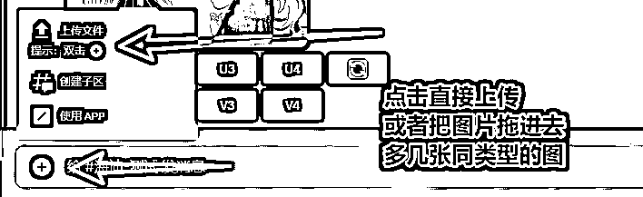

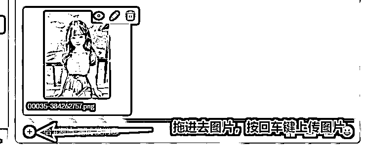

② 在图片上点右键，复制图片地址。

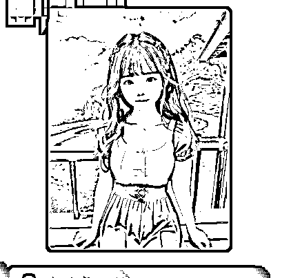

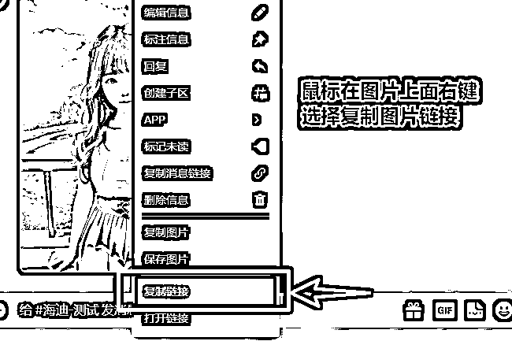

③ 回到输入框，按 imaging prompt 的写法，把“图片链接 + 描述语”一起提交。这里的关键是：画面内容要用英文讲清楚；如果完全不写描述，MidJourney 很可能自由发挥得离题。比如想要宝宝头像，可以写“宝宝、短发、微笑、皮克斯卡通感”，对应英文如：babies, short hair, cartoon, smile, pixar, cartoon。

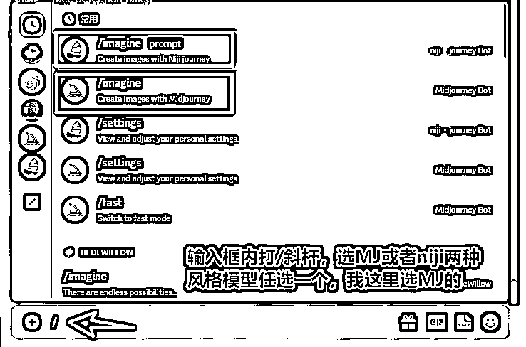

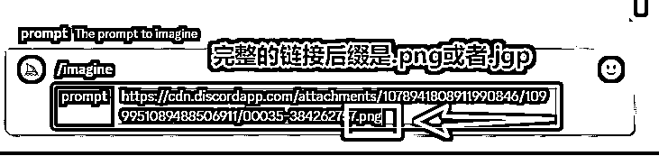

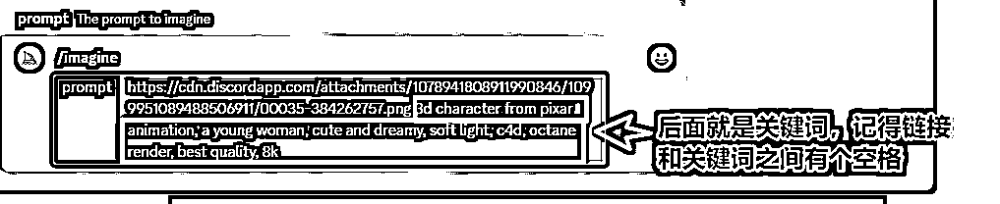

也可以直接把这组辅助关键词接在头像 URL 后面，通常效果不会差：3d character from pixar animation, a young woman, cute and dreamy, soft light, c4d, octane render, best quality, 8k。其中 woman 可以按需要替换成 man。

④ 关于 --iw 数值：在基础描述后面可以追加指令，格式如 --iw 2。它的取值范围是 0.5 到 2，数值越高，成品越贴近原图。

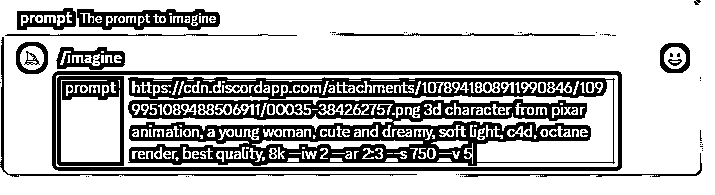

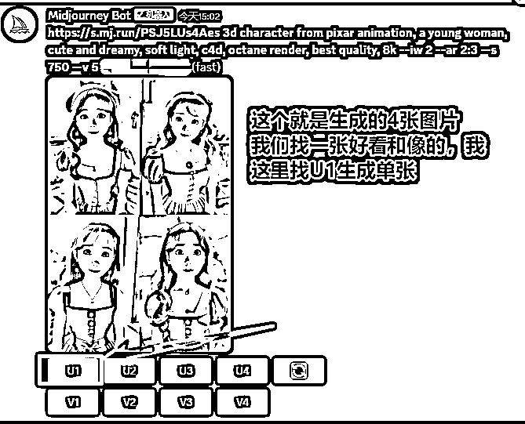

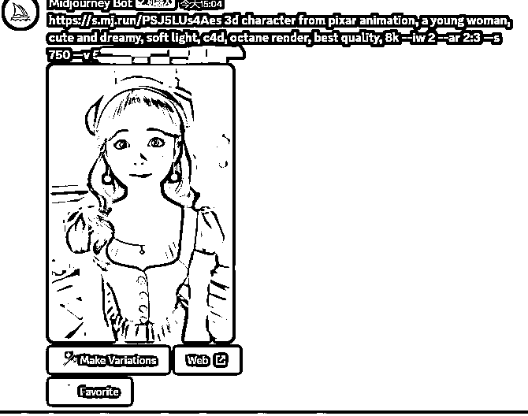

第一步到此完成，接下来进入换脸环节。

第二步，用 InsightFaceSwap 完成换脸。

① 先把 InsightFaceSwap bot 邀请进你的 Discord 聊天室，操作方式与把 MidJourney 机器人拉到服务器相同。邀请链接：https://discord.com/api/oauth2/authorize?client_id=1090660574196674713&permissions=274877945856&scope=bot 。顺利加入后，聊天室右侧会出现类似下面的列表。

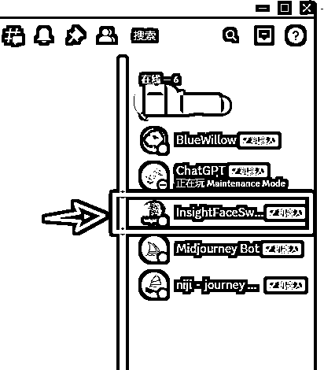

② 发送斜杠命令「/saveid mnls <上传照片>」。这里的 mnls 是注册名 ID，可换成任意 8 位以内的英文字母或数字。保存成功后，新 ID 会自动成为默认 ID；之后也能用「/setid idname（s）」手动切换默认 ID。

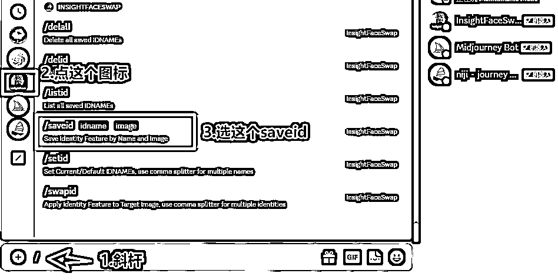

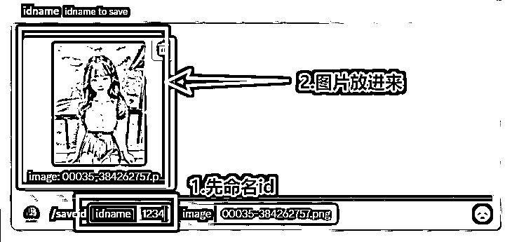

上传照片后别忘了按回车。看到对应提示，就说明命名成功了。

③ 开始换脸。原理不复杂：把上传照片中的人脸，替换到 MidJourney 生成图的人脸位置。

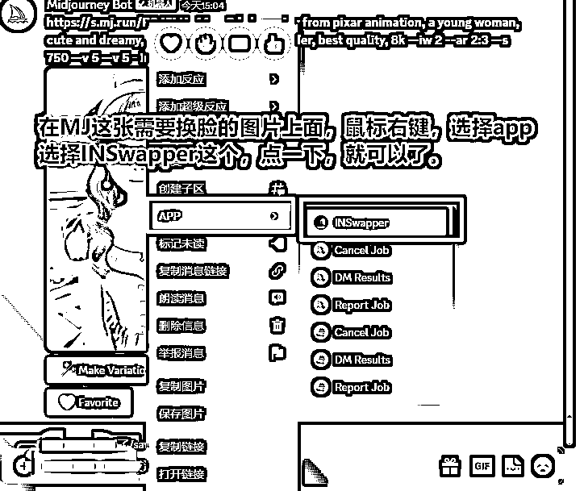

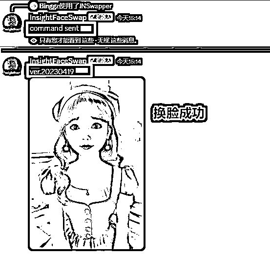

完成以上操作，换脸就成功了。

注意事项：

• 用「/listid」可查看当前已注册的全部 ID，总数最多 10 个；用「/delid」和「/delall」可以删除 ID。
• 注册 ID 只能使用英文和数字，且长度不超过 8 个字符。
• 想一次替换多张脸，可以输入多个 idname，用逗号隔开，例如「/setid me，you，him，her」。
• 重新上传同名 ID 可以覆盖旧 ID 的人脸特征。
• 如果不想上传自己的照片，也可以调用 insightface python package 生成人脸特征，保存为 .npy 的 512 维向量文件后再上传。
• ID 照片尽量满足：清晰、正脸、无遮挡。
• 不建议使用戴眼镜的照片，或美颜过度、丢失面部纹理的照片。
• 每个 Discord 账号每天最多执行 50 次命令，这是为了防止自动化脚本。
• 每次生成效果不保证都理想。
• 请仅用于自我娱乐。

