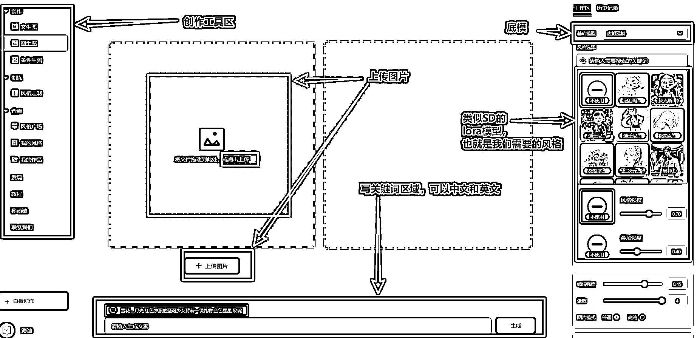
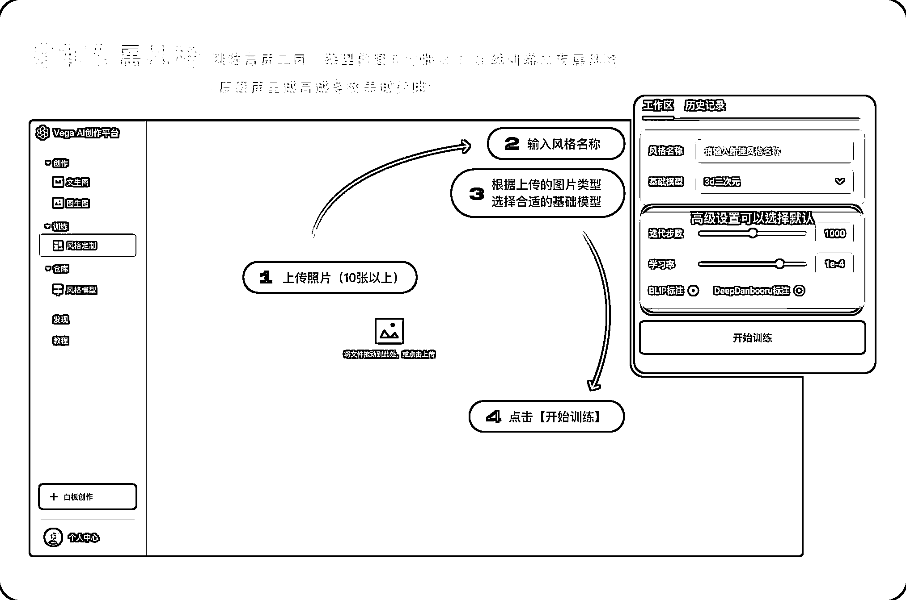
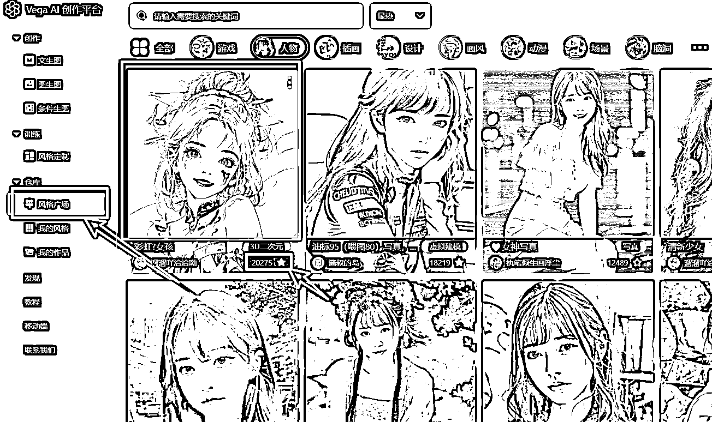
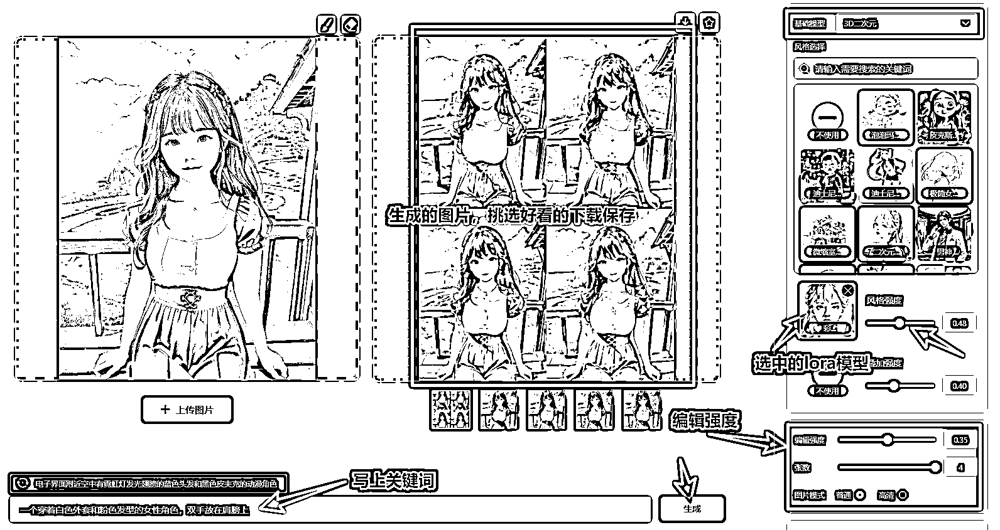

# 13.2.2 用 Vega AI 制作专属头像与壁纸

关于 Vega AI 的基础操作，可以回顾👉【三、快速上手：用 Vega AI 轻松搞定 AI 绘画】

这次我们以“图生图”功能为例，演示如何批量生成各种风格的人像壁纸：

如果你想要更个性化的效果，还可以挑选某种风格的照片，把它训练成属于你自己的 LoRA 模型：

更省事的做法是直接去“风格广场”借用别人训练好的 LoRA——点击模型上的五角星收藏，然后回到图生图页面：

在图生图设置里，选中“彩虹女孩”这个 LoRA，基础模型则切换为“3D 二次元”：

•风格强度建议设到 0.40 以上，数值越高，风格就越贴近 LoRA 的效果；

•编辑强度保持在 0.35 上下，这样只会改动部分特征，画面主体仍然接近原图；

•张数代表一次性生成的数量，按需要设置；

•画质选高清即可，只是渲染速度会稍慢一些。

此外，你也可以把两个不同的 LoRA 叠加混合使用。

以上就是通过 Vega AI 打造头像和壁纸的完整操作。

