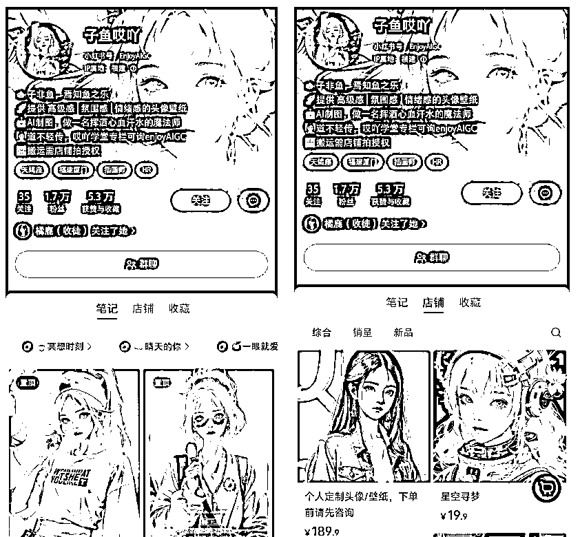
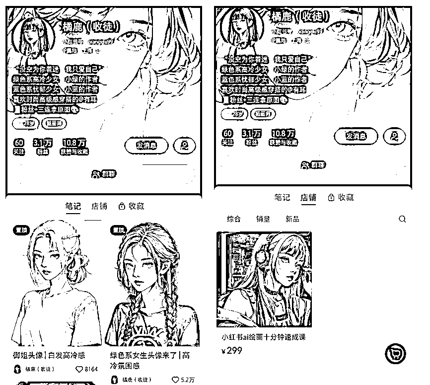
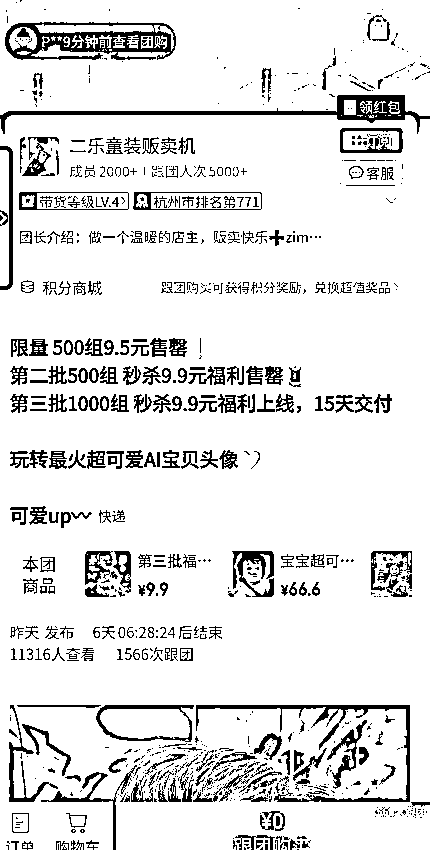
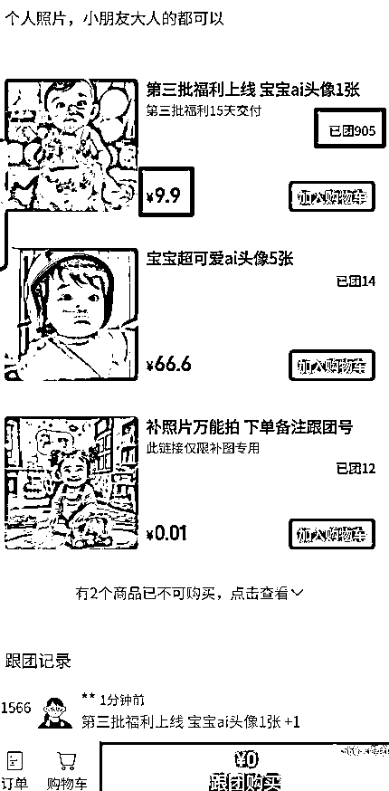
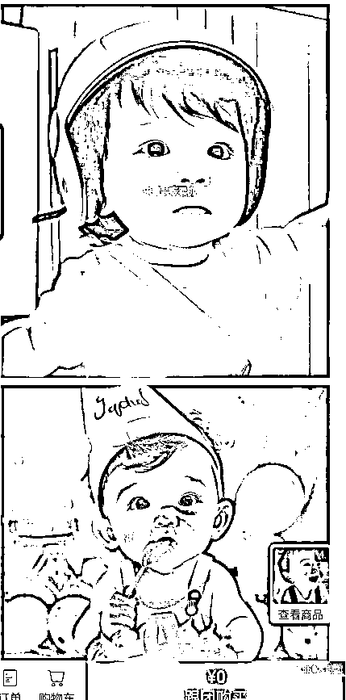

# 13.3 赚钱路子

头像和壁纸的变现玩法还挺丰富，核心逻辑就一条：把公域或私域的流量变成订单。

- 私域玩法：可以借助快团团这类工具开团，卖收费制图服务，也能卖教学课程，发到微信群和朋友圈就行。如果你本来就有私域粉丝，转化会更轻松，顾客看中了直接下单；
- 公域玩法：在小红书发图文笔记，或者做成“原图 vs 换脸图”的对比视频。笔记一旦跑出热度，就会有粉丝私信找你定制，定价 30～99 元三张完全有人买单。另外还能一鱼多吃，多平台同步发，或者顺便收徒教课；
- 避坑提醒：AI 绘画的出图方式决定了它没法像人工设计那样反复修改，所以接单时最好提前和客户约定一口价，免得后面扯皮；
- 更多的图文变现思路，参考【2 月航海｜AI 绘画&ChatGPT｜实战手册】里的【3.1.2 图文变现】部分。

案例一：头像壁纸

有个叫“子鱼哎吖”的小红书博主很受欢迎，她的定制报价大概在 129～189 元一张，笔记里的单图则卖 19.9 元。账号做起来之后，半个月就赚了五位数：

案例二：知识付费

在小红书搜“橘鹿”，这个账号只用了 3 天就涨粉近 2 万，还推出了付费课程，付费会员有好几百人，客单价定在 299～599 元之间。

案例三：儿童照片

现在很多宝妈宝爸对迪士尼风格的儿童照特别买账，毕竟是新鲜玩法，价格合适就直接付款了。

有位宝妈平时就爱给孩子拍照，接触 AI 绘画后，用 MidJourney 试了试，效果让她很惊喜，于是动了靠这个补贴家用的念头。她很快在快团团上开了个 AI 绘画团购，把拼团链接发到朋友圈和群里，没想到两天就吸引了一千多人参团，而且几乎不需要成本，唯一投入就是自己的时间：

这类照片的操作门槛其实很低，只要套上关键词、再用垫图功能，就能批量产出同样风格。来算一笔账：9.9 元 × 1500 人 = 14850 元，轻轻松松冲到五位数。

对绝大多数普通人来说，想用 MidJourney 给自己生成一张像样的肖像照几乎不可能——除非你是大明星，网上有几千上万张你的照片供模型学习。但现在，借助 InsightFaceSwap 这个 Discord 机器人，你完全可以帮助客户实现这个愿望。

