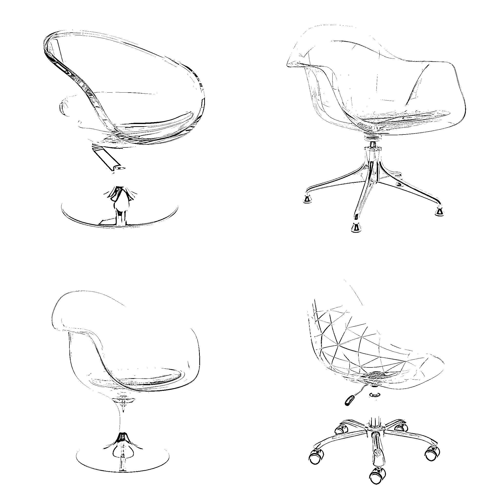
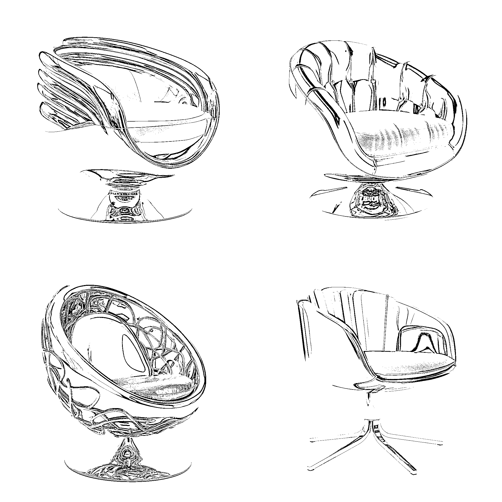
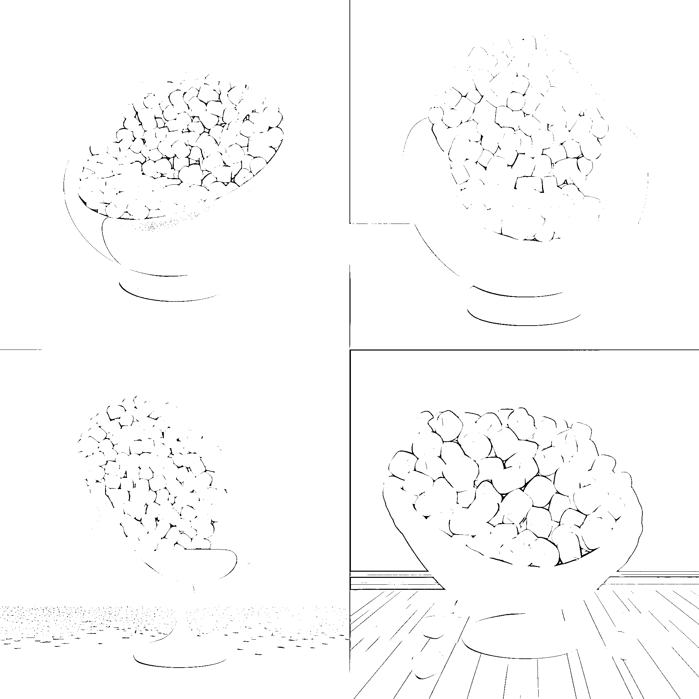
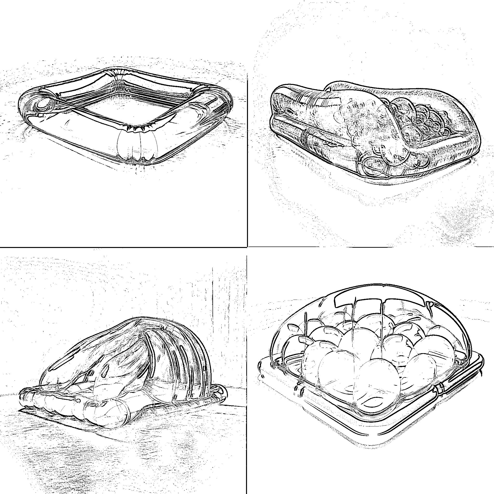

# 14.2.1 家具设计：材质换装实验室

借助AI绘图工具，围绕各色家具展开画面创作，往往能催生别样的设计巧思。特别是在同款家具的材质切换上，操作简单又高效，短短几步就能看到多种方案。

以一款北欧风旋转座椅为例，换一种材质就像换一种性格：

- 玻璃款：晶莹通透，光线穿透后折射出层次感。
- 钢铁款：硬朗而克制，表面泛着冷冽的金属反光。
- 棉花糖款：蓬松软糯，裹着一层甜美的糖果色调。

对应提示词如下：

Made of glass, Nordic style swivel chair, transparent, refraction of light, white background, simple, HD --v 5 玻璃制造，北欧风转椅，透明，光的折射，白色背景，简约，HD

Steel manufacturing, Nordic style swivel chair, metallic luster, lumen reflection, white background, minimalism, HD --v 5 钢铁制造，北欧风转椅，金属光泽，流明反射，白色背景，简约，HD

Nordic style swivel chair made of marshmallows, soft, white background, minimalism, HD --v 5 棉花糖制造的北欧风转椅，柔软，可爱，糖果色，白色背景，简约，HD

跳出座椅这个品类，其他家具同样值得玩味。下面这张“流体床”的构想，就是一个不错的延伸尝试：

fluid bed, transparent pvc, inflatable, soft, colorful,black background, minimalist, hd --v 5 流化床，透明 pvc，充气，柔软，多彩，黑色背景，极简主义

