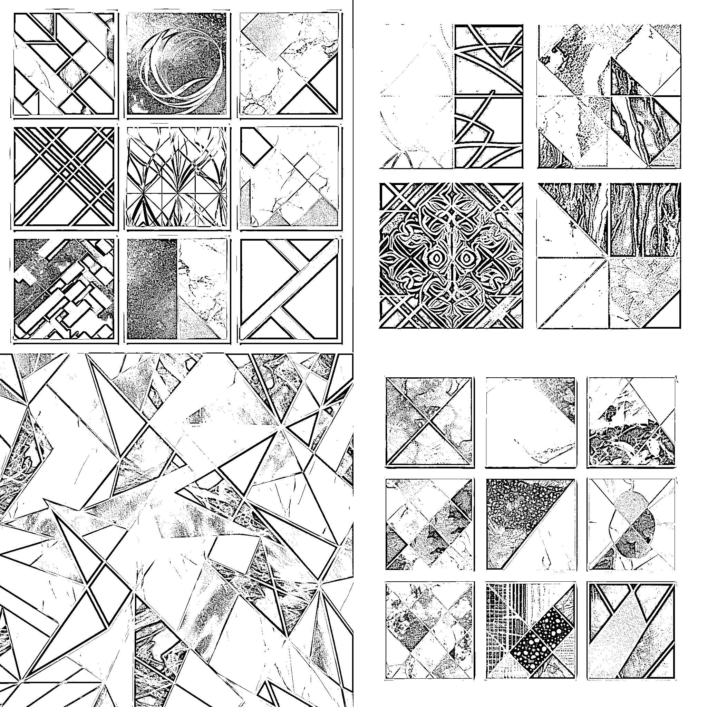
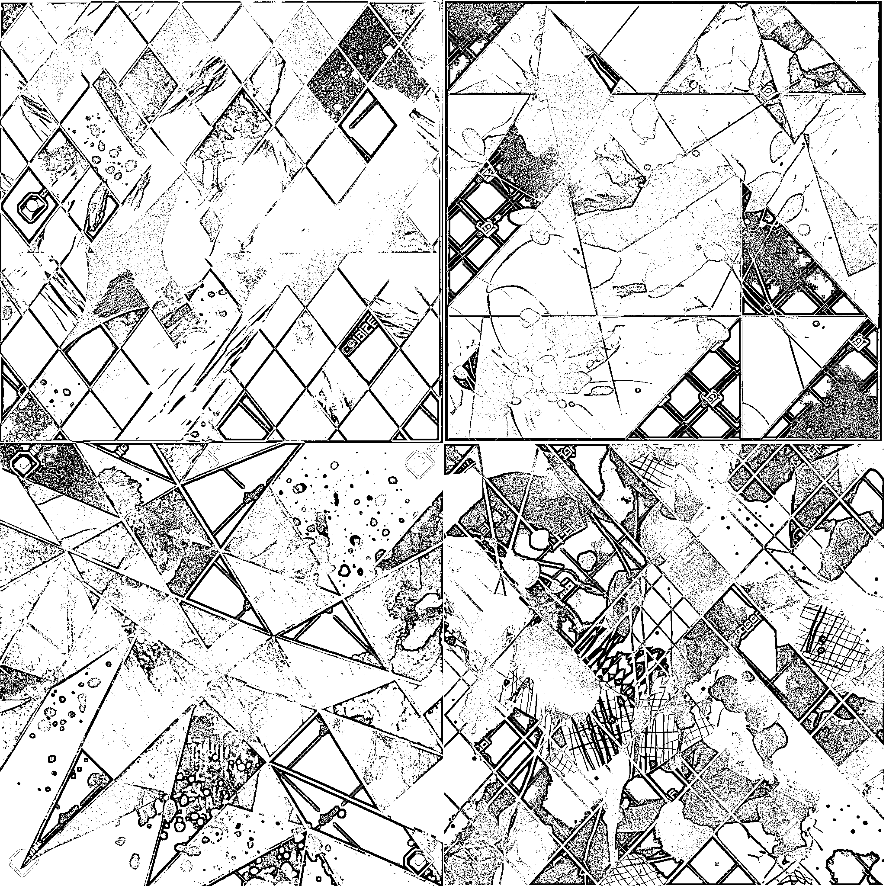

# 14.2.2 装饰画：一组变一张

想批量生成金黑配色的几何艺术挂画，并且统一白底高清，可以直接使用下面这组提示词：

Wall art, geometric patterns, collection, gold and black, white background, HD --v 5 艺术挂画，几何图案，集合，金与黑，白色背景

若你并不需要成组画面，只打算生成一张，处理方式很简单：把提示词里代表“集合”的 collection 和中文“集合”去掉，改用单幅表述即可：

Art painting, geometric pattern, gold and black, white background, HD --v 5 艺术挂画，几何图案，金与黑，白色背景

这样，同一套视觉方向就能从系列图切换为单幅作品，配色、风格和背景条件都保持不变。