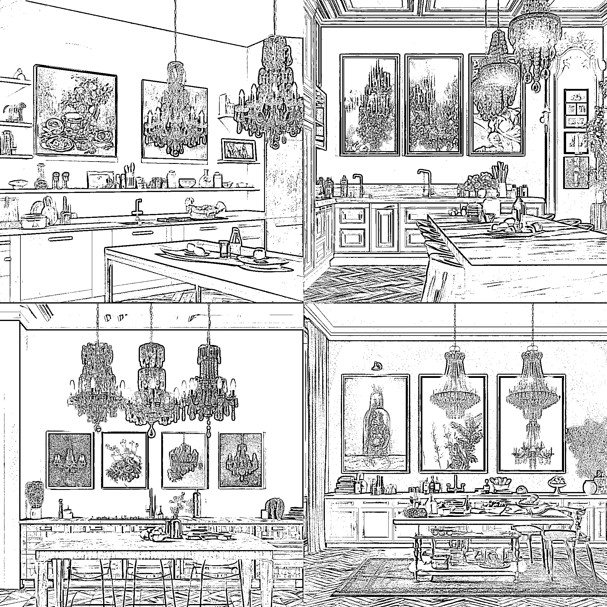
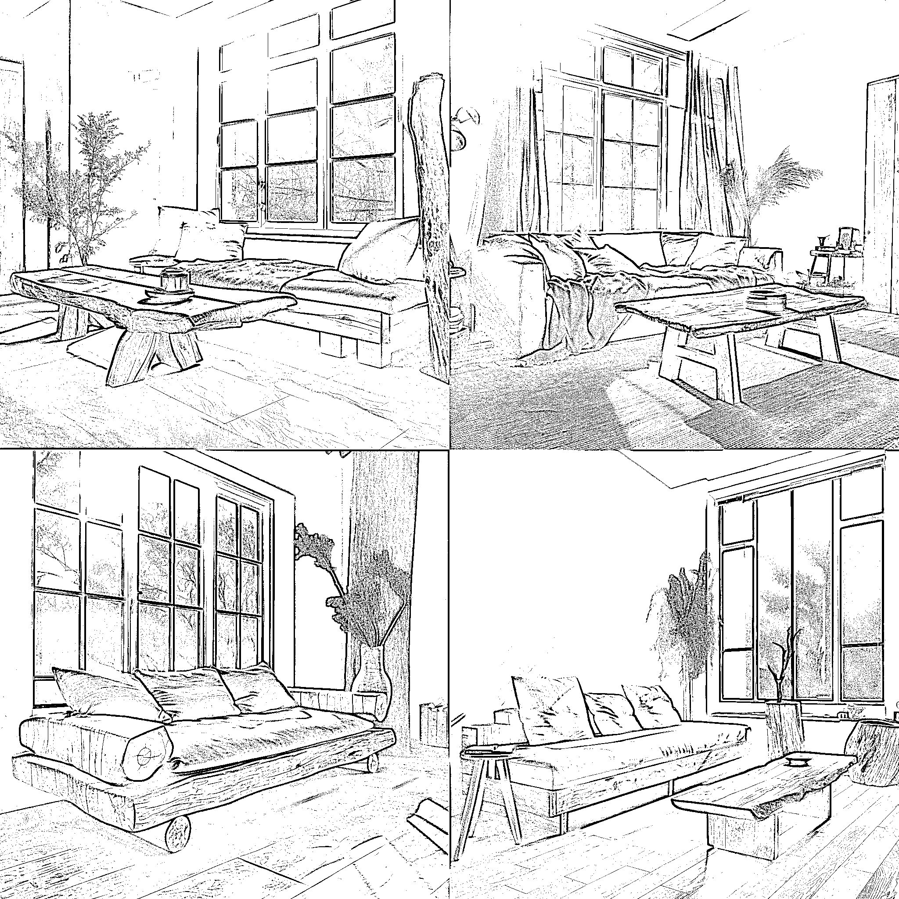

# 14.2.3 整体装饰：暖色厨房，侘寂客厅

先看厨房墙面：以室内设计为基底，在墙上布置五张艺术海报，再搭配一盏吊灯；氛围要暖，颜色要丰富，明暗层次要分明，画面保持高清，并沿用 --v 5 参数。简单说，就是让厨房墙面既有装饰感，又有光影变化。

接着转到客厅：一张沙发就够，整体走极简与侘寂路线，原木色打底，让暖阳从窗户自然照进来。重点不在堆砌，而在安静、柔和与原木质感，提示词同样保留 --v 5。

