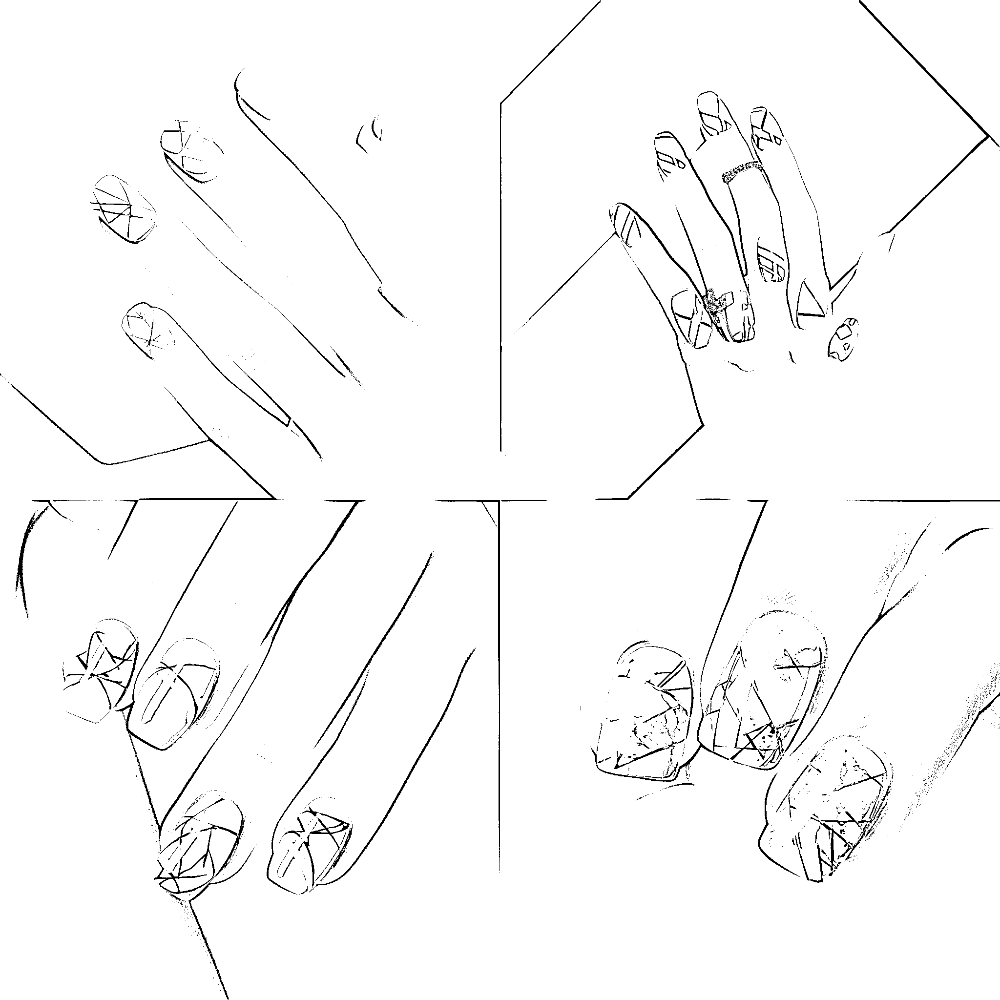
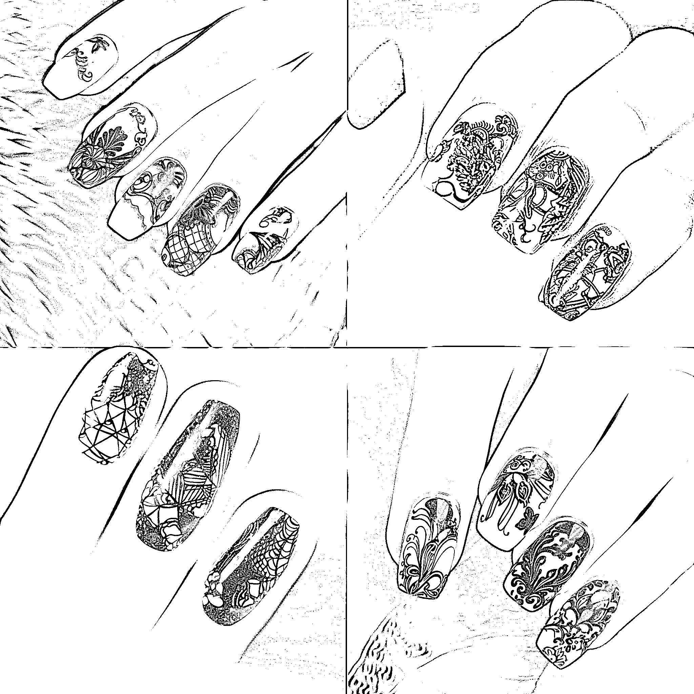

# 15.2.1 色系出图法

从色系入手，能让画面风格快速统一。这里提供两种常用配色，直接照抄提示词即可。

**青色系**  
提示词：`Nail art, cyan, white geometric pattern, minimalism, HD --v 5`  
解读：以美甲为主题，青色作主调，搭配白色几何图案，极简风，高清（HD）出图。

**黄色系**  
提示词：`Nail Art, Yellow, Intricate Black Pattern, HD --v 5`  
解读：同样以美甲为主题，换成黄色基调，再加上繁复的黑色花纹，高清（HD）画质。

