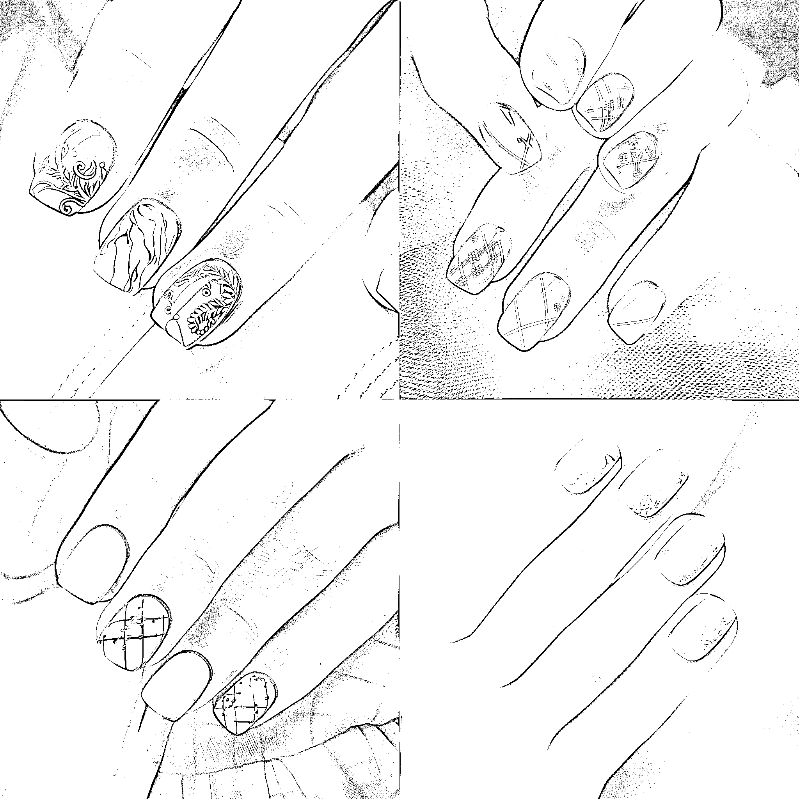
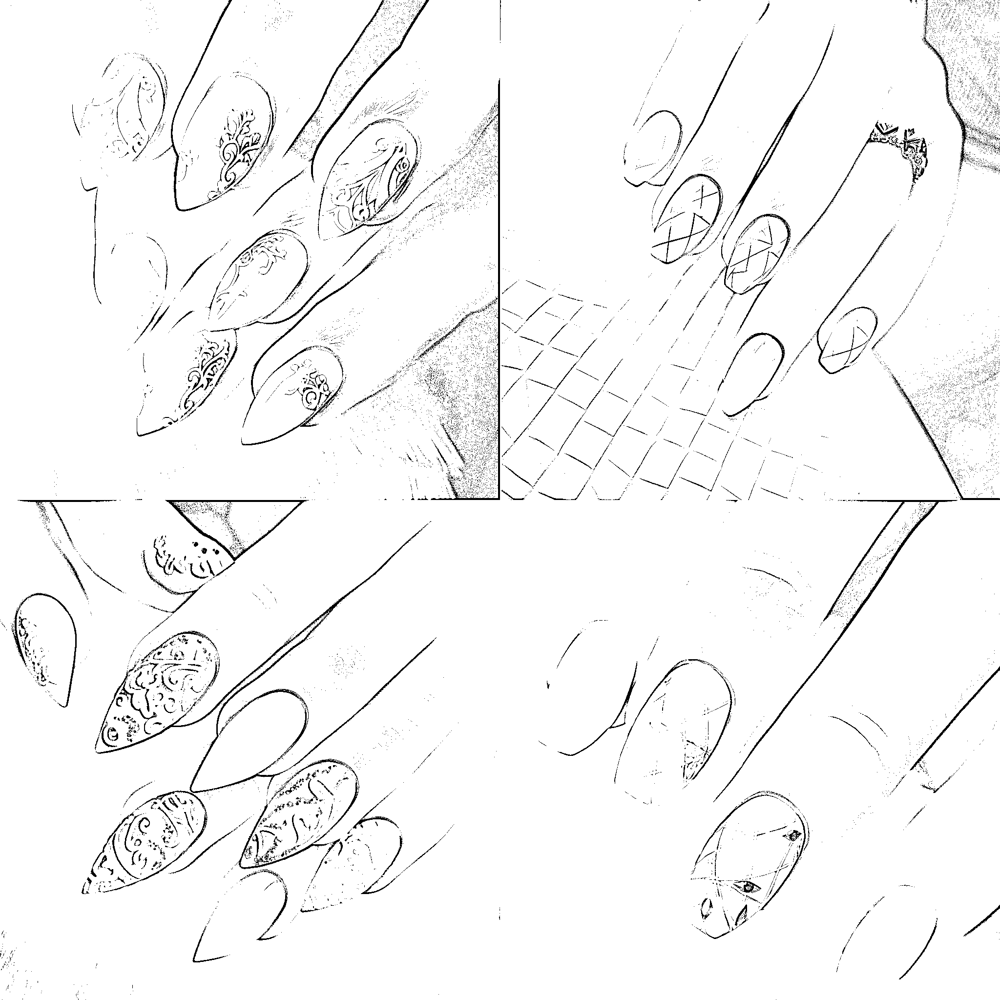
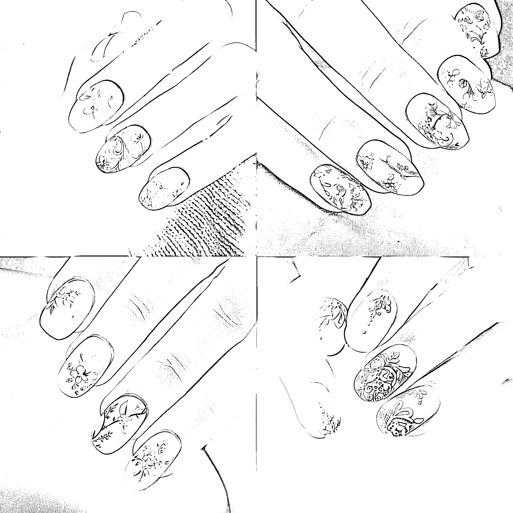

# 15.2.2 换甲型，提示词这样写

想按甲型生成美甲图，做法很直接：底色、花纹和高清要求都别动，只把提示词里的甲型关键词换掉。下面三种甲型可以直接套用。

方形甲：甲型词用 square。英文提示词为“Nail art, powder blue, square, simple white pattern, HD --v 5”；中文意思就是浅蓝美甲、方形甲、白色简约花纹、高清画质。

尖型甲：把甲型词改成 Stiletto。英文提示词为“Nail art, powder blue, Stiletto, simple white pattern, HD --v 5”；中文即浅蓝美甲、尖型甲、白色简约花纹、高清画质。

杏仁甲：甲型关键词换成 almond。英文提示词为“Nail art, powder blue, almond, simple white pattern, HD --v 5”；中文对应浅蓝美甲、杏仁甲、白色简约花纹、高清画质。

按这个思路替换甲型词，出图方向会更明确。