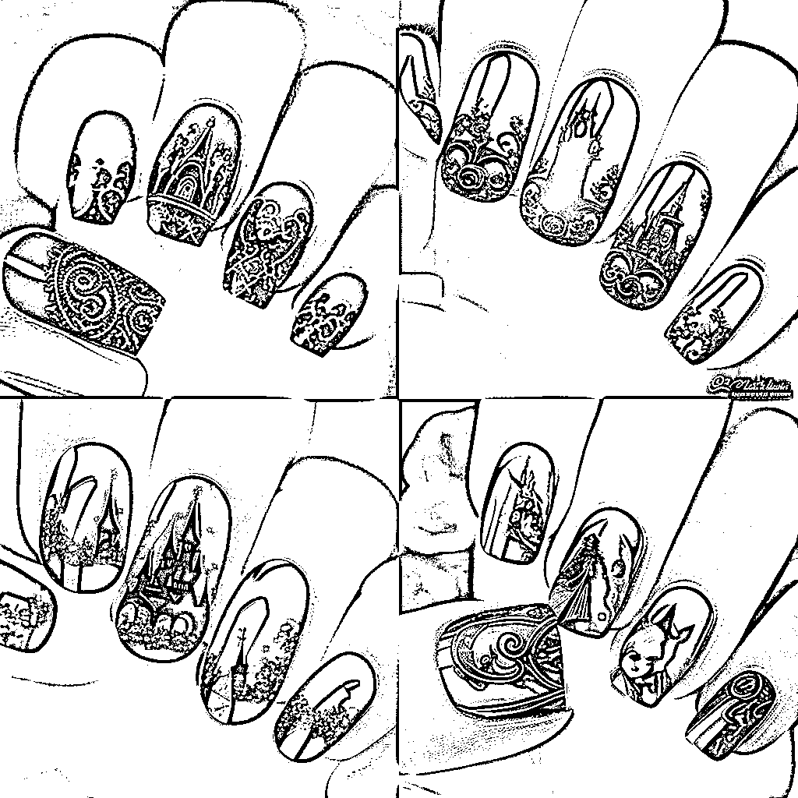
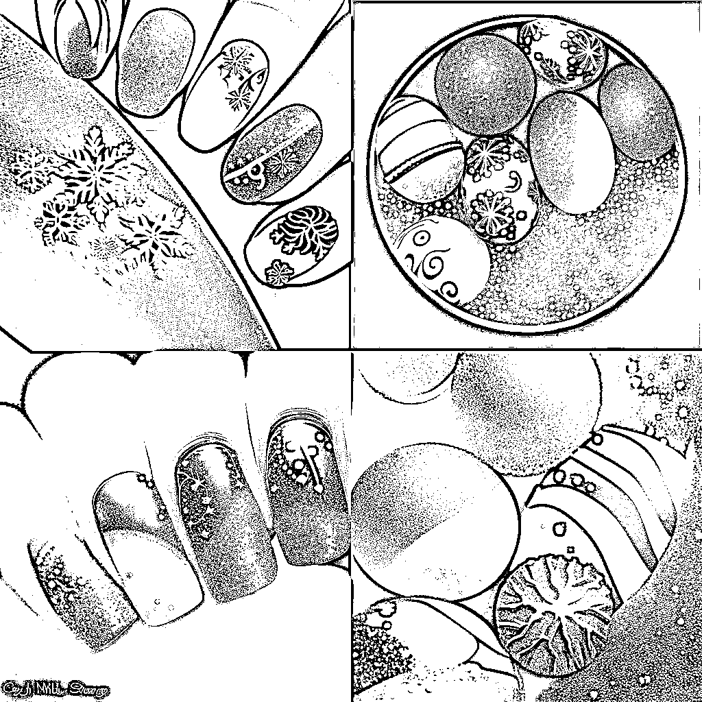

# 15.2.3 风格化出图：美甲提示词两例

想让美甲图稳定呈现某种风格，写提示词时别只丢一个“美甲”进去。把风格关键词、主色调、质感效果和画质要求一起写清楚，出图方向会更容易控住。下面两组可以直接照抄。

**迪士尼主题**：提示词这样写：
`Nail Art, Disney, dark red, best quality --v 4`
中文意思是：美甲作品、迪士尼主题、暗红主色、最佳品质。

**圣诞主题**：提示词可以写成：
`Nail Art, Christmas, white and red, silver powder, glow, best quality --v 4`
中文理解为：美甲设计、圣诞氛围、白红双色、银色闪粉、发光质感、最佳品质。

