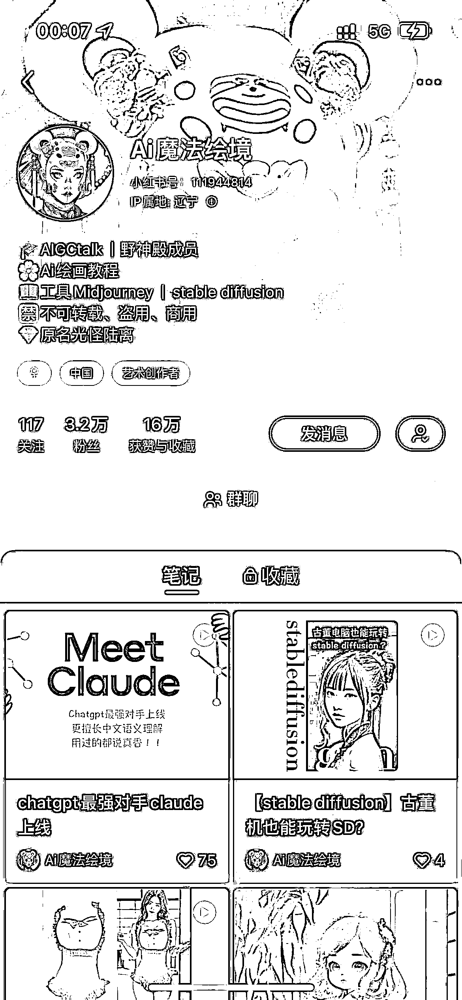
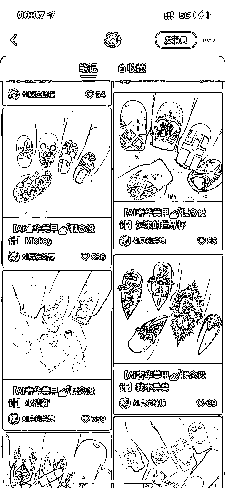
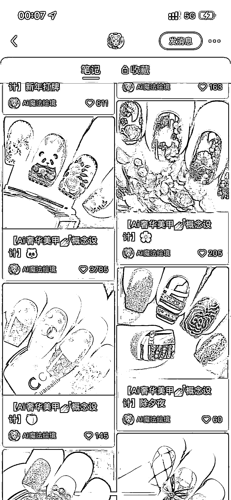
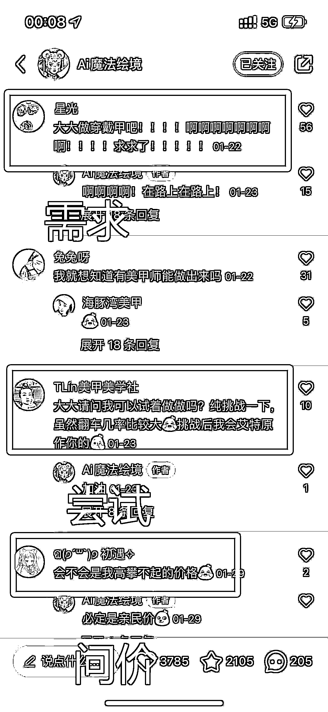

# 15.4 AI美甲该怎样落地赚钱

先看一个真实样本。博主“AI 魔法绘境”专注用 AI 生成美甲图，凭这个垂直内容积累了 3 万粉丝，点赞加收藏总共 16 万。翻看它的热门笔记，会发现评论区里不少人直接问价、表达需求，甚至想试做。这些小信号说明：这个方向不仅有受众，有真实需求，也有办法完成转化。

为什么这个组合能跑出来？因为 AI 绘画和美甲都属于当下热度很高的领域，而且天然贴合📕以年轻女性为主的社区氛围。用 AI 输出美甲设计图，恰好击中很多用户“想要新款式、想要不一样”的诉求，因此内容更容易引发互动，也更容易带来流量。

在变现层面，思路可以打开：一是和美甲店联动，把线上内容带来的关注引到线下消费；二是把它当成热门话题持续运营，等聚起足够多的人群后，再围绕人群拓展其他业务。

