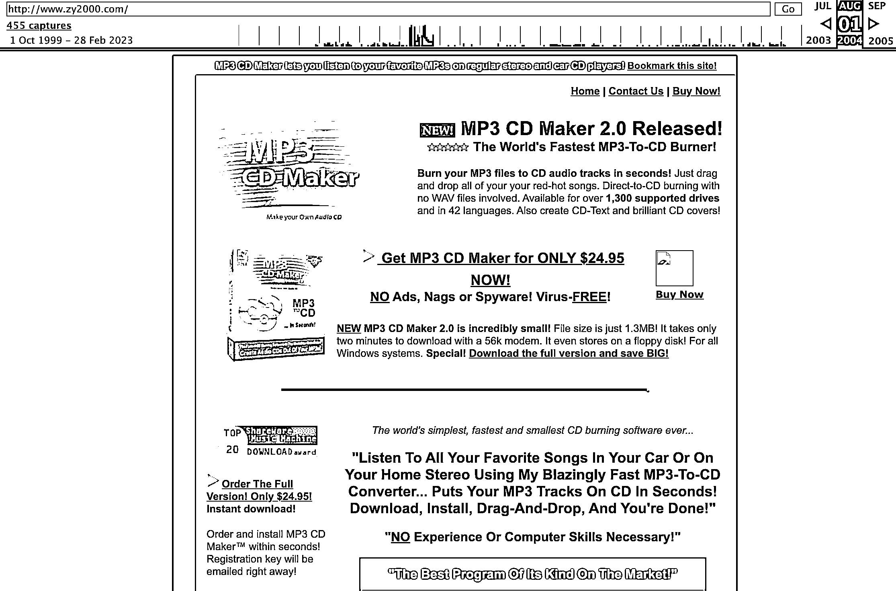
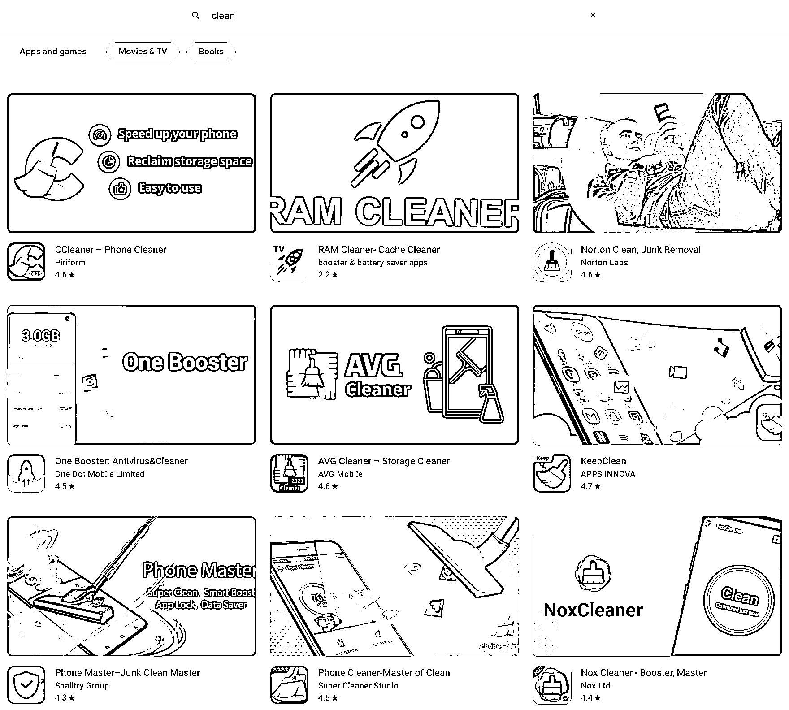
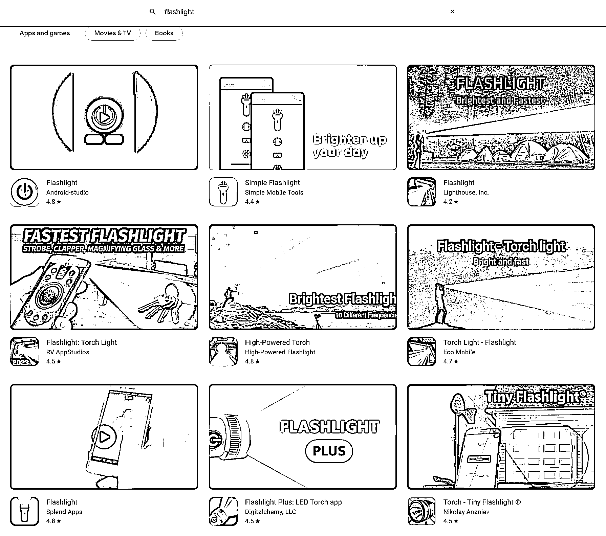

# 1.4 工具出海二十年：四段路，一次转折 @非洲水手

看完吴晓波《激荡四十年》，我忍不住把这二十来年中国工具走向海外的轨迹重新捋了一遍。大致可以分成四个阶段：萌芽、起步、扩张、转型。

1、萌芽

1998—2007年，国内互联网还在发展初期，“Copy to China”是主流打法。被不少人看作中国工具出海开路者的周奕，从 MP3 CD Maker 起步，让中国互联网产品出海第一次透出微光。

2、起步

也是在这一阶段，大家慢慢意识到：工具类产品恰好能绕开中西文化差异。2007年第一代iPhone和Apple App Store登场，移动互联网时代拉开序幕，工具出海进入起步阶段。久邦、百度、360、UC、金山等国内玩家先后在海外低调落子，不声张地抢占市场，赚到了实打实的收益。

3、扩张

2011—2016年，移动互联网出海驶入扩张段，工具赛道开始分出多个细类：手机管理方向有 Clean Master，拍照修图方向有美图秀秀，桌面启动器跑出 Solo Launcher、Go Launcher，浏览器赛道则由 UC、海豚浏览器等占位。那时获客单价不到0.01美元，安装量却常能冲到数亿甚至数十亿，资本也迎来明媚春天。

这个阶段还带火了一批广告代理公司，如 Yeahmobi、Mobvista、Avazu；也有企业自己拓展代理业务，比如猎豹 CM。我很幸运在这一时期入行，服务过不少当年的明星产品，也亲眼见过出海行业的辉煌。

4、转型

时间来到2017年，工具出海已经走过数年黄金窗口。增长路径更多元，变现手法也更成熟（甚至可以说夸张）；但另一面，海外流量红利渐薄，产品同质化加剧，Facebook和Google的平台规则持续收紧。

久邦股价大幅缩水后退出资本市场；Google与Facebook先后叫停锁屏广告，Facebook还暂停了中国区工具广告主的投放；Google陆续下架iHandy、猎豹等开发者合计数百款工具产品。看空工具出海的声音此起彼伏，利润空间被不断挤压，行业只能转向。

中国工具出海会就此停下吗？答案不妨接着往后看。

内容来源：3月6日《关于出海工具产品营销推广，我的几点经验分享》@非洲水手

