# 3.4 搜索词里藏着生意：需求挖掘实战手册 ★★★

用户内心的真实想法，往往会在搜索框里悄悄留下线索。比如，你可能在某平台发过一条产品吐槽帖；也可能在搜索引擎里输入过某个困惑……这些举动都会在互联网上沉淀为数据痕迹，间接映射出某些潜在需求。那么，如何真正钻进用户脑袋里，去理解这些关键词背后的心思？可以拆成两个方向来切入：

• 用户是在什么场景下造出关键词的，他们通常把搜索词留在哪些平台？
• 用户搜索时是什么状态，是随手一搜还是带着明确目的？

搞清楚这两点，搜索引擎就成了绕不开的工具。那么问题来了：搜索引擎上有哪些操作技巧，能帮我们快速捞出高价值的关键词？

## 1、关键词的诞生地

在互联网世界里，只要用户能参与互动，就必然留下脚印——不管他是主动输出还是被动浏览。从需求挖掘的视角看，这些留下脚印的地方，恰恰就是值得深挖的富矿。

拿 Amazon 站内的用户行为来举例：

当用户输入一个搜索词，Amazon 会默默存档，下次用户打开首页时便能收到相关商品推荐；用户点进哪个商品、停留了多久、有没有加收藏夹，系统同样会一一记录，用于后续分析其偏好；如果用户最终下单或留下评价，这个信号也会被捕捉，平台会据此给对应 listing 倾斜更多曝光；此外，Amazon 还会采集用户所在区域等信息，用来匹配更合适的商品推荐。

上面提到的这些用户轨迹，实际上就是我们判断真实需求的线索来源。而这些行为数据，Amazon 或者卖家精灵这类第三方工具都会开放给我们。真正要做的，是从不同维度指标里层层筛选，去验证某个目标需求是否真实成立。

内容来源：《航海实战｜Google | 付费插件｜实战手册 》

## 2、用户到底是怎么搜的 @Tiger

普通用户很少一上来就敲核心词，他们更习惯把需求直接说出来——也就是那些包含核心词的长尾搜索。

举个例子，假如我现在想用 Google 给老爸挑个礼物，我大概率会这样搜：

送给爸爸的礼物哪些合适？给父亲买什么好（比如烟、酒、手表、剃须刀之类的）？老爸退休了生日送什么比较贴心？

你会发现，这些都是从需求本身出发去组织搜索词的。这里有个比较通用的组合思路（顺序可以灵活调换）：核心词+需求动作（或对象）+疑问成分。

至于怎么把这些长尾需求词捞出来，除了借助第三方工具，还有个更省事的办法：直接看搜索引擎的下拉联想框和结果页底部的相关搜索，这两个位置最能反映用户的真实想法。

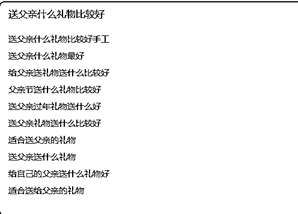

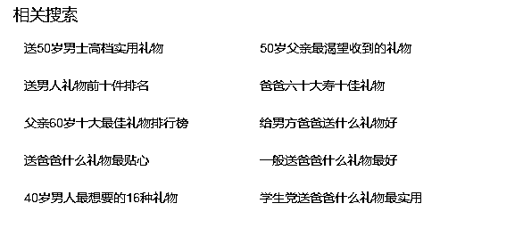

内容来源：《Google 搜索 技巧寻找潜在商机》

## 2、关键词挖掘的实操路径 @三林@Tiger

### 1）跑通一条完整的挖词链路

把我自己的经验分享给圈友。先从第一步做起：锁定母词。

先明确你要研究谁——TikTok、YouTube 还是 Tesla——然后围绕它选一组母词。拿 tiktok 来说，我会先框定 tiktok video、tiktok live、tiktok shop、tiktok fans 这些词，把范围划出来。

然后按下面几步走：

第二步：扩展词汇。借助「谷歌关键词规划师」之类的工具，把相关搜索词铺开。

第三步：清洗数据，再做第二轮扩展，同时重新核对各词的流量表现。

第四步：对搜索结果做二次归类，看哪些「关键词」的流量真正具有代表性。

第五步：挑出有价值的关键词，针对性地研究对应的产品或服务如何承接，把它们归入自己的「项目库」或「需求池」。等调研和评估都做扎实了，再拍板要不要动手做。

### 2）拓展词汇的实用方法

• 用下拉联想框淘词 @TIGER

在 Google 或 YouTube 输入关键词时，有时会弹出一串联想词，这是找热词和长尾词的高效入口。这些联想结果都经过平台算法过滤，相关度高、热度也不差，用来开拓新流量业务非常合适。

这次以 Google 为例，但同样的思路放回国内，很多场景都能套用。

小技巧：在目标词前面加一个星号（*），它相当于一个“模糊匹配符”（wildcard），能帮你捞出更多关联词，这类词竞争度往往偏低，但搜索潜力不容小觑。（注意：YouTube 里直接以 * 开头不会被识别为通配符，得先输入关键词，再在词前补上 *。）下图展示了以“TikTok”为例的操作方式。

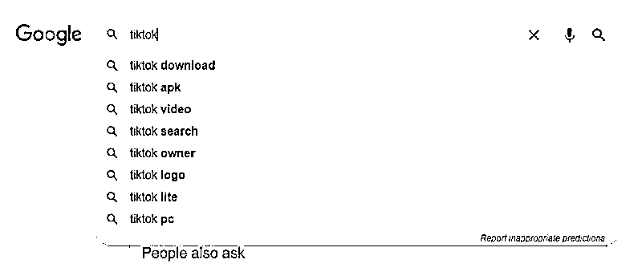

按上面的方式在 Google 搜索热门关联词后，跳出来的第一条是 How to go live on TikTok（怎样在 TikTok 上开直播）

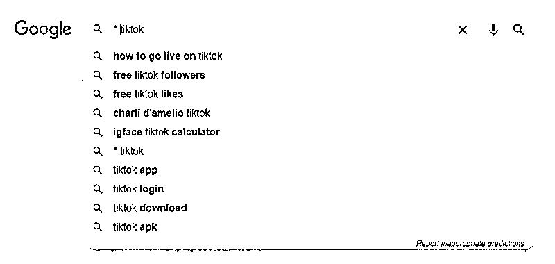

搜这个词之后，首页出现了一条标题完全对应这个搜索词的讲解视频。

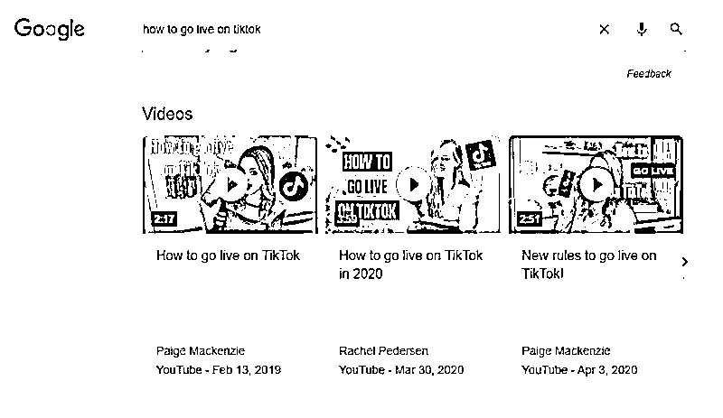

点开一看，这条视频的播放量达到 150 万次。

再进入博主主页会发现，她平时视频流量大多在几万量级，而这条 150 万播放的视频是她最大的爆款。可以说，她的粉丝积累很大程度靠这条视频引流，目前该博主已拥有 20 多万粉丝。

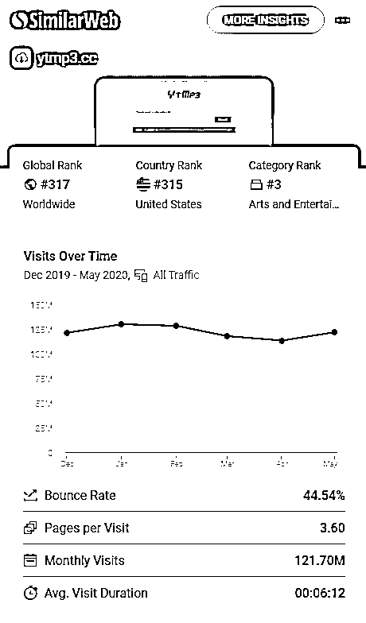

就这样，通过分析一个搜索词，挖出了一位靠搜索流量起号的 YouTube 博主（当然她也有从 TikTok 导流）。上面这个案例只是抛砖引玉，想告诉大家如何用这类搜索技巧去发现需求，或者拆解别人的成功路径。

内容来源：《Google 搜索 技巧寻找潜在商机》

• Google 关键词规划师 @三林

这是 Google Ads 广告平台自带的后台功能，用谷歌账号就能注册，免费使用。入口在菜单「工具和设置-规划」里，找到「关键词规划师」即可。

进去之后有两个功能入口：一个侧重「扩词」，帮你发现新词；另一个侧重「查词」，用来查询流量数据。

在「发现新关键词」板块，输入一个「关键词」，就能生成一批相关词，同时附带每个词的月搜索量、广告点击出价预估等数据。（这功能本质是服务广告投放的，但拿来辅助需求调研也完全可行。）效果如下图所示：

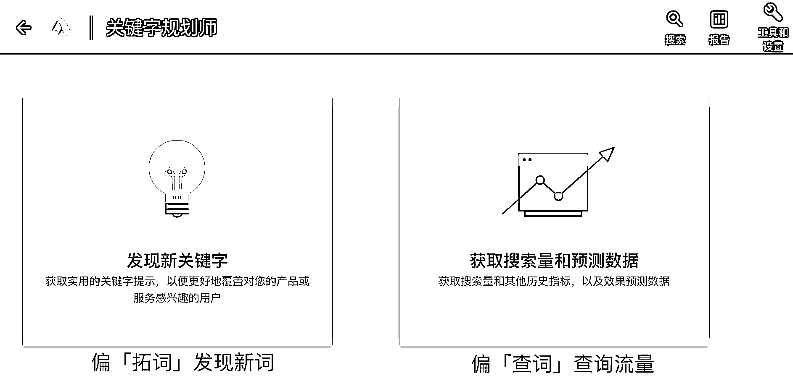

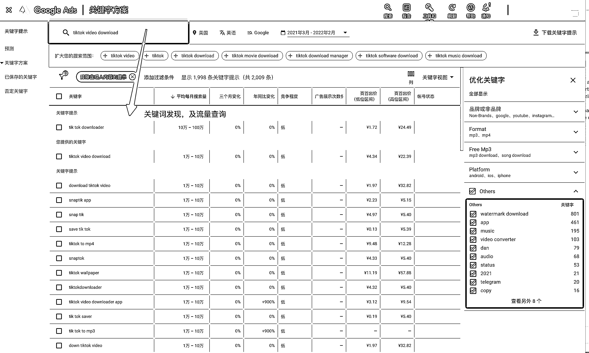

这就是「扩词」。第一轮初筛之后，还能做「二次扩词」。通常一个母词能扩出上千个词，而一两千个核心母词，最终扩展到百万级带搜索量的词也不稀奇。

• 用 Ahrefs 查关键词 @三林

Ahrefs 在海外站点 SEO 方面相当专业。它同样有关键词发现（keyword explorer）板块，但和 Google 关键词规划师不同，它更擅长对某个具体关键词做精准定向研究，数据颗粒度非常细。比如 tiktok video downloader 这一个词的数据概况：

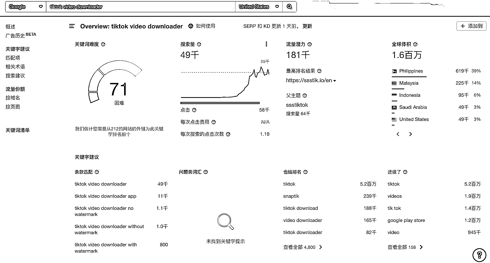

「直接匹配」出了哪些关联词：

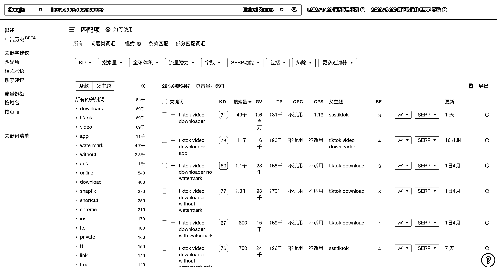

其他相关词建议：把同需求的词导出下载，还能继续作为「关键词」进行下一轮扩词。

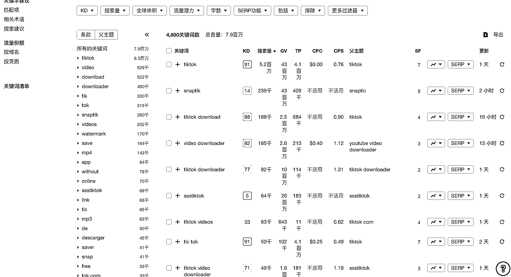

Ahrefs 确实好用又专业，可以到某宝租个共享账号体验一下，上手很快。

另外还有一款 SEO 工具「similarweb」也带关键词分析模块，不过我觉得它数据量偏少，不太好用；但如果你要查某个网站的访问量，similarweb 比 ahrefs 更准。

• 光年-谷歌关键词分析工具 @三林

这款工具出自国内一家做流量增长的咨询公司「光年实验室」，亮点是支持批量查询和多维度数据导出。如果数据量特别大，光靠网页版撑不住，得去申请谷歌关键词 API。（数据同根同源，同样来自谷歌关键词规划师。）

备注：谷歌关键词规划师的 API 目前申请难度很高。

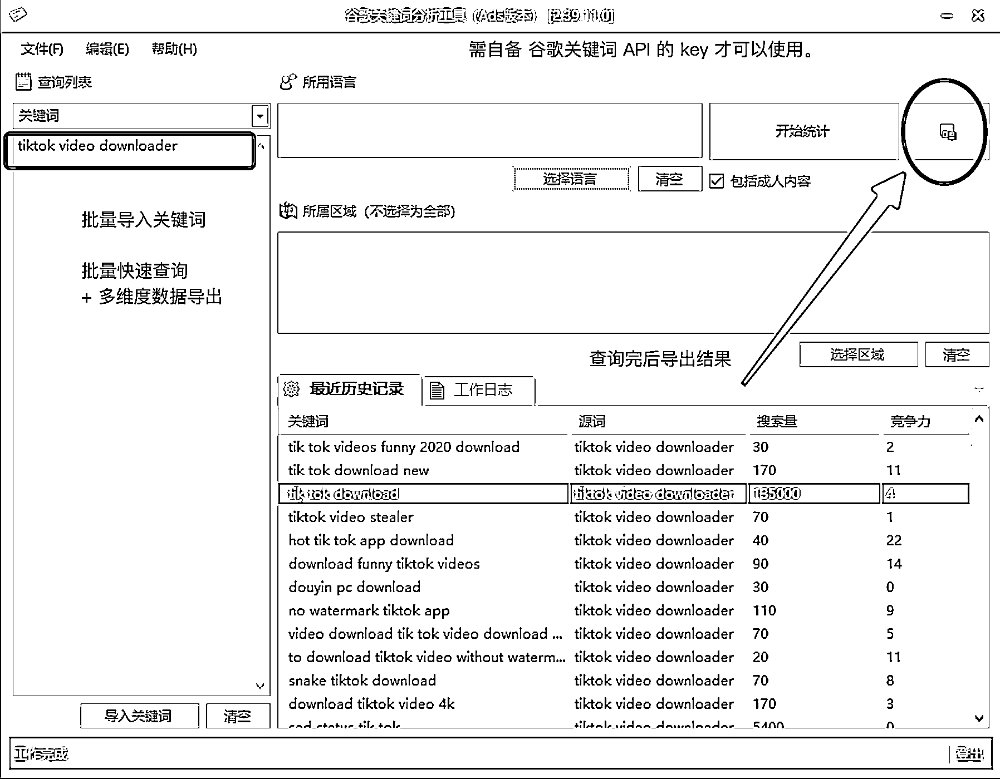

内容来源：《以 TikTok 举例，如何发现海外产品的赚钱机会 ？》

### 3）拿到词之后怎么筛选和处理 @TIGER

当你手上有了觉得靠谱的热词，接下来通常要走几步：

• 先看这个词的实际搜索频次

有些热词像 YouTube，搜索量能到上亿次，衍生需求自然也多，比如 Youtube to mp3 这类，单这一个子类的月搜索量就能到千万级。头部几个简单的工具站靠关键词 SEO 就能做到月流量过亿。但有些词组的母词本身搜索量就不高，想靠走量做业务，价值就未必大。可用工具：Google Ads Keyword Planner（关键词规划师）、Ahrefs、Semrush、Keywords Everywhere 等第三方服务。

• 再看竞争对手

真正的好机会，关键不是发现某个地方流量有多大，而是要找到流量可观、竞争又不那么激烈的领域。

不管你是想做新网站，还是起一个新 YouTube 频道，第一步都是摸清对手实力。你看到的热门关键词，别人同样看得到。

如果是做 YouTube 频道，直接看该关键词下被推荐出来的几个频道，分析对方的粉丝规模和内容制作水平。

如果是做独立站引流，先分析排在 Google 首页前十的网站，看它们的外链数量、域名权重等，再判断自己有没有实力超越。

这里还有个查外链的小技巧。

直接在 Google 搜索框输入「link：xxx.com」（xxx 换成具体域名），就能搜出该网站的大部分外链。想要更精细的数据，可以借助 Ahrefs 的服务。

内容来源：《Google 搜索 技巧寻找潜在商机》

### 4）母词挖掘的补充技巧 @三林

母词这件事，核心是「多且准」。数量上建议达到四位数，数千个母词能扩出数十万到百万级的关键词。但精准度同样关键，否则容易扩出一堆不相关的结果，筛选成本反而更高。比如「Tiktok」很容易扩出一些大网红的名字，这类词在扩词阶段就要先剔除。

那母词可以从哪里找？分享三个方向：

• 从目标网站挖掘：比如网站首页、关于我们等页面，人工整理关键词，像 Slogan、页面描述、Metawords、底部导航菜单命名等。描述业务的词越全越好。
• 从自己所处行业出发头脑风暴：包括但不限于直接相关词、行业相关词、人均相关词。
• 从广告投放词入手：这也是一个很好的母词来源。Ahrefs 上线了一个「付费关键词」功能，能查一个网站投放了哪些关键词，这个功能很强。你想，人家愿意按点击付费购买的关键词，精准度能低吗~ 下图以 Shein 为例：Ahrefs 共收录了 7.4 万个关键词，可以过滤导出后进一步筛选。

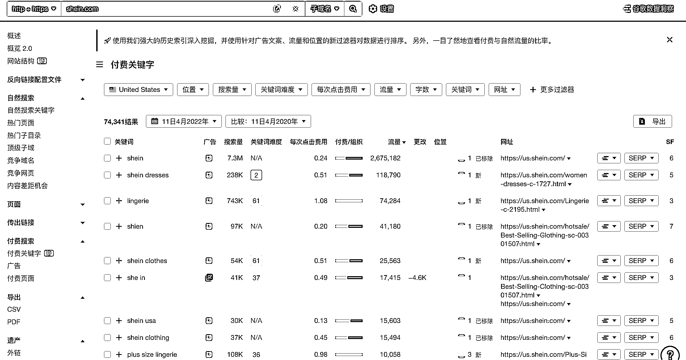

最后总结一下：

借助 Google 的搜索大数据，能直接反映用户的真实需求。如果要对一个行业做更全面、更耐心的挖词和选词，我上面介绍的是通过工具快速上手的方式。围绕 TikTok 可以这么做，换其他产品方向也一样，比如据说最新估值 1000 亿美金的 Shein，周边还有哪些机会值得做？

平台会变，但用户需求有延续性。如果能在新兴平台提前布局相关服务，就有机会分到一杯羹。比如 Instagram/YouTube 下载站的经验，完全可以在 TikTok 上再复制一遍。

通过 Google 搜索平台做关键词研究，去发现用户需求或产品机会，我把它称作「赚钱机会」。关键词研究很有意思，你会发现：居然有人这样搜一个词；当你亲自去搜这些词，又会感叹：我靠，居然还能这么玩。关键词研究的应用场景很多，不止是需求发现和 SEO/SEM，还能用于内容生产参考、信息流投放、舆情监控、KOL 挖掘等。

内容来源：《以 TikTok 举例，如何发现海外产品的赚钱机会 ？》
