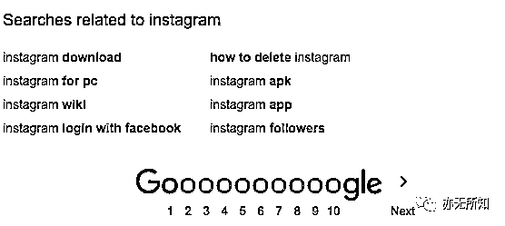
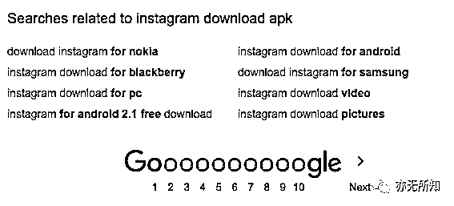
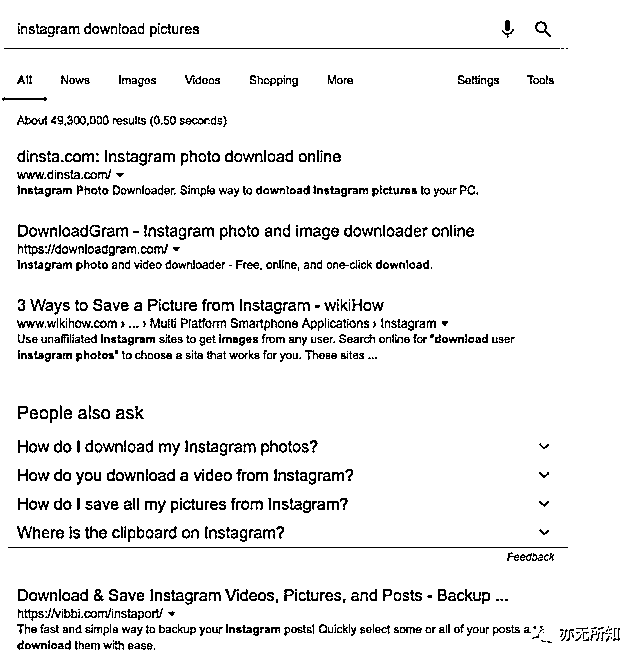
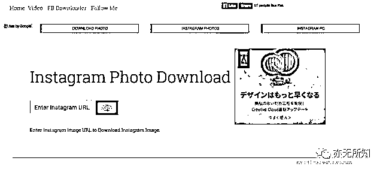
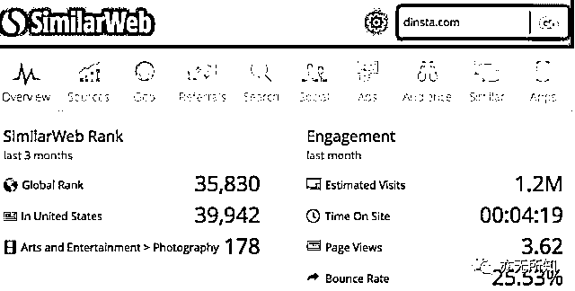

# 3.5 方式四：从被忽略的需求里找生意

找需求的路子不少：可以盯自己的真实麻烦，也可以从所在行业、长期关注的话题切入，还可以顺着互联网大厂的产品外围找机会。资源不宽裕时，我更偏爱最后一种。原因很简单——任何一个成熟的大产品，周边都散落着大量尚未被照顾到的需求。

这些缺口大致有两类。第一类，大厂评估过但不做，于是第三方补位。🛰️👸号的数据服务催生了新榜，🛰️小程序导航让爱范儿这类玩家有了空间。第二类，大厂压根没留意的小众场景；即便看见了，也未必愿意为了1%用户改变99%人的体验，比如让一部手机同时登录两个🛰️。可这些被主动放弃或被无意漏掉的需求并非伪需求。谁能把它们接住，谁就可能圈住一批真实用户，规模未必小。放眼各大平台，靠巨头外围活得滋润的产品和创业公司并不少见，上市公司也有。下面拿Instagram做一次演示；把路径换成Facebook、WhatsApp、Bitcoin、Snapchat、🛰️或🧣，同样能跑。

先从搜索词里找线索。用Google搜“Instagram”，下拉框和相关推荐会冒出一串词：

粗看下来，除了instagram download，其他词都挺常规。再拿Google继续查这个方向，又能看到几组关键词：

其中最后两个——“instagram download video”和“instagram download pictures”——之外的搜索需求，官方基本已经满足了。

接着判断这个缺口是真是假。在Instagram上保存图片和视频，难道还有没被解决的地方？还真有：网页版Instagram不允许右键保存他人上传的图片，另存为功能被卡住了。类似的限制并不稀奇，知乎等网站也会出于版权保护等原因，禁止站内直接复制文字或保存图片。换个场景体会一下：🛰️里收到朋友发来的语音，想转给另一个人，却发现根本转不了。Instagram这道设置，可能把九成以上的普通用户挡在门外。但下载图片、视频的需求确实存在，说明这个需求既真实又有回应价值。至于围绕它有没有靠谱方案、能不能变现，还看不清，那就接着用Google找答案。

随后看看已经有哪些产品在接这个需求。搜索“instagram download pictures”，结果首页会跳出6个专门解决这件事的小工具：

再拆解它们怎么赚钱。打开排第一的网站，会发现功能和模式都不复杂：把Instagram图片链接粘进去，就能直接下载，收入来自Google Adsense广告系统。

借助流量统计插件SimilarWeb查看数据：该站每月约120万访问量，日均4万访问量。若按每千次访问2美元估算，它每天大约进账80美元，一个月约2400美元，一年约28800美元，折合人民币约20万元。这个数字，差不多抵得上一个白领一年的工资。

走到这里，结论已经比较清楚：需求是真的，量也不小，而且市面上已有成熟产品跑通。对普通人来说，这算得上一个值得留意的机会。

内容来源：[《通过 Google 挖掘细分市场的一个案例》](https://mp.weixin.qq.com/s/cXa6Rwiet5gN8bSe-h4QNw)

