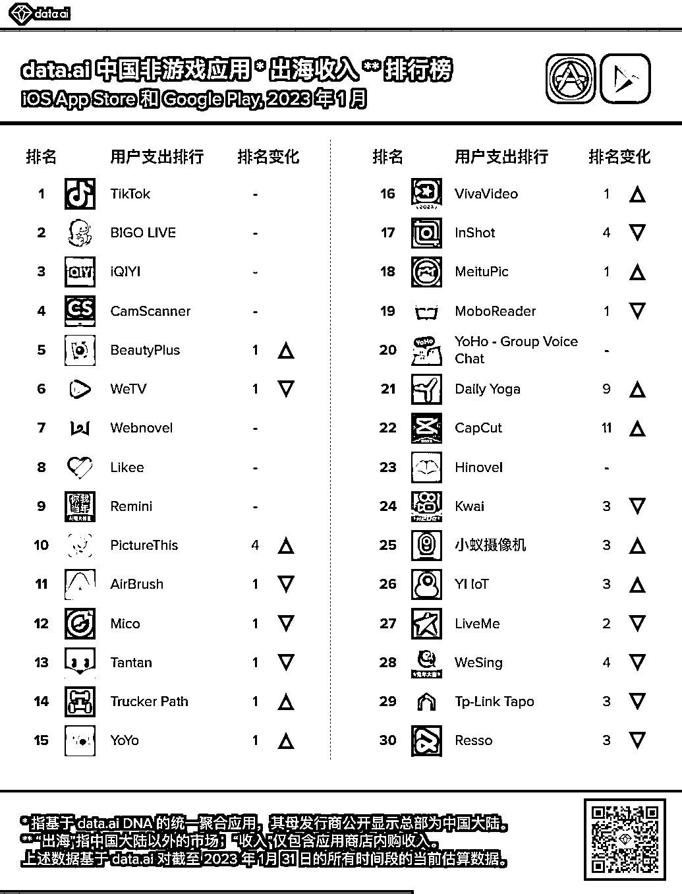
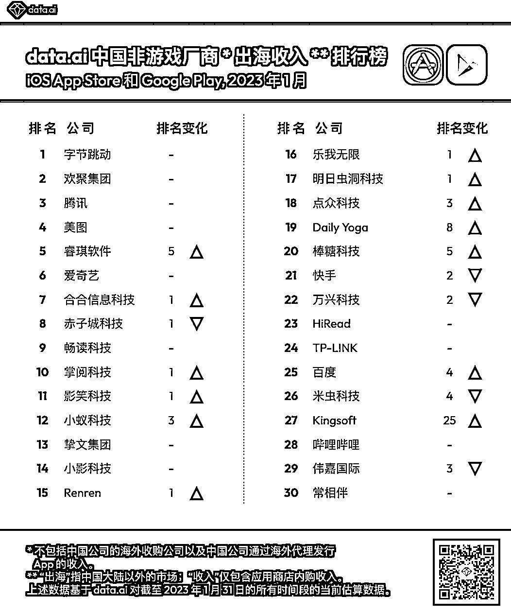

# 3.8 方式七：收入榜里找机会

App Annie 2023年1月非游戏类应用收入排行中，藏着不少值得琢磨的产品方向。

1. 娱乐类依然最抢眼，收入前三名被它包揽。顺着这股热度往周边看，头部娱乐应用是否会带出强需求工具？比如短视频去水印、Bio 链接跳转，或者把 Instagram 上跑通的小工具移植到 TikTok、Bigo、Kwai 上。

2. 长期打磨产品力，往往能垒起难以跨过的护城河。扫描全能王、美图秀秀就是例子：锁定一个细分方向持续投入，时间给出的回报可能远超预期。

3. 收入前十中竟出现了赚钱圈友熟悉的老照片修复项目。说实话，连我自己也没料到，这一点值得认真复盘。

4. AI 方向上，除了老照片修复，还有智能识别动植物的产品；🛰️里的“识花君”也很火。类似爆款值得挖掘。海内外用户对新颖创意类目的接受度都不低，像“蚂蚁呀嘿”就曾在两边同步走红。

5. 从出现频次看，娱乐社交、照片/视频编辑、阅读、AI 项目、健身、办公等类目都值得留意。部分方向或许需要资源池，但社群中已有不少可对接资源；只要有心，总能找到路径。

6. 还有一款没出现在榜单里的海外开发者产品《Hallow》，可以关注。它面向天主教徒做祈祷冥想，原型是冥想独角兽《Calm》，只是把受众切得更细。该产品曾在今年2月24日冲到美榜前三，说明宗教类移动市场潜力不容忽视。再联想到被做成矩阵的《Holly Bible》圣经电子书，是不是有点熟悉？两个品类的交叉，也能碰撞出强烈的化学反应。

内容来源：3月6日分享《关于出海工具产品营销推广，我的几点经验分享》，作者 @非洲水手

