# 3.10 强烈关注：ChatGPT 周边工具站的机会挖掘 @三林 🔥

AI 赛道正以肉眼可见的速度狂飙。ChatGPT 4.0、Midjourney 5、谷歌新 LLM、微软 Copilot、百度文心一言... AI 领域一周的迭代，顶得上别的行业一年——Web3 在这股浪潮面前都要靠边站（开个玩笑）。详细分析可参考极客公园的这篇文章：[mp.weixin.qq.com/s/5fhzpYmLKQhx9FEIT0wssA](https://mp.weixin.qq.com/s/5fhzpYmLKQhx9FEIT0wssA)

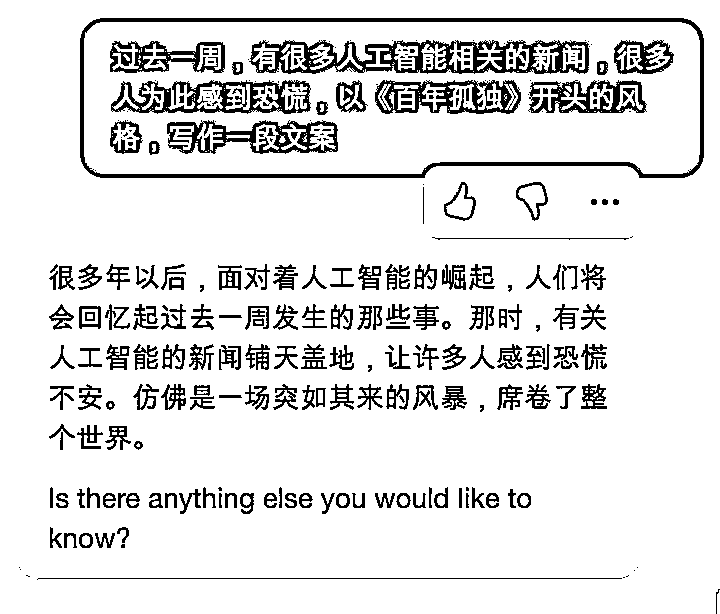

回到正题，聊 ChatGPT。几乎可以确定，随着 API 全面开放，一大波基于 ChatGPT 的应用将如雨后春笋般冒出来，一个繁荣的应用生态正在成形。而在 API 还没开放的那段时间，已经有一些先行者跑了出来。比如国内开发者 Lencx 做的 [ChatGPT 客户端工具](https://github.com/lencx/ChatGPT)（支持 Mac/Win），以及火遍全网的浏览器插件 ChatGPT for Google，安装量已经达到百万级别。

接下来，围绕这些 ChatGPT 第三方浏览器插件，聊聊它们的产品定位和体验层面的思考。

这些产品发现自谷歌应用商店搜索「ChatGPT」：

[`chrome.google.com/webstore/search/ChatGPT`](https://chrome.google.com/webstore/search/ChatGPT)

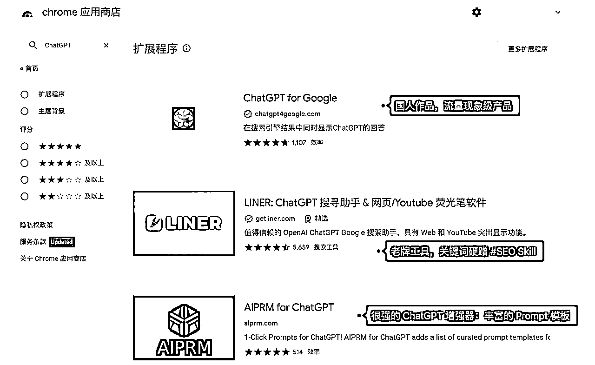

**1、AIPRM：堪称 ChatGPT 最佳辅助插件**

想要让 ChatGPT 给出更优质的答案，关键往往在提问本身。如何提出一个好问题，是每个用户都要面对的核心命题。市面上有几款专门解决这个痛点的工具，让高质量提问变得毫不费力，其中表现最亮眼的当属 AIPRM。

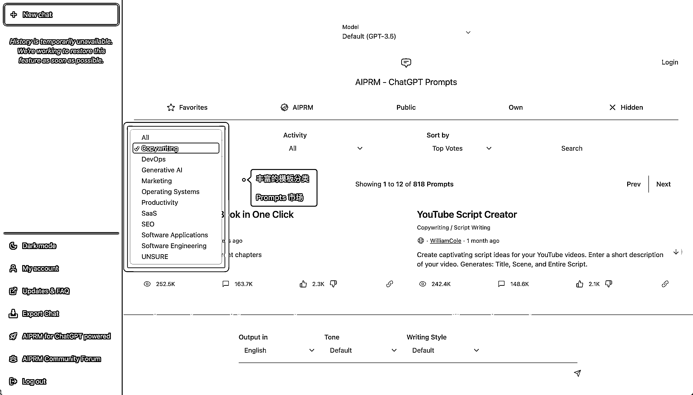

AIPRM 自带一个 Prompt 模板市场，直接嵌入 ChatGPT 界面。对普通用户来说，提问门槛大幅降低，输出质量也水涨船高。我个人很喜欢它的一个功能：可以指定输出语言和语言风格。举个例子，我用中文输入问题，设定英文输出，ChatGPT 就会自动用英文回复。

营销方面，由于开发者本身就是 SEO 领域的专家，AIPRM 率先在海外 SEO 圈子打开了知名度。比如[这条推特](https://twitter.com/aleyda/status/1612071976654225408)就是证明。目前安装量已经突破 60 万，Chrome 商店里来自全球各地的用户好评如潮。

最新动态：AIPRM 已经[开启商业化](https://app1.aiprm.com/pricing)，免费版功能限制不少，精选 Prompts 仅对付费用户开放（最低 20 美金/月）。预算有限的朋友可以试试替代品 ChatGPT Prompt Genius。

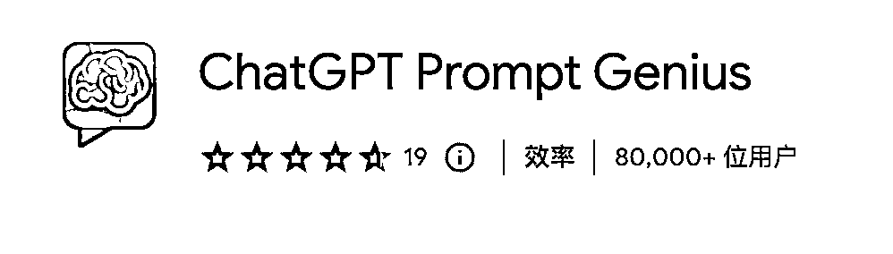

**2、ChatGPT for Google：搜索场景的标杆案例**

这是国内开发者做的产品，也是最早一批响应 ChatGPT 浪潮的浏览器插件。使用体验相当直观：你用 Google 搜索时，插件会同步返回 ChatGPT 的答案，搜索效率直接翻倍。

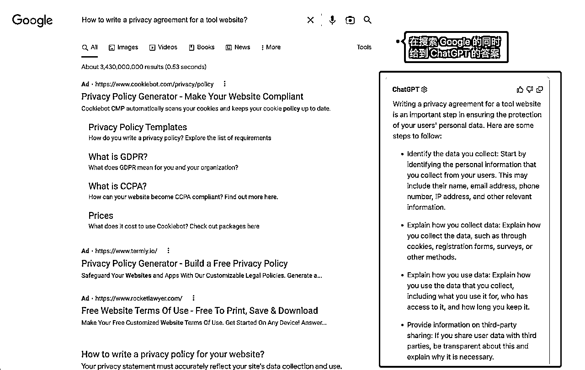

这款产品最早在即刻社区传播，增长非常迅猛，目前是第三方工具里用户量最大的，安装量已超过 100 万。而且它是开源项目，支持二次开发（这点很关键）。

评价一个工具好不好用，我通常快速看两处：一是设置项 Setting，二是价格页 Pricing。

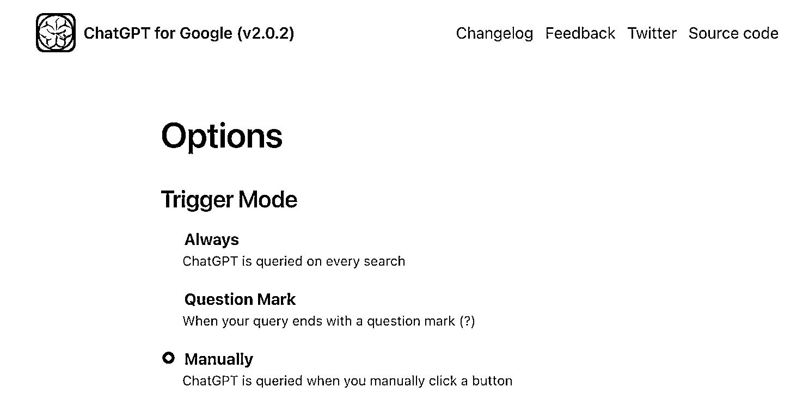

ChatGPT for Google 的设置项里有个非常值得一提的设计：Trigger Mode（触发模式）

• Always：每次 Google 搜索都触发查询
• Question Mark：只有当问题带问号「？」时才触发
• Manually：默认不触发，需要时手动点击

这个细节暴露了这款插件的核心交互哲学。之所以单独拿出来讲，是因为这恰恰是它早期被吐槽最多的地方——如果每次搜索都要调一次接口，会产生大量无意义的对话请求。而 Trigger Mode 这个设置，把主动权交还给了用户。

**3、ChatGPT Writer：精准切入核心场景，增长迅猛**

作为大规模语言模型，文本处理本来就是 ChatGPT 的看家本领。如果你打算做一个 ChatGPT 赋能的工具，从文本处理入手无疑是收益最高的方向。

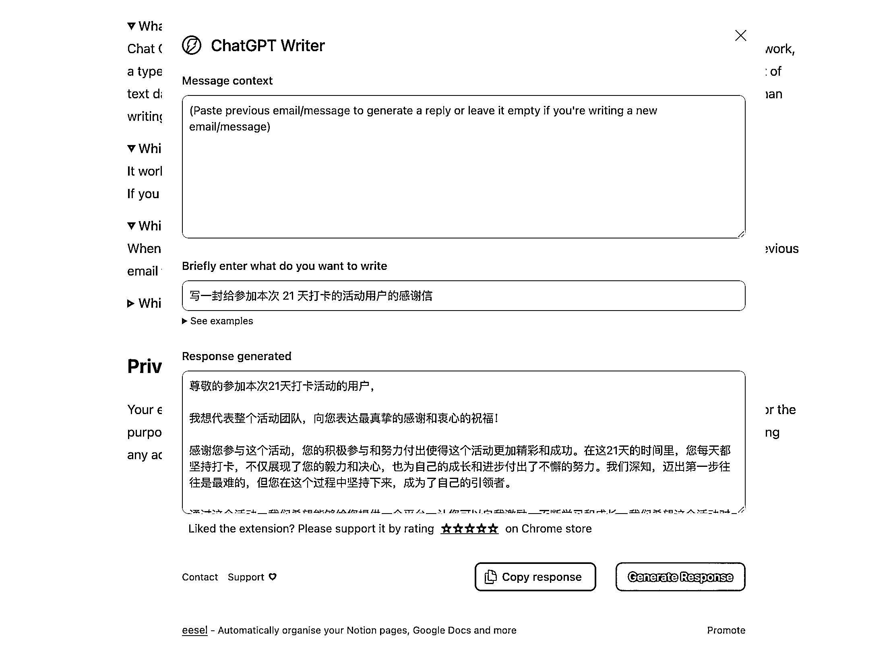

ChatGPT Writer 是一款辅助写作插件，场景定位非常精准。除了随叫随到的创作辅助，它还切入了不少刚需场景，比如直接嵌入 Gmail 的邮件书写框。目前安装用户已经涨到 30 万——难道是因为名字起得好？

同类产品还有：

[YouTube Summary with ChatGPT](https://chrome.google.com/webstore/detail/youtube-summary-with-chat/nmmicjeknamkfloonkhhcjmomieiodli) —— 一键总结 YouTube 视频内容。实现逻辑非常简单：抓取字幕，跳转到 ChatGPT 做摘要。这条产品线给我一个启发：一个 Prompt 就是一个迷你工具。

还有[后起之秀 Monica —— Your ChatGPT Copilot](https://chrome.google.com/webstore/detail/monica-%E2%80%94-your-chatgpt-cop/ofpnmcalabcbjgholdjcjblkibolbppb) in Chrome，国内团队出海之作，产品设计相当精美，交互方式和 New Bing 的侧边栏对话类似。不过内容生成质量差点意思，我总觉得它用的是 GPT-3 而不是 3.5 或 4。

**4、弥补官方功能短板，以 ShareGPT 为例**

这是我日常高频使用的一款插件。一键把 ChatGPT 对话生成分享链接，比发长截图要友好得多。

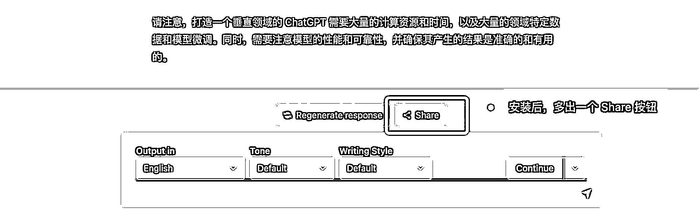

类似补足官方功能空缺的产品还有不少：

• 生财圈友 @码叔编程 的 [AI 会话存档插件](https://sle.xet.tech/s/rzeIG)：支持把 ChatGPT 对话导出为 PDF 等多种格式保存到本地；
• 生财圈友 @啊洛 开发的 [ChatGPT to Notion](https://chrome.google.com/webstore/detail/chatgpt-to-notion/bknieejaaomeegoflpgcckagimnbbgdp)：一键把会话保存到 Notion；

再比如 [ChatGPT Master](https://chrome.google.com/webstore/detail/chatgpt-master-chatgpt-ev/cplgddddgbofhhffggfagngknmakifkg)，主打划词+快捷键提问，还支持自定义右键菜单，字段模板可自由配置。交互思路类似 Notion AI——选中一段文字，让 ChatGPT 去干活：润色、翻译、缩写、扩写……你想怎么配就怎么配。

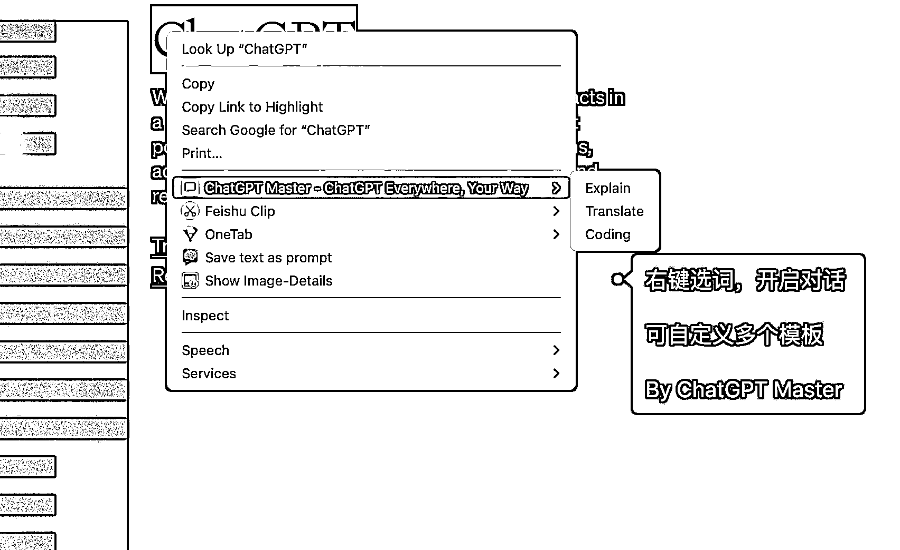

还有些插件结合了浏览器的语音播报能力，比如 Voice Control for ChatGPT、Speak to ChatGPT，适合用来跟 ChatGPT 练口语、练听力。

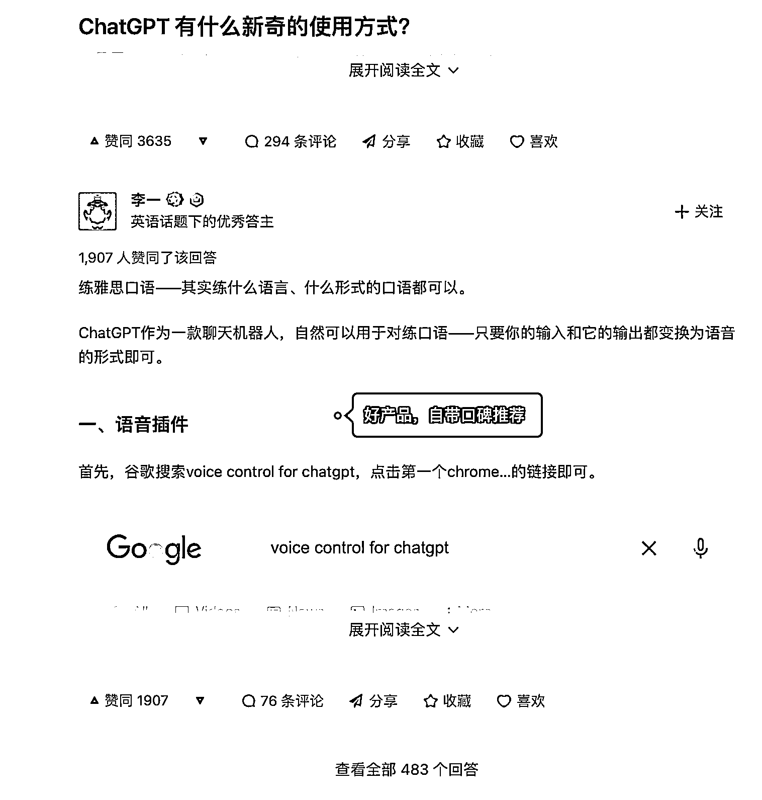

**5、ChatGPT for Amazon：给原有业务来一次升级**

这款产品出自国内创业公司 Shulex VOC，定位是面向亚马逊商家的评论分析 SaaS，靠数据挖掘和垂直行业分析来洞察消费市场。ChatGPT 出现之前，虽然它在几个大类目上做得够深，但很难覆盖全品类。ChatGPT 一出，NLP 的门槛直接被打穿，服务更多商家变成了可能。

Shulex VOC 原本在电商评论分析上已经够专业，ChatGPT 帮它再上一层楼：多维度评论分析（产品优缺点、消费者预期）可以高效产出，Listing 优化建议秒出结果，整个产品体验肉眼可见地提升了。营销端也没闲着，借助 ChatGPT 热度和跨境圈红人视频传播，增长势头相当猛。

这种技术底层的变革，让我想起生财圈友强哥的那句名言：研究 NLP 家破人亡，用好 NLP 鱼翅拌饭。

同样路径的产品还有「Glowe 阁楼」，用 ChatGPT 底层能力赋能心理咨询，刚拿到一笔千万级融资。

在生财有术内部，AI 教练、AI 鱼丸，甚至 AI 亦仁都在路上。搞不好下一期航海，陪你的就是 AI 教练了。

这些案例，都在我身边真实发生着。

---

上面提到的插件整理一下：

• 提示词集成类：AIPRM、ChatGPT Prompt Genius 等
• 文本处理类：ChatGPT Writer、YouTube Summary with ChatGPT、Monica
• 效率工具类：ChatGPT for Google、ShareGPT、ChatGPT Master、ChatGPT to Notion
• 业务赋能类：ChatGPT for Amazon 等

总结下来虽然已经出现一批玩家了，但说实话，插件生态其实还在早期。毕竟从去年 12 月初到现在也就四个月，能跑出来的都是手速快的。但这个赛道的爆发期，大概率还没真正到来。

回到最初的问题：为什么偏偏是浏览器插件？

理由也简单。ChatGPT 官方就是个网页产品，浏览器插件天然能做「网页增强」，在你熟悉的场景里完成体验升级，既贴合用户习惯，也不增加学习成本。更重要的是，它补足了原生产品的很多短板，本质上就是站在巨人肩膀上干活。

以上还只是我看到的一小部分产品。接下来的几个月，大概率会冒出更多更有意思的玩法。

**几点认知总结：**

1）从面向 Google 编程，到面向 ChatGPT 编程——这一点开发者圈子的朋友应该体会最深。
2）ChatGPT 就像一个魔法百宝箱，而打开它的密码就是 Prompts。这既是流量密码，也是财富密码。
3）浏览器插件只是产品形态之一。API 一开放，可能性就被无限放大了。一个 Prompt 就是一个 Mini Tool，一套 Prompts 就是一套 Mini SaaS。
4）结合自己业务的真实场景去思考，大胆用 ChatGPT 武装自己。
5）最后一条，也是最重要的一条：考虑到原生体验和内容安全，强烈建议大家出海搞。这也是我们做英文工具站的核心价值所在。

内容来源：《ChatGPT 应用生态之浏览器插件观察》

补充一下，目前 ChatGPT Plus 版已经逐步支持联网，并接入了 70 多个第三方插件，覆盖教育、电商、娱乐、新闻、投资等各个领域。圈友 @黄小刀 整理了一份详细的插件功能清单，除了上面提到的这几个，那些功能描述说不定也能给你不少灵感：[《ChatGPT Plugins 清单 @黄小刀》](https://shengcaiyoushu01.feishu.cn/sheets/shtcnbZVcicTbk6DKuspfcIWfqg)

另外，在生财有术社群里，和 ChatGPT 相关的风向标帖子里也藏着大量需求线索。

我们还整理了 73 条技术应用相关的风向标，供大家参考，看看有没有适合你的工具站机会点：

生财有术 ChatGPT 中标风向标合集（技术应用类）

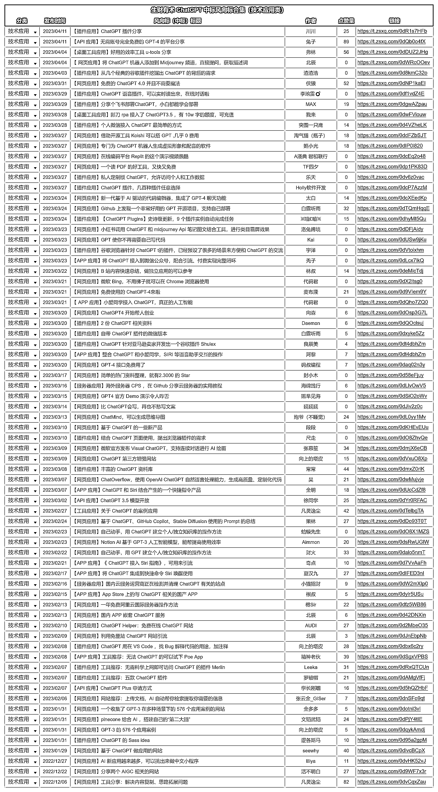
