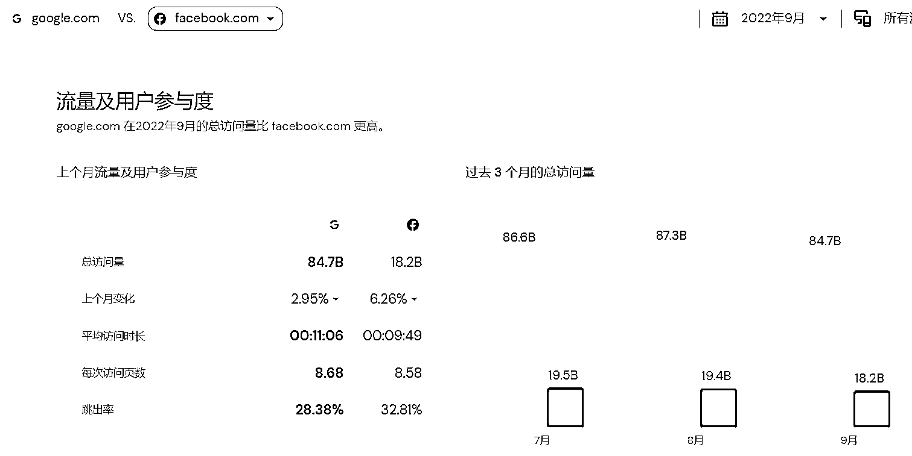
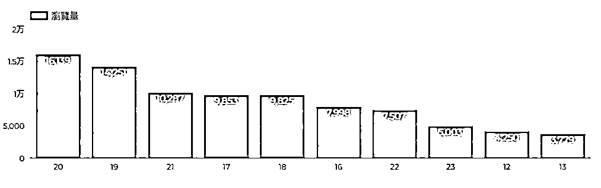

# 4.1.1 流量到底怎么看

聊流量，先分清两个基础指标：PV 指页面访问量，UV 指独立访客量。同一位用户在不同页面之间来回浏览，系统会记下多个 PV，但只算一个 UV。因此，PV 始终不会低于 UV。Similar Web 中那个“页面平均访问量（每次访问页数）”，算法就是 PV 除以 UV。它和平均页面访问时长一样，都是判断用户粘性的可选参考，通常数值越高越能说明用户愿意停留和深入浏览。

拿 Similar Web 对 Google 的分析来说，用户打开谷歌往往目标明确。有意思的是，Facebook 虽然常被视为社交媒体，但它在访问量、平均访问时长、每次访问页数以及跳出率上，和 Google 并不一样，这跟不少人的直觉相反。做竞品分析时，这些维度同样值得拿来比较。若你的站点在相近指标上能压过对手，那流量增长接下来更多就取决于推广投放了。

若想进一步做精细化运营，还可以拆开看不同时段的流量统计。不过时差不能忽略，通常要先把统计时间换算到目标用户所在时区，这样得到的浏览趋势才对应出海网站真正要服务的人群。流量数据还能细看到页面层面：某个页面若被同一用户反复打开，PV 自然偏高，这也能帮助我们判断用户更偏爱哪些内容。

以某网站的用户浏览量为例，统计采用美国时间，横轴表示从开始浏览到 1 小时以内的各个时间点，20 对应晚上 8 点到 9 点。从图里能看出，用户更活跃的区间集中在美国时间下午 5 点之后到晚上 10 点之前。若运营的是内容站，把引流与推广放在这个时段，效果通常会比早上更好。