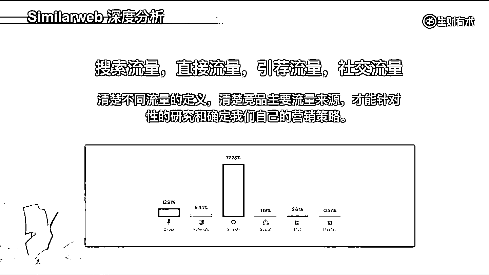

# 4.1.2 流量来源：从异常数据里找增长点

流量来源怎么分？答案其实和你自己的业务需求挂钩。作为网站运营或开发的管理者，最关键的动作不是埋头拉数据，而是主动盯住数据变化，定期复盘。一旦发现某个数据突然不对劲，先别急着忽略，去拆解背后的原因——尤其是当异常值带来的是流量上涨时，那往往就是一个信号：某个特性起了作用。抓住这个特性，果断加大投入，很可能就能让流量迎来一波爆发。

当然，前提是得先摸清流量的底细。我们需要弄懂四种最核心的流量类型：搜索流量、直接流量、引荐流量、社交流量。每类流量的定义是什么、各自有什么特点，这些都要心里有数。更重要的是，搞清楚竞品的主要流量入口和来源结构，站在对手肩膀上做判断。只有这样，我们制定营销策略时才能有的放矢，而不是凭空瞎猜。

