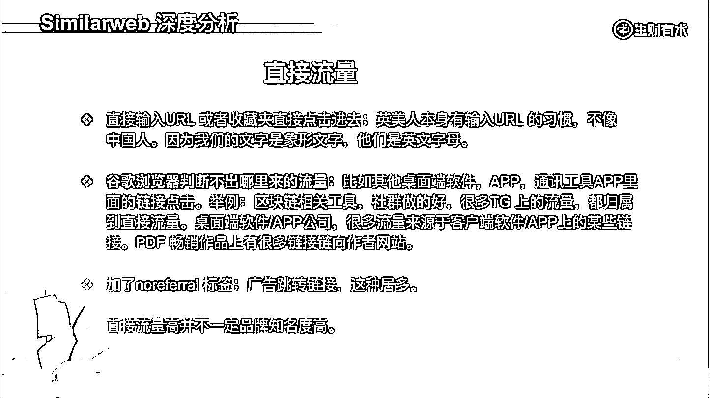

# 4.1.2.2 直接流量，来路比你想的杂

聊到网站流量时，“直接流量”很容易被理解成用户亲手敲网址进来。其实，这个来源比想象中复杂，至少要分成几种情况看。

先看最直观的一类：用户在地址栏输入 URL，或者从收藏夹、插件入口点进网站。这里有个有意思的中外差异。英美用户母语就是英文字母，互联网地址也以英文为主，所以他们顺手敲下 google.com 很常见；而不少中国用户并不会直接输入完整域名，更习惯先搜“Google”或“Apple”这类品牌词，再点进目标网站。

接着是 Chrome 识别不出来源时，也会把访问归到直接流量里。比如用户从桌面软件里点开链接：视频剪辑工具、图片处理工具、文档编辑工具，或者从 Telegram、WhatsApp 这类通讯 App 里点击链接跳转过去，都可能被算作直接流量。原理并不玄乎：以 Adobe 桌面软件为例，用户在里面点了一个链接，浏览器只知道某个 URL 被打开了，却无法判断访问者是从哪个网页来的。Adobe 不是网站，它和 Chrome 更像两个互不相通的独立环境，没有一个可追溯的“上一页”，所以这种访问就等同于手动输入网址。也正因如此，一些桌面软件或 App 公司的 Web 端流量很高时，其中不少直接流量很可能来自它们自家的客户端。

还有一种常见案例：Web3 工具和区块链相关产品往往直接流量特别高。它们很多靠社群传播，Telegram 群里分享了大量链接，用户点一下就进了网页。看到这类站点流量漂亮，立刻判断它做了 SEO，可能方向就错了——对方未必在搜索优化上发力，主战场其实是社群运营。类似地，一份免费或付费的 PDF 作品，里面嵌入了指向网站的链接，用户从 Adobe 或其他 PDF 桌面软件中点击过去，这部分访问同样会落入直接流量；注意，这里说的是桌面端阅读器，不是网页版 PDF。

最后还有一类容易被忽略：带有 noreferral 标签的链接，也会被归为直接流量。广告跳转链接中这种情况不少，尤其是网盟渠道过来的链接，常常带着 noreferral，或者来自弹窗广告。

