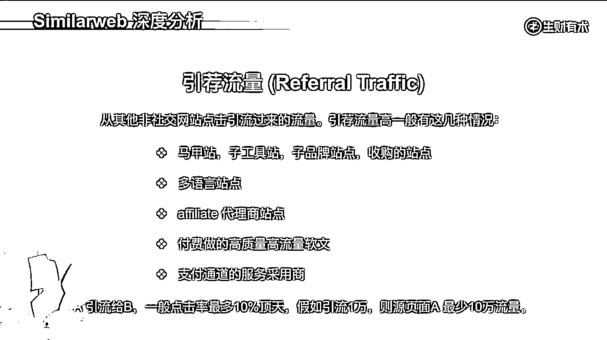
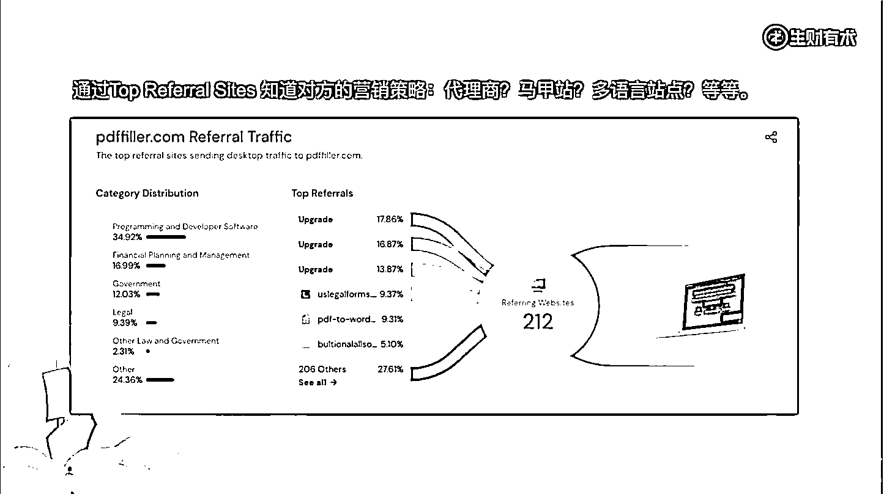
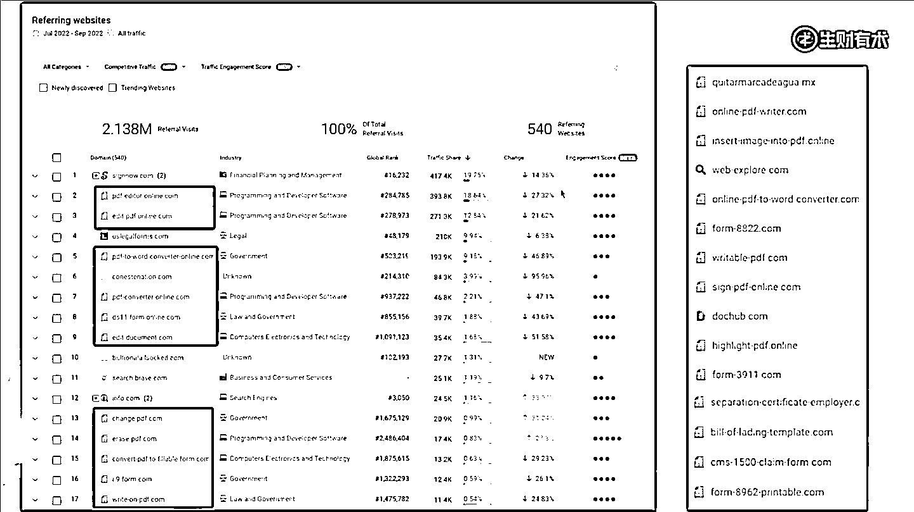
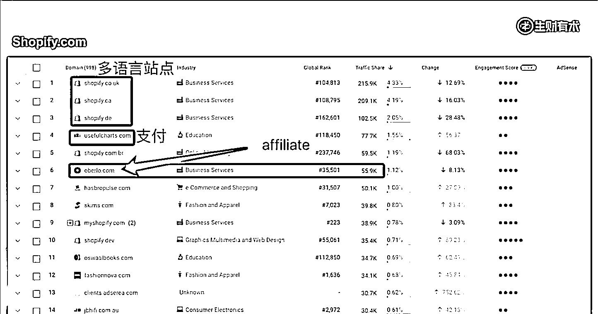
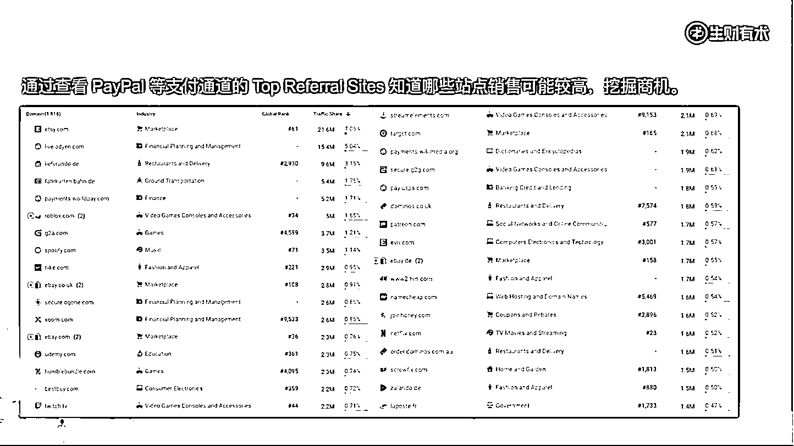

# 4.1.2.3 谁在为你导流

先把概念讲透：如果访客不是从社交平台，而是从另一个网站点链接进入你的站点，这类访问就属于“引荐流量”。当某个网站的这类流量特别大，背后通常离不开以下几种来源：

一是主站布下的“分身”。同功能的换壳站（外观、配色换一换，功能基本不变）、把单一小功能拆出去的工具子站、独立子品牌站，或者它已经收进来的站点。某个分身导流很猛，很可能就是它下一步准备收购的对象。视频编辑类产品常这么干：每个小工具单独做个站，最后统一把用户送回主站。

二是多语言版本。域名后缀不同，本质是同一品牌的不同语言入口。

三是联盟/代理商站点。很多主品牌会发展 Affiliate 业务，外部看到的高引荐量，背后可能正是它自己的代理网络。

四是花钱投放的高质量、高流量软文。

五是支付服务商。比如站点接入 PayPal，用户结账时会跳转到 paypal.com，链接尾巴再带回原站，支付通道自然就获得了导流。

这里要提醒一句：对目前约 80% 的普通玩家来说，想靠软文硬生生做出引荐流量并不现实。假设 A 站给 B 站导流，转化比例通常能到 10% 已经是天花板，3%—5% 就算不错。换句话说，B 站一个月想拿到 1 万引荐访问，A 站原始页面每月至少得有 10 万流量，这种条件很少见，也很难得。

借助 Top Referral Sites，我们能反推对方的营销打法：它有哪些代理站、换壳站、多语言入口，基本都能顺藤摸瓜。

刚才展示的是免费版，接着看付费版。

以 pdffiller.com 为例，这是一家做在线 PDF 编辑的站点。图上统计的是它的推荐来源流量：6 月到 9 月，累计被引荐了 200 多万访问。具体由谁送来？看红框，右侧还列了一长串。再看中间的 traffic share，比如 pdf-editor-online.com 这一项，三个月贡献了 393k。

继续往下翻，会发现不少站点的 logo 几乎一个模子刻出来的，很明显是主站拆出去的工具子站——把多个细分功能各自做成独立网站，再往主站输送用户。

这些子工具站的流量从哪来？可能有六成，甚至八成到九成以上，来自广告投放。也就是说，主站大规模投广告，子工具站也投，再把流量导回主站，这是一套组合策略。这个玩家在 SEO 圈里基本属于头部梯队，感兴趣可以细挖。它做的是一整套生态：网页端在线编辑、客户端、App、浏览器插件全都有，属于全终端软件，背后拿到过大几千万美金的投资。

再看 shopify.com。它的引荐来源里，很多是多语言站点。排第四的 usefulcharts.com 给 Shopify 送了 77.7k 流量。为什么它能导流？原因不复杂：这个网站用了 Shopify 的购物车和支付能力，于是就给 Shopify 带去了访问。再往后看，第六名 Oberlo 贡献 55.9k，仔细一查，正是它的代理商站点。

换到 PayPal 的引荐数据，思路又不一样：查看 PayPal 或其他支付通道的 Top Referral Sites，可以判断哪些站点销售更旺，从中找商机。支付通道的核心环节就是收钱，谁给 PayPal 带去的流量最多，通常也意味着谁收款规模更大。如果把前 1 万到前 1000 名导出来，逐个筛，看到感兴趣且自己能力够得着的，就可以考虑切入。

榜单第一是个电商网站，单月给 PayPal 导流 21.6M，两千多万，量级极高，毕竟它本身就是电商平台。下面还有不少熟悉的站点，这里不逐个展开。这个名单里当然未必有适合你的目标，因为大多是巨头；但方法值得学。把视线放到靠后的位置：比如你做 Shopify 或工具站，就去看哪些同类工具站给 PayPal 导流较多——那往往说明它很赚钱，你也可以纳入考虑。这就是用支付通道数据挖商机的一种方式。