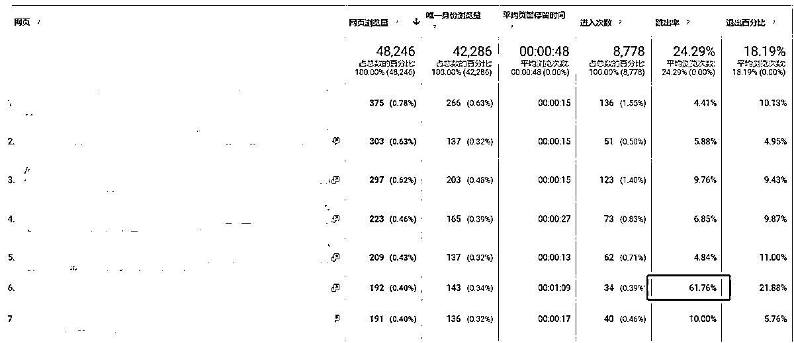

# 4.1.3 跳出率：用户为何匆匆离开？

所谓“跳出”，通常指访客打开网页后，没有进行任何操作就将其关闭；另一种情况是，用户直接点击返回上一页，也被视作跳出。跳出率就是这些跳出用户在所有访问者中占的比例。如果跳出率居高不下，往往意味着用户觉得页面内容没吸引力、操作出现了失误，或者压根不感兴趣。

我们针对不同页面的跳出率做了统计。在这个案例里，一个商家页面的跳出率远高于其他页面，这很可能说明该页面的视觉设计比较粗糙，也有可能是商品选择太少。具体原因需要点进这个页面，和其他页面一一比较后才能判断。单个页面的跳出率偏高并不会直接影响其他页面的表现，但用户确实可能因为这一个页面体验不佳而选择离开，造成客户流失。