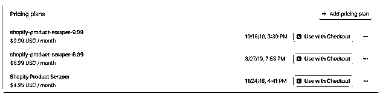
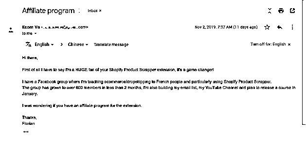

# 4.2 涨价后，留存反而更好了？@壹树

在小众市场里，价格常常不只是交易数字，它还会替产品传递价值信号：标价往上走，用户对产品的期待也会被抬高。我把价格从 $1.99 一路调到 $4.99、$6.99、$9.99，留存表现完全刷新了我的判断。

同样的动作，我也用在了 Shopify Product Scraper 上，价格依次从 $4.95 提到 $6.99、$9.99。下图标注的是每次调价的时间节点。

结果并没有出现我担心的用户大量流失；相反，价格更高时留下来的用户比例还更理想。现在回头看，只怪自己动手太晚——产品层面几乎没做额外优化，利润却随着价格调整往上走了。

下面这封邮件来自一位付费用户，是我收到的最好的反馈之一。它带来的满足感甚至超过收入本身，也让我更确定：产品确实为他创造了足够大的价值。

这轮调价让我反复从技术和产品视角中抽离出来，站到运营层面重新审视价格与小众市场的关系。最后沉淀成一句更具体的体会：让价格匹配价值，为价值定价。