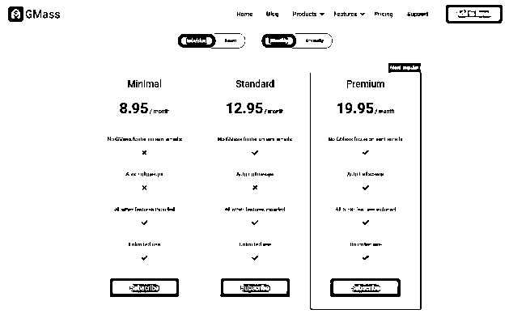
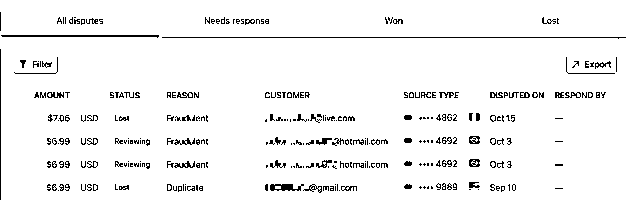

# 4.2.4 订阅续费，赚的就是“忘了”

在国内，订阅制玩得最转的地方大概是视频平台：按月、按季、按年，几档价格摆在那里，不同预算的人各取所需。不过自动续费这套，在国内推广得并不顺。去 App Store 翻翻评论就能感受到，一旦被扣了钱，用户往往要追着客服讨说法，平台的人力开销也跟着上来。所以国内更常见的，其实是一次性买断——严格讲，这不能算真正的订阅模式。

到了海外，情况反过来：订阅付费普及度很高，用户也习惯，很多工具类软件干脆都走这条路。计费周期通常以月为单位，也会给季度、年度选项；有的产品还会多设几档，再把其中一档标成“最受欢迎（Most popular）”。一般来说，买的时间越长，单价就越低。

那为什么说订阅这事有点“黑”？关键在于，用户开通之后，很大概率会忘了取消——或者取消入口被放得不够显眼。用一阵子，慢慢就忘了；再过些时候，工具被删掉，更是彻底想不起来。

结果就是，扣费照常进行。只要用户不主动取消，也不去找发卡银行申诉，这笔钱基本等于白花。偶尔会收到邮件，对方说扩展程序早删了，让我帮忙取消订阅，但几乎不会提退款。

我自己的小产品也用了这套模式，并不会去核实用户是否还在使用。其实从使用日志能看出来：如果长时间不登录，本可以自动帮他取消订阅。但圈子里彼此都明白，却默契地装作没看见——钱来了，就让它来吧。

当然，也有用户会向银行申诉，不过概率很小。到目前为止，我只遇到过十来起。下图是 Stripe 后台里一笔有争议的订阅收费。

争议理由（REASON）里，有人填的是欺诈（Fraudulent），这大概率意味着信用卡被盗刷了。对于存在争议的交易，收款方也可以申诉，提交邮件往来、使用日志等材料；不过这种事我通常懒得花时间，退就退了。