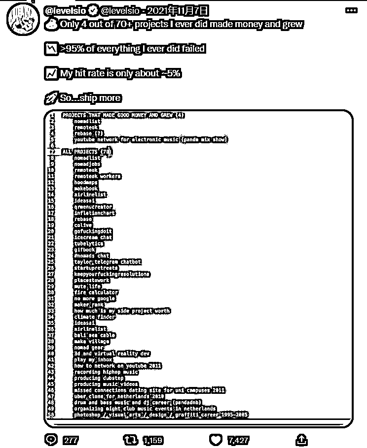

# 用速度换成功率

当你完成了需求挖掘、掌握了分析思路、理解了产品差异化，也看清了完整生命周期之后，下一步就是动手打造属于自己的英文工具。

为什么一定要尽快做出产品 MVP？原因很直接：新产品的失败概率实在太高。想抬高整体成功率，我们只能把数量做上去，不断去试新的 iada——这几乎是每位创新者都绕不开的窘境。

这一章是手册新增的部分，我们梳理出若干把产品快速做出来的方法，供你参考。在讲究精益迭代的商业竞赛里，如果你一年能推出 12 个 MVP，而对手一年只能推出 3 个，你就握有四倍的数量优势。

知名独立开发者 Peter Levels 在今年十月推出了新产品 [avatarai.me](http://avatarai.me/)。产品上线首日收入就达到 1 万美元，十天累计进账 10 万美元。

他凭什么做到？答案只有一个字：多。

过去十年上下，他先后做了大约 70 款产品，真正跑出来的只有 4 款，成功率仅约 5%。要知道，他已经是全球最出色的独立开发者之一，成功率尚且只有 5%，更不用说我们普通人了。

既然如此，最优策略就很清楚：

• 把你脑子里冒出的每个 idea 都动手做；
• 用最省力、最迅速的方式把它推上线，比如压缩到一个周末；
• 上线之后盯住用户数据，让市场反馈决定要不要继续加码。

至于怎样快速冒出产品 idea，前文讲需求挖掘时已经聊过；具体怎么落地，下面整理了一些更细的方法：