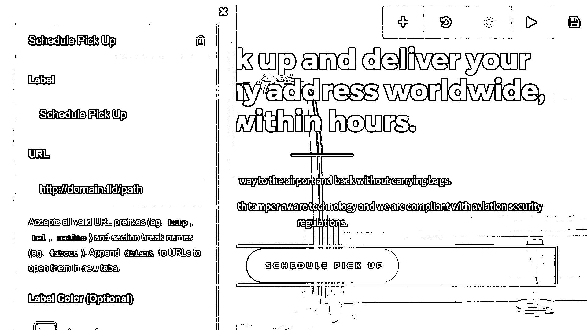
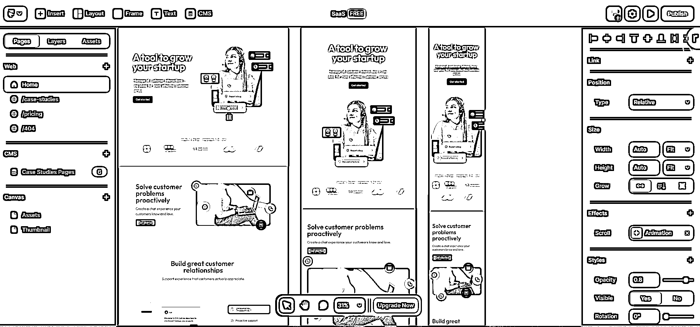
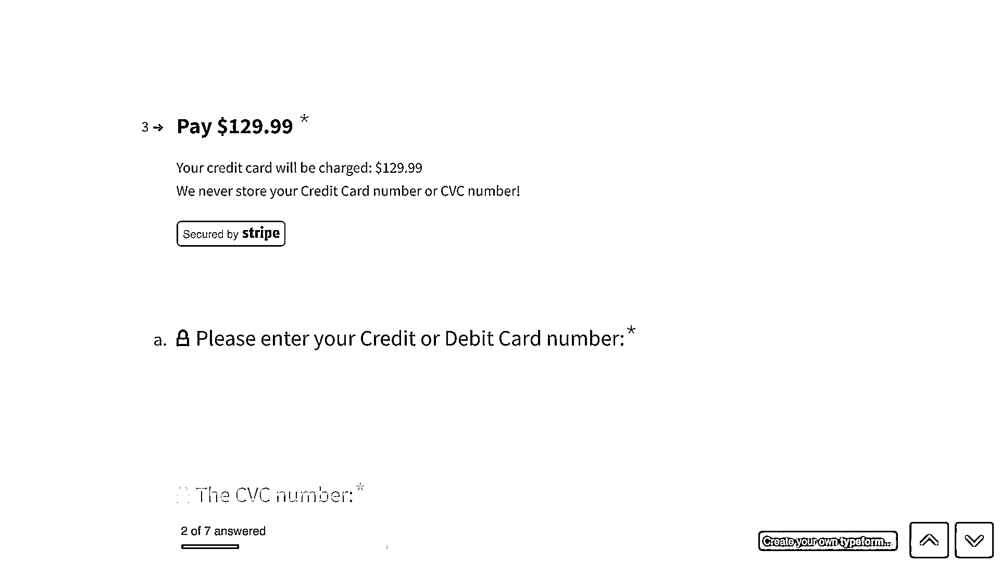
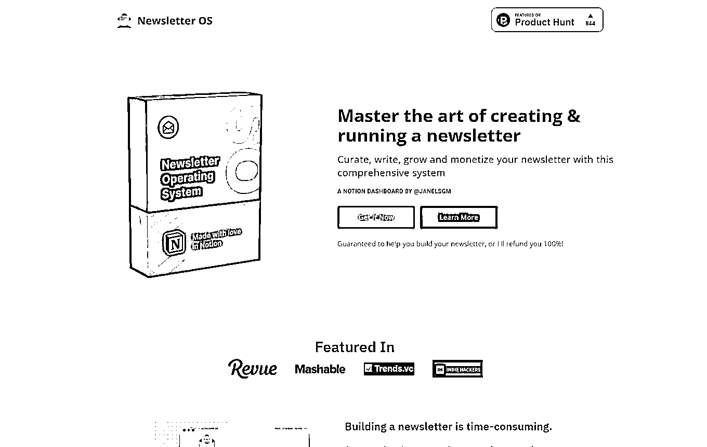
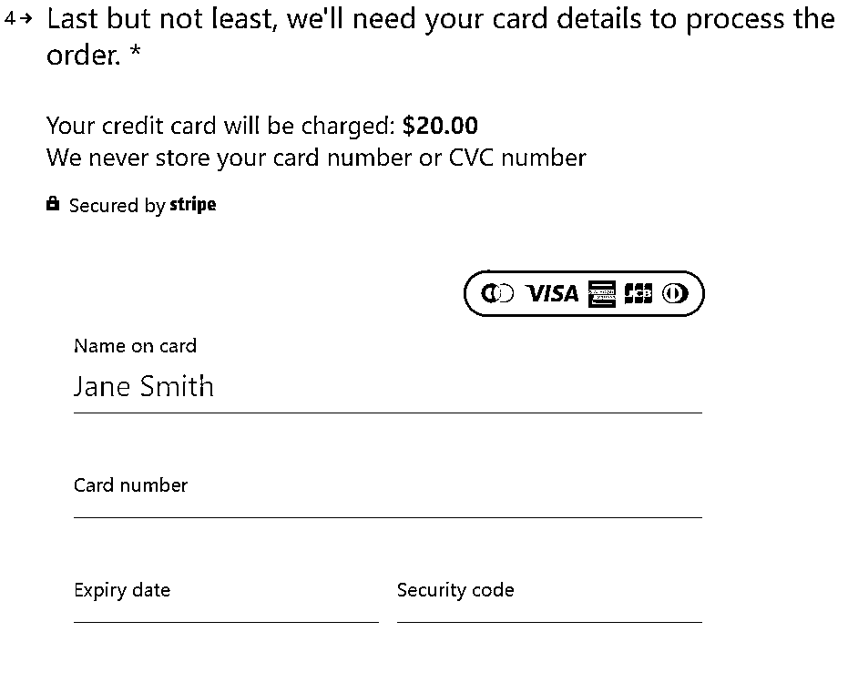

# 7.2.1 不写主功能，半天验证 MVP

复盘前面的流程，真正吃时间的环节很明显：主函数开发排第一，前端界面排第二——买模板、改模板都算在内。两项加起来，常常吞掉整个 MVP 七成以上的工期。

那换个思路：这两块暂时都不做，是不是还能把时间再压短？可以。尤其做付费产品时，主功能并非必须。你此刻要确认的只有一件事：用户是否愿意付费。

验证付费意愿最有效的方式，就是预售，也就是常说的“卖空气”。

具体可以这样操作：

- 先写一份产品预售营销文案，重点讲清楚你要解决什么问题，并列出 3 个卖点。
- 用建站工具生成 Landing Page。可选 carrd.co、Webflow、Framer，把上面的文案填进去。
- 通过 Typeform 接入 Stripe 的支付能力。
- 投放 Google 关键词搜索广告，重点看转化率数据。

carrd.co 和 Typeform 这两个工具的顺手程度都挺高，具体操作这里不展开手把手教学。

carrd.co 中制作 landing page 的界面如下：

Framer 中制作 Landing Page 的页面如下：

Typeform 中添加收款功能的界面如下：

再看几个实例。下面两个产品的 landing page 都由 carrd.co 生成，全程无需写代码：

而下面这个链接，是 Typeform + Stripe 做出来的“带支付功能的调查问卷”，同样不用写代码。把它放到 landing page 上，你的 MVP 就基本完成，可以开始测试转化率了。感兴趣的话可以点开感受：

[`template.typeform.com/to/zDzdJ3Me`](https://template.typeform.com/to/zDzdJ3Me)

内容来源：《写给独立开发者：如何快速做出产品 MVP》

