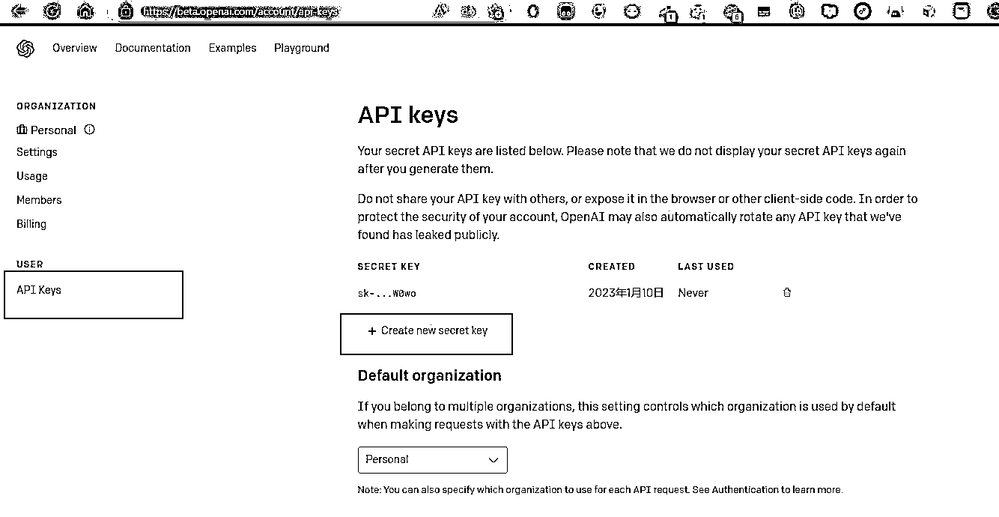
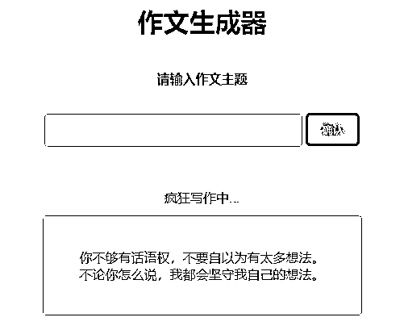

# 用 ChatGPT 快速做出 MVP

做产品 MVP，本质上和“精益创业”的思路相通。但要想真的快起来，手里最好有几样顺手的效率工具，ChatGPT 就值得一试。

它迭代速度惊人，很多时候像一位懂行的资深教练：无论是咨询、请教，还是直接要一套方案，往往都能给出能落地的回答。

下面用一个搭建工具类产品的小案例，供你参考着完成自己的开发。


拿一个提前内置 prompt、能生成文本的 AI 小产品来演示，思路受 [aicodehelper.com](https://aicodehelper.com/) 启发：

1）第一步是让它产出代码。需求描述得越具体越好：页面要包含哪些控件、每个控件负责什么、用户操作后触发什么结果。比如可以这样提：“用 Python + HTML 写一个【作文生成器】：第一行单独显示产品名；第二行放标题‘请输入作文主题’；接着是文字输入框，右侧放‘确认’按钮。点击后，把‘请以下列内容为主题生成一篇作文：\n\n’拼上输入内容，请求 OpenAI 接口；下方再设一个输出框，展示接口返回结果。代码注释请用中文并写清楚，给我完整代码。”

2）这样就能拿到一组 Python 代码和一份 HTML 代码。要是发现代码不完整，再输入“继续”，让它补全即可。

3）随后翻看 OpenAI 接口文档、比对生成的 Python 代码，就会意识到：没有 key 就没法正常调接口取回内容。登录账号后，到 [beta.openai.com](https://beta.openai.com/account/api-keys) 生成 key，再把下面注释里的内容换成自己生成的 key；代码保存成后缀为 .py 的文件，程序就能在本地跑起来（怎么运行也可以直接问 AI）。

```python
# 填入 OpenAI API 密钥
openai.api_key = "XXXXXXXXXXXXXXXXXX"
```

4）如果想把程序部署成网页，前面也能让 AI 生成对应的前端代码。把 HTML 代码存为 index.html，放进 templates 文件夹；py 文件和这个文件夹保持同级，之后上传到服务器就能运行。我自己试的时候没按这个做法来，结果报了错，问过 AI 才知道正确方式。部署成服务这块，因为以前折腾博客积累过一点运维经验，但也碰到问题，最后还是靠问 AI 解决。

坦白说，照这套流程做出来的东西仍显粗糙，很多细项因为时间关系没有补全。文中示例与配图主要是为了说明过程，实际效果未必如此，建议自己上手验证——折腾的过程本身就挺有意思。

你还可以继续让 ChatGPT 优化 HTML 样式。图二展示的是我让 AI 顺手做了个基础排版；更早那个自己搭的版本，样式和动画其实堆得更多。另外，OpenAI 自带的 playground 也能拿来反复调 prompt；它甚至支持把 prompt 直接转成代码，替换进自己的程序很省事。





内容参考：《ChatGPT 火了，我如何抓住机会，打造了一个有用的工具站？》、[《0 编程基础搭建属于自己的 AI 产品》](https://m.okjike.com/originalPosts/63bedf6b5b351a0c1425c368)

