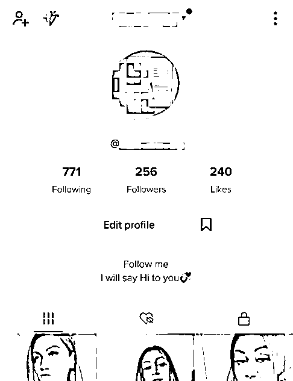
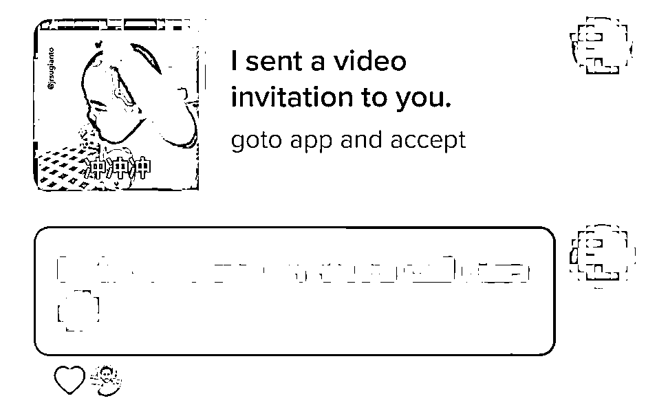
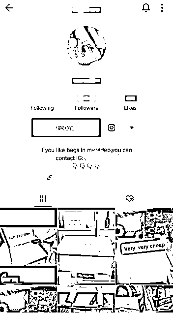
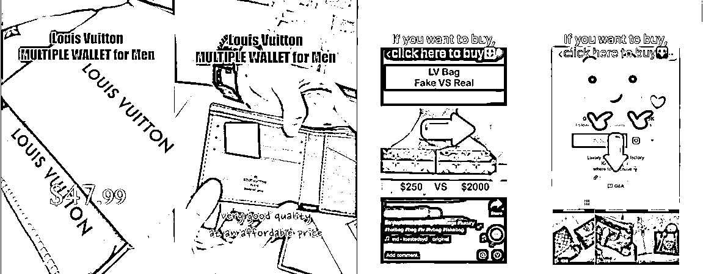

# 8.1 玩法一：TikTok 私信获客拆解

TikTok 的流量池有多大，做海外市场的人都清楚。只要把“从 TikTok 找人”这件事做顺，新品上线最愁的起步阶段也就能化解大半。

新手想上手，可以参考 @Harevy 的实操。他是我的一位圈友，当时用一款主打海外市场的交友应用做测试，跑通了整套流程。

**第一步：先把账号包装成美女号**
注册 TikTok 后，昵称、头像、个人简介统一做成美女人设，再传 3 到 6 条美女视频，让号有真实感。这个阶段不必追求播放数字，真实感比数据重要。

**第二步：找到目标地区的美女号**
这类账号下的男粉，就是我们要触达的用户。欧洲、美国、台湾、中东、东南亚这几个地方我都测过，账号文案或简介用的语言，基本能看出地区来源。目前欧美的付费表现最好，但也仅供参考。

想快速攒出一批同类账号，可以用两种裂变思路：
思路一：①先关注一个目标地区的美女号；②点 Follow 右侧的箭头，系统会推相似账号；③再点 See all，一下子能拉出一串同类博主；④重复以上动作，号会越裂变越多。
思路二：①先关注一个目标地区的美女号；②进入它的粉丝列表，里面几乎是男性；③再看这些男粉关注了谁，又能挖出一片新账号；④最后按需筛选。

**第三步：去关注这些男粉**
老外本来就有回关的习惯，在美女号人设的加持下，整体回关率能做到 30% 上下。这一步做完，等于是把潜在客户主动请了进来。

**第四步：私信引导下载**
将编辑好的文案发给对方，带上 App 下载链接，引导安装。用户在 App 里消费后，推广者就能拿到佣金。

除了直接发下载链接，也可以把人引到 WhatsApp 深聊转化，话术到位的话效果不差，缺点是效率偏低。等账号有了一定权重，再升级成企业号，主页放上链接，就多了一个触达入口。

为什么这套打法不盯着播放数据？说到底是流量取舍：等平台分饭吃，还是亲手去抓用户。
过去的基金、带货逻辑，都是先做内容博流量，积累粉丝再谈变现；可这种路径太看环境，流量来去不由自己。视频偶尔爆一次当然开心，但漫长 0 播放、低播放的时期更磨人。关注回关则省去内容压力，也不会被 0 播放困住，流量主动权握在自己手里。稳定出单，比一夜爆火更值得追求。

**这套玩法还能迁移到哪？**
底层逻辑其实很朴素：一个 TikTok 号上的粉丝，就是一类人群的集合。围绕产品去定向联系这批人，完成营销和变现即可。
顺着这个逻辑，很多项目都能复用。也有人用出了更泛用的版本：大号立人设，小号在留言区截流。

具体操作：
1. 先建一个大号，想清楚类目。比如卖包，就把名字、头像、简介做得够专业，把独立站网址或 WhatsApp 放在主页。

2. 拍产品短视频时，把外观、质感、价格这些卖点展示够，再用图片和箭头画出下单路径。

3. 找和包包风格搭调的账号，比如品牌官方号、种草博主，用工具批量抓取他们的粉丝昵称。

再给一个找精准账号的技巧：TikTok 官方也有类似星图的创作者平台，网址是 https://creatormarketplace.tiktok.com/，用公司资料注册激活后，可以免费按性别、年龄、国家、粉丝体量、兴趣等维度筛选账号。

4. 准备一批小号，在自家这条短视频的留言区统一 @ 已抓取的粉丝。对方一登录就能看到提醒，点进来直接是产品展示。

一个有明确需求的用户，看到产品刚好对路、价格又不贵、下单路径清清楚楚，转化率自然能上去。
5. 掌握了这套玩法，后续就能按粉丝属性复制到各种场景。尤其适合跨境商家，可以把目标客户导向独立站或私域，做长期复购。

例如：圈住年轻女性，卖美妆、箱包、鞋子；圈住家庭主妇，卖家居清洁用品、刷好评；圈住小孩，卖玩具、做游戏推广。各类 CPS 项目、线上课程、其他产品也都能套用。

内容来源：《TIKTOK 如何利用海外 CPS+工具 0 粉丝变现月入过万》
