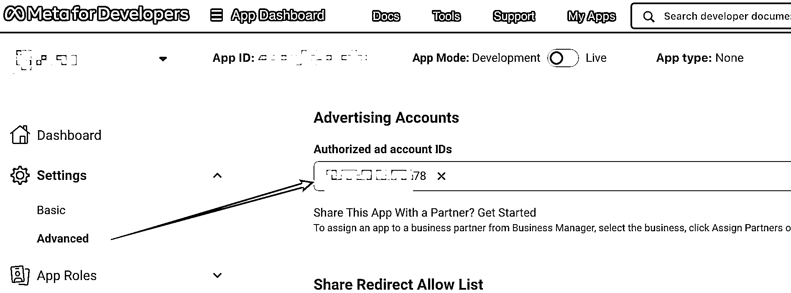
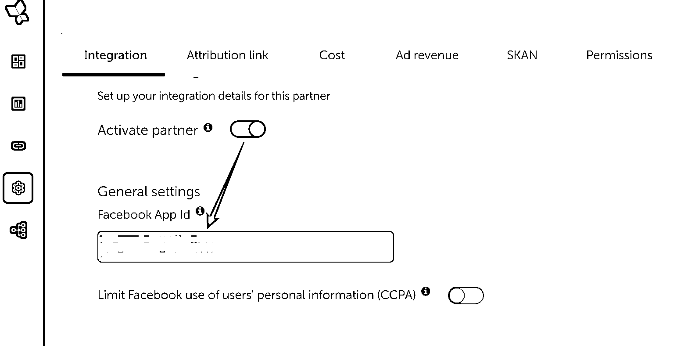

# 8.6.2 投放前，先备齐这些

产品方向已经定下来，产品完成度也过了八成，下一步就该进入买量环节了。这篇以 Facebook 为例，梳理工具型 App 的投放链路。

先聊开户。人在大陆，就别考虑个人户了，这条路基本只有挫折。如果有营业执照，Facebook 大陆账户开户时可以谈返点，具体能拿到几个百分点，取决于你的商务谈判水平。Google 大陆户的返点如今几乎归零，但海外户仍有机会拿到 10%～20%（Facebook 海外户也有类似空间）；若对接上少数源头渠道，25% 以上也并非完全没戏。TikTok 大陆户的返点政策相对保守，不过近期海外户也开始逐步放开，返点能够按全球统一比例执行。这里可展开的内容很多，之后另找机会详聊。

Google 在用户属性等选项上给得不多，投放更多依赖算法完成智能投放（UAC）；Facebook 则保留了更多定向和测试空间，因此本教程主要聚焦 Facebook 的基础投放流程。

在 Facebook 投放前，请确认手里已经有下面 4 样东西。若账户来自代理商而非个人户，这四样通常已经配齐：

• 广告账户
• BM（Business Manager）
• 主页（Facebook Page）
• 已上架的产品：Google Play、iOS App Store，或已上线的网站（Shopify 独立站、工具站均可）

尤其要提醒：新账户不要玩“挂羊头卖狗肉”，拿 A 产品开的户去跑 B 产品，Facebook 对此明令禁止。2017 年以前的老账户尚有一定操作空间，但这类账户在行业里非常稀缺，用一个少一个。

账户问题解决后，先做投放前设置：

第一步，完成开发者授权
• 进入 Facebook 开发者平台 https://developers.facebook.com/，在后台录入广告账户 ID，把 App 关联到 Facebook 广告前端

第二步，配置三方 MMP（App）或 GA（网站）
• 以 Appsflyer 为例，其他第三方服务商逻辑相同。启用 Meta 渠道，填入上一步的 FB App ID，归因窗口保持默认，勾选需要追踪的关键 App 应用内事件，保存即可

完成这些，就可以正式进入投放流程，按步骤操作即可。