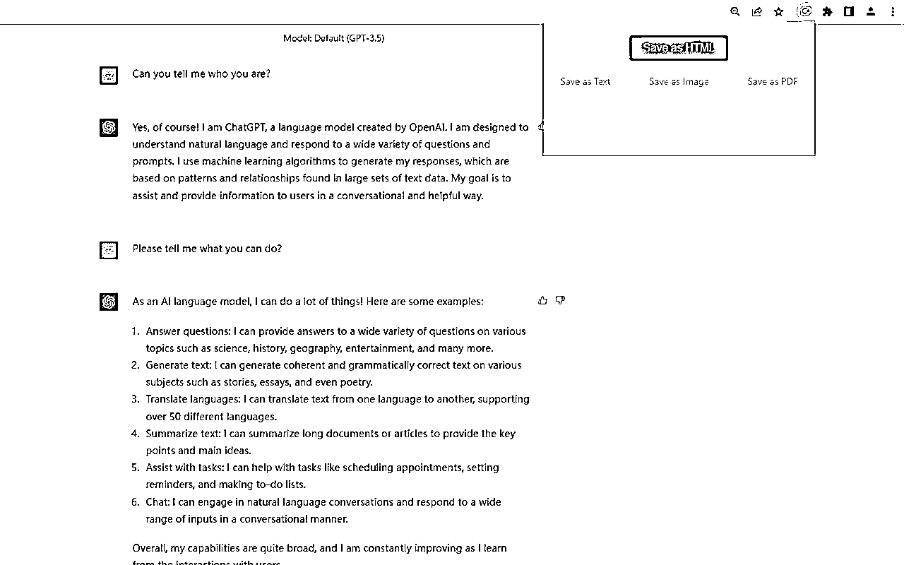
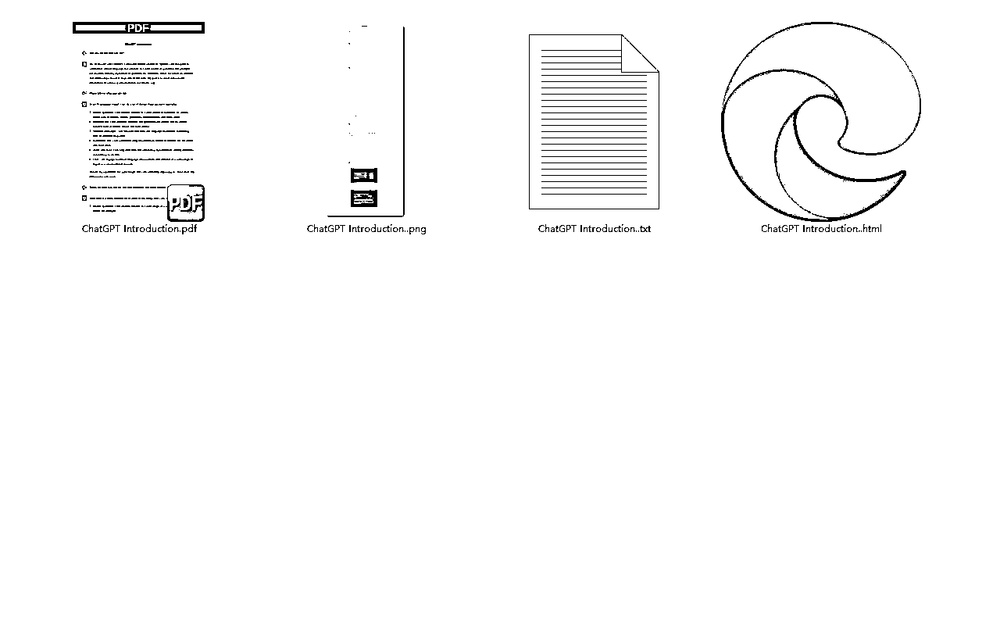

# 案例二：零代码，ChatGPT 替我上线了 Chrome 插件

3月，我第三次参加英文工具站航海，终于在 ChatGPT 协助下把首个 Chrome 插件推上商店。这个插件能把 ChatGPT 对话保存为 HTML、TXT、PNG、PDF 四种文件并落到本地电脑，不必上传分享，也就少了记录外泄的顾虑。同时，我让 ChatGPT 做了一个 WordPress 插件 API，供 Chrome 插件读取远程站点指定的文章列表。

插件地址：https://chrome.google.com/webstore/detail/chatgpt-save-data/ocejkjkjbhbkgdidjhodiejdppbiahna

最近 ChatGPT 封号情况严重，这个工具正好能帮大家尽快把调教记录存回自己的电脑。账号本身不值多少钱，真正无价的是你和 ChatGPT 一路调出来的记录与创意灵感。

整个插件没有一行代码由我手写，完全是跟 ChatGPT 对话磨出来的：先从读取当前网页 HTML 起步，再写入 TXT；接着在保存前清洗、优化 HTML 内容，导出 HTML、PDF、PNG；最后增加多语言版本。十几天里，我常和 ChatGPT 每天聊 8 到 10 小时，卡壳、误解都遇到过，但靠我引导调试、它耐心配合，问题一个个被拆掉。

快上线时才发现，自己被 ChatGPT 带进了 Manifest V2 的坑；而自 2023 年元旦起，Chrome 应用商店就不再放行按 V2 规范制作的新插件，只好再让它逐版改成 V3 规范。折腾数日后提交审核，审核阶段的问题也继续丢给 GPT，连商店概述都用 PAS 模型代写了。最终，插件在昨天通过审核并上线。

这只是一个不大的浏览器插件，若去 GitHub 找相近代码做二次开发，也许更快。但这次尝试验证了 GPT-4 的开发能力。用 ChatGPT 写项目，我总结了几点：

1）把第一步缩到足够小。别指望把整份需求扔给 GPT-4 就能拿到完整项目；即使项目不大，只要多几个模块，它也未必能一次实现。先抽象出最小功能点，小到它能给出完整可用的初始版。这个插件的第一步，不是直接做网页处理和多种格式导出，而是先做一个能读取当前页源码并显示在 popup 里的基础插件，跑通后再加需求。

2）按文件拆开让它写。ChatGPT 输出长内容容易中断，发“继续”有时管用，但不稳定；代码又强依赖上下文，前后逻辑一偏就容易出问题。所以先问清实现功能需要哪些文件，再逐个文件单独生成。

3）加功能前反复核对代码。GPT-4 偶尔会出现前后接不上的情况。每次增加新功能前，我都会让它复述需求，并把现有代码交回去检查，确认没问题后再叠加新逻辑。

4）人要深入判断并引导。GPT-4 有时会困在某个功能的一种实现方式里打转，给出的代码仍解决不了问题。这时要回到具体需求和代码里，凭自己的经验判断，引导它换一种做法。

开发和审核过程中波折不少，但我和 GPT 一起把问题逐个解决。它不只是工具，更像帮手、同事；要像对接同事那样，与它共同探讨和解决问题。插件虽小，上线却意味着 ChatGPT 可以辅助开发英文工具站，未来还有很多想象空间，等我们一起创造。

内容来源：《通过 ChatGPT 开发上线第一个 Chrome 插件，实现保存 ChatGPT 对话记录》

