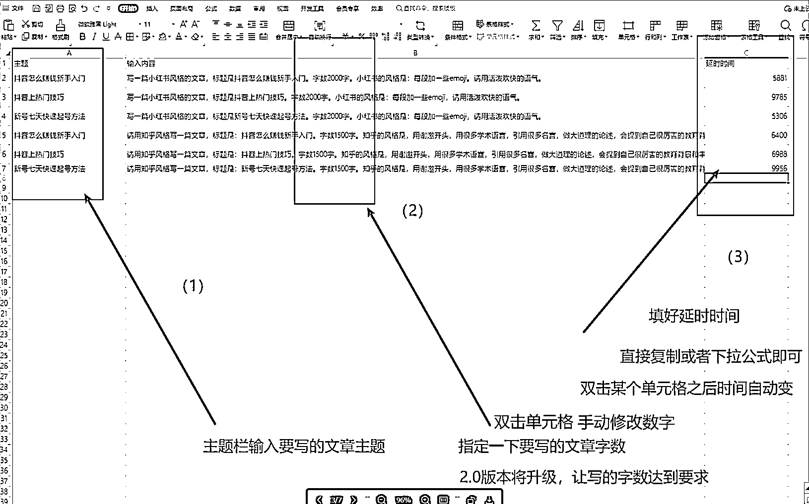
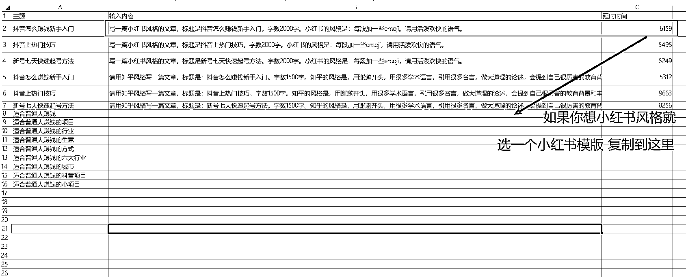
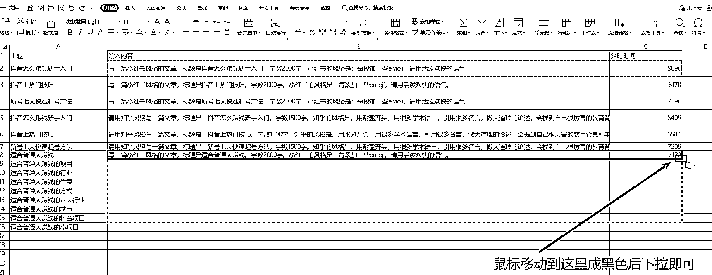
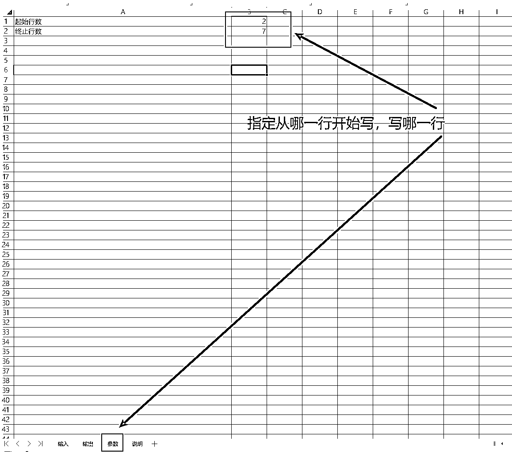
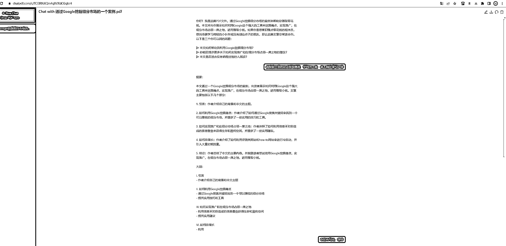
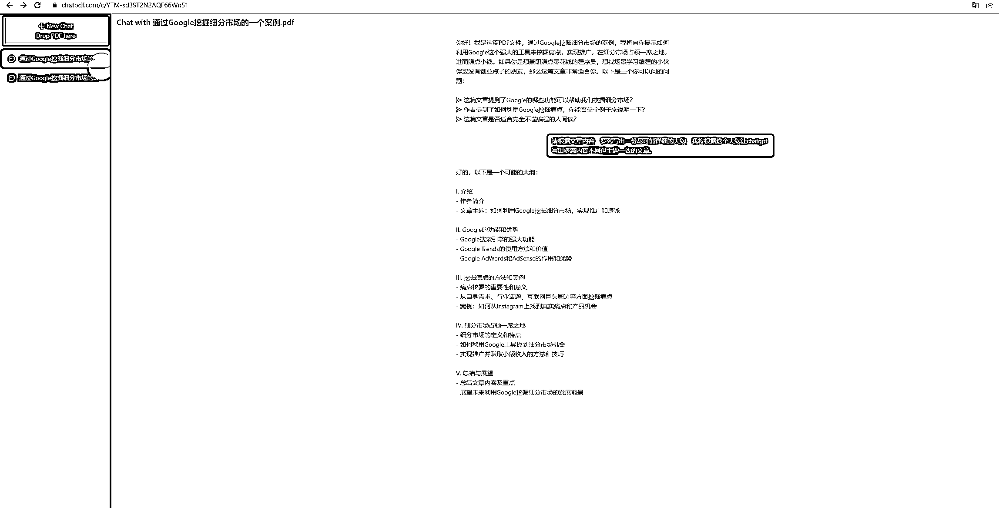
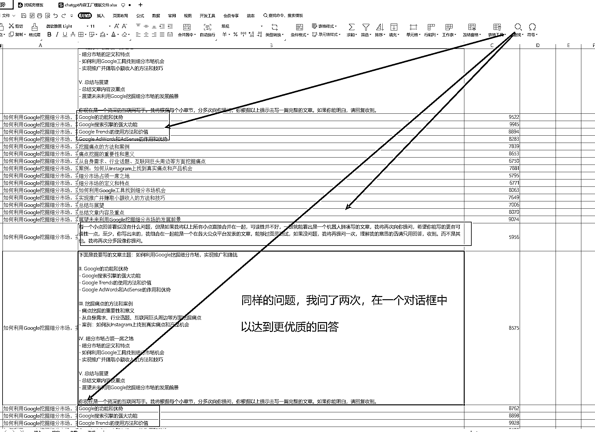
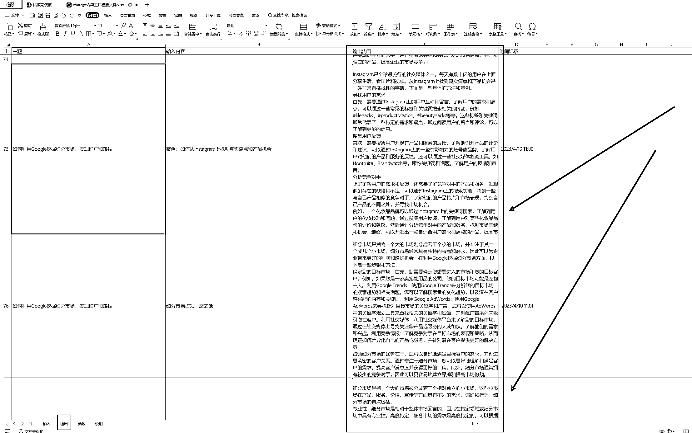

# 案例三：AI写作机器人1.0，流程自己跑

## 1、为什么做它

### 1）ChatGPT 卡在哪

ChatGPT 靠深度学习训练出来，本事覆盖不少内容场景：能写稿，能按兴趣给内容推荐，能做跨语种转换，能压缩长文重点，也能给文章归类。初看像产品说明书，但别急着划走——后面提取大纲要靠它；只有把它和自动化流程接上，创作才会从“人盯着”变成“机器自己跑”。这些能力确实能提高产出效率与质量。

真正动手写，麻烦就来了：

- 写到半截突然没下文；
- 叫它接着写，前后文常断线，严重时直接跑偏；
- 问题和答案得自己来回搬；
- 对话一多，整理成本直线上升；
- 历史问答不会自动落盘；
- 请求频率与数量都有限，靠多账号、多浏览器轮换，还得有人守着处理卡顿与报错。

说到底，ChatGPT 本事不小，但很多环节仍要人动手，只能算辅助工具。

### 2）ChatGPT 更像 AI 时代的地基

从蒸汽动力到电力，再到电脑和网络，每个时代都有支撑它的底层设施；到了 AI 时代，ChatGPT 也扮演类似角色。但“人工智能”并非新词，1956 年就被提出。许多企业早早投入研发，团队、资金、技术都不缺，自动化对它们并不难。

ChatGPT 是首款面向大众的 AI 产品，普通用户却要忍受很多重复又机械的步骤。大公司有程序员和研发队伍，搭自动化很容易；而 ChatGPT 本身像一块“建材”，得和其他工具拼起来，才会变成真正好用的自动化利器。

对刚接触一两个月的人来说，既没有开发团队，也没有预算，怎样让它看起来像个智能产品，而不是需要人一点点带的“小可爱”，就成了很现实也很紧迫的问题。

### 3）RPA 加 ChatGPT，把创作流程跑成无人值守

市面上常能看到“ChatGPT 一次做几百条小红书笔记”“一次产上千条抖音脚本”之类的宣传，可实际操作时，光把几百个问题、几百个答案来回拷贝、黏贴，就够让人崩溃。也正因如此，这类说法通常不敢承诺全流程无人值守。

## 2、先配好你的首个 RPA 机器人

这套方案底层借助 RPA 这类低代码工具，所以先花几分钟把机器人配置跑通，后面用起来才顺。

### 1）安装 uibot

uibot 安装教程（生财有术）

### 2）上手首个 RPA 机器人：批量联系微信好友（生财有术）

上手首个 RPA 机器人：批量联系微信好友（生财有术）

## 3、1.0 版怎么用

### 1）源码

https://t.zsxq.com/0cC5e4Pkn

### 2）搬文件、填参数，不用写代码

操作顺序不复杂：把工具压缩包放到顺手的位置并解压；用 uibot 载入机器人文件夹；借 listary 调出“ChatGPT 内容工厂”模板；最后按自己的需求填入内容。

RPA 机器人的门槛很低，核心就是文件搬运、黏贴和填参数，不会写代码也能用。压缩包不会处理的话，回看“上手首个 RPA 机器人：批量联系微信好友（生财有术）”。

这套 1.0 能做的事：

- 自动产出文章；
- 续写过程不用人催；
- 每段续写结果会分段存档，后面对不上逻辑时方便拼回去改；
- 全部跑完后，问答记录自动写进 Excel。

它比 3.0 弱一些，但能力并不寒酸。其他版本的情况，生财有术里有说明。这里没必要吹得太满，因为再夸也没意义，别人看它，无非关心值不值。按发行方定价，50 个打包不到 500 元，摊到单个约 10 元。

### 3）跑起来的录像

[4 月 7 日 RPA 帮内容工厂 chatgpt 超级写手 1.0.mp4](https://search01.shengcaiyoushu.com/upload/doc/CWXpde77HoNk0lxKRfScEkWAnwf/DB5KbawPXolWWvxDWsYc8fPxn9g)

## 4、实战：让 1.0 重写一篇文章

拿一篇讲“怎么用 Google 找细分市场、做推广并变现”的文章做样本，交给 ChatGPT 重写。

**第一步：用 ChatPDF 提炼大纲**

www.chatpdf.com

**第二步：把大纲放进模板表格**

演示时正赶上午饭，没来得及再跑一轮调优；这里展示的是模板用法，大家按自己的场景改就行。

**第三步：问答都返回后，逐段整理答案**

有人偏爱让模型一次性吐完整篇，但未必合适。模型偶尔前后不一致、逻辑断裂，全拼在一起反而不知从哪改。

演示视频

[4 月 10 日 chatgpt 超级写手机器人实战案例-谷歌挖掘细分市场.mp4](https://search01.shengcaiyoushu.com/upload/doc/CWXpde77HoNk0lxKRfScEkWAnwf/ZiqIbA98po1g9uxCgUZcnriSnZg)

## 5、收个尾

用上这套工具后，ChatGPT 不再像“小可爱”，也不只是等人调教的电子宠物。

本文讲的是 1.0。对 99% 的创作者来说，这个版本已经够用。开发者阿愚呱呱透露，后续还计划做其他版本；后面的版本对大团队可能更有帮助，小个体是否有用还不好判断。

内容来源：《全自动，真批量——ChatGPT 超级写手机器人 1.0》

