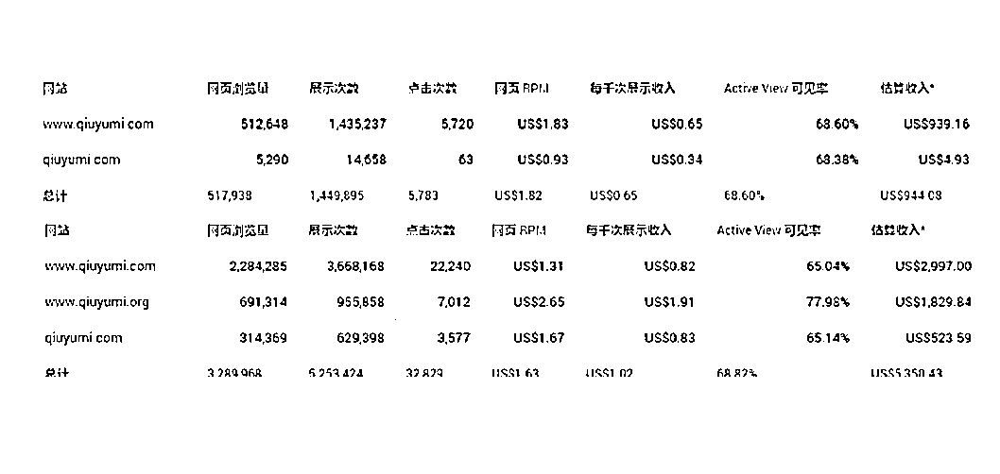

# 案例一：两周做出域名扫描站，广告费累计四万多

2009年，我从网上下载过一款桌面端域名扫描软件。用了几年后，我觉得它确实顺手：设定规则后，它能把不同词组合成大量域名，逐一查询注册状态，还会把尚可注册的挑出来。词库支持自己添加，只是软件没有预装现成词库。那几年，我陆续攒了拼音、区号、邮编、人名、水果、动植物等好几套词库。

2012年2月末，我冒出一个念头：域名圈里应该也有人被同样的问题困住，何不做个网页版？再把我的词库直接内置进去，大家不必再花时间搜集整理，打开网页随时都能查。想法落地用了约两周，第一版在3月7日上线，地址是 qiuyumi.com——这个域名还是用那款桌面软件扫出来的。

后来杂事一多，第二版拖了五年也没动工。我原本的规划是：加入账户体系，让用户能建自己的词库；提交查询后无需守着，有结果自动通知；再做定时任务，例如每天跑某个组合，发现可注册域名就提醒。围绕域名相关需求，还可以往秋玉米里补更多顺手的工具。

从上线到2019年，秋玉米总PV约380万，日均两千多。因为没添新功能，也没做推广，流量一直比较平稳。它终究是服务小众的工具，流量天花板不高，赚点零花钱没问题。累计广告费有6200多美元，折合人民币四万出头；跟投入的精力比，这个回报还算可以。

内容来源：《生财有术 #轻享栏目：做 Adsense 网站赚到 3 万美金的实操经验》

