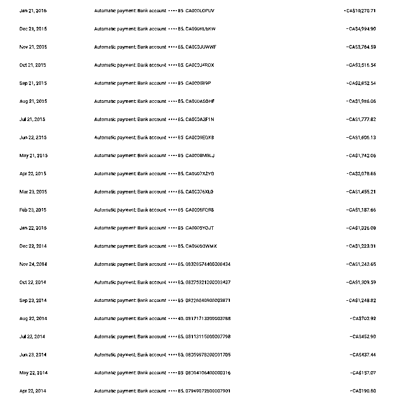
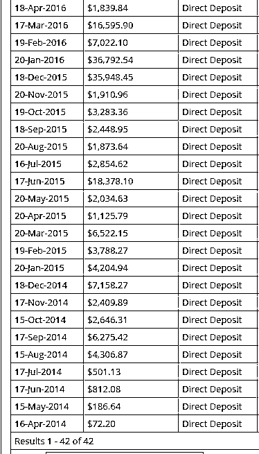

# 案例九：翻译老外博客，旅游站Adsense收入破万美元

今天拆一个老案例：3798.com 这个旅游站，以及它当年的赚钱路径。

先聊个大背景。现在流量入口基本被大平台把持。我在广告中国也提过，很多人只盯着Facebook、Google投放赚钱的故事，却很少有人讲投放亏损面能超过90%。预算能花只是入场券，优化和杂项才是真门槛；如果连个站点都搭不起来，就算机会同时摆在所有人面前，钱也很难轮到你。

相比之下，建站是启动成本很低的切入点。白天正常上班，晚上回家抽个把小时维护，Adsense和广告联盟的进账会肉眼可见地涨起来，甚至超过工资，而且这种收入偏被动、能持续。圈子里真正做过产品、把站点做到日PV几十万的人其实不多。下面这张图，就是3798.com从零收入到单靠Adsense突破一万美元的记录：

为什么4月才见收入？因为网站2月才开做，到4月才达到起量门槛；这些数据用网站历史工具都能查到。做法本身不复杂，核心参考是 loyaltylobby.com/ 。那位老外更新很勤，每天只发一篇，我就把文章译成中文，图片另存或简单裁切后放到自己站上。一般半小时收工，代价是几乎365天不断更。万一他当天没更新，我就去 boardingarea.com/ 或 www.flyertalk.com/ 找素材。

每天超过一小时我就觉得吃力。后来站里人多了，我用Discuz搭起论坛，靠UGC（User Generated Content）模式运营。高峰时拿走了飞客论坛约67%的流量，日发帖量在4000到10000之间。

项目成本也不高：服务器是2H4G的阿里云，后期上了OSS和CDN，数据库再拆到云数据库。我们早期用阿里云，很多价格比现在低不少；即便按现在的价格，每月开销也不超过2000元人民币。对照高峰收入看，流量越大服务器越贵，但这笔成本反而越可以忽略。

除了Adsense，CJ等广告联盟也带来了收入：

原帖地址：ads.org.cn/thread-34407-1-1.html

有兴趣可以翻翻早年的教程，我觉得不少东西今天仍未过时：ads.org.cn/forum-101-1.html

内容来源：《3 个单人就能做的赚钱案例，告诉你怎么通过互联网在海外淘金？》

