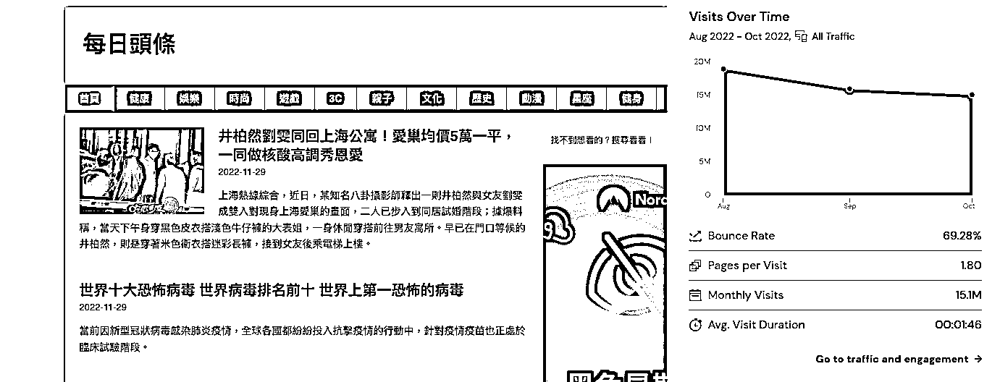

# 案例十五：关键词铺得够广，流量就没有上限？

小排老师写过一篇《0 资源，做出 3 个日 UV 过十万、7-8 个日 UV 过万的网站，分享我获得无限网站流量的秘籍》（https://t.zsxq.com/BeiemMB）。还没读过的圈友，建议抽空看看，里面的思路很有启发。

我的理解是：一个站点能拿到多少流量，上限取决于它能覆盖多少关键词，以及每个关键词背后有多大流量。总流量由两层相乘：可覆盖的关键词数 × 单个关键词的潜在流量。所以，想做出“无限流量”，难点就落在两件事上：能锁定多少关键词，以及能否持续产出这些关键词所需的内容。

下面拆两个案例。先提醒一句：重点看思路，不必照搬抓取别人内容——对方很可能不授权。

网站一是 kknews，入口为 [`kknews.cc/`](https://kknews.cc/)，成绩是月 PV 破千万的内容农场。

它的关键打法可以拆成四点：1. 用程序抓取微信公众号文章；微信有反爬，普通搜索通常搜不到这些内容。2. 将简体转为繁体后发布；在搜索引擎眼里，这更接近原创内容。3. 站内文章之间互相链接，关联做得紧密，而且不少文章图文丰富、质量不差。4. 主题覆盖面很大，各类关键词都能接住。

网站二是批踢踢（PTT）系站点，入口为 [`www.ptt.cc/bbs/index.html`](https://www.ptt.cc/bbs/index.html)，这一系列站点的总流量突破千万。

PTT 由台湾大学管理，几十年前出现，至今仍是台湾最大的线上论坛之一，类似美国的 Reddit。网友在篮球、韩纵、美妆等分类版大量发帖，几乎汇集了各主题的问答。

做 SEO 也好，做任何网站也罢，本质上都在服务“问答”需求，所以 PTT 里的内容很有价值。于是有人这样操作：1. 按分类把 PTT 内容抓出来，让内容聚焦在特定主题，对 SEO 更友好。2. 抓取文章后，重新优化原 PTT 的标题和描述。3. 加强文章之间的内部链接。

后来市面上出现了不少由不同人持有的 PTT 复制站，其中很多流量都突破百万 PV。

内容来源：12 月 2 日《在生财有术开启月入过万的工具站之旅》@阿杰

