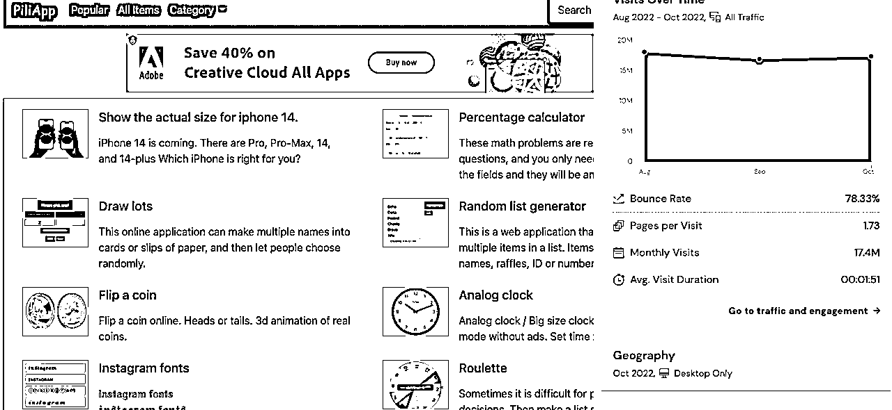

# 案例十六：多语系工具站 @阿杰

网站名称：工具邦、网址：[`www.piliapp.com/`](https://www.piliapp.com/) 、成绩：月流量破千万 PV 的多语系工具站

我自己盘点了一下，做工具类网站的好处大概有这几个：

1. 从关键词竞争度来看，门槛比纯靠文字内容满足搜索需求的站点要低（既懂代码又懂 SEO 的选手本来就不多）
2. 多语系能带来额外流量，因为很多工具全世界都在用
3. 不容易被 Google 的 zero-click 策略“截胡”（Google 经常直接把答案展示在搜索结果里，导致用户压根不点进网站）
4. 单位广告收入通常比内容站更高（页面上的点击和操作更多，广告位的曝光和点击机会也跟着变多）

说到典型代表，我第一个想到的就是 [piliapp.com](http://piliapp.com/)（工具邦）。这个站每个月能扛住好几千万的 PV，而且工具站本身的变现潜力往往也优于普通内容站——用户在页面上不停点击、操作，顺手点到广告的概率自然更高。

工具邦的流量确实让人眼红，但更关键的是，人家可不是一夜之间做起来的。我几年前就开始留意它了，当时它的流量就已经相当惊人。可最近再看，它竟然还在不停地改版优化，从外观到整体架构都没停下过。

很多工具站做起来之后就放着不管了，毕竟我猜工具邦的开发者月收入早就是十万美元以上的级别（欧美流量占比高，单价自然也更香）。但他依然在持续开发新功能，甚至还做了不少偏门的小工具，比如台湾捷运时刻表、数字大小写转换这类需求，照样老老实实地补上。

内容来源：12 月 2 日《在生财有术开启月入过万的工具站之旅》@阿杰

