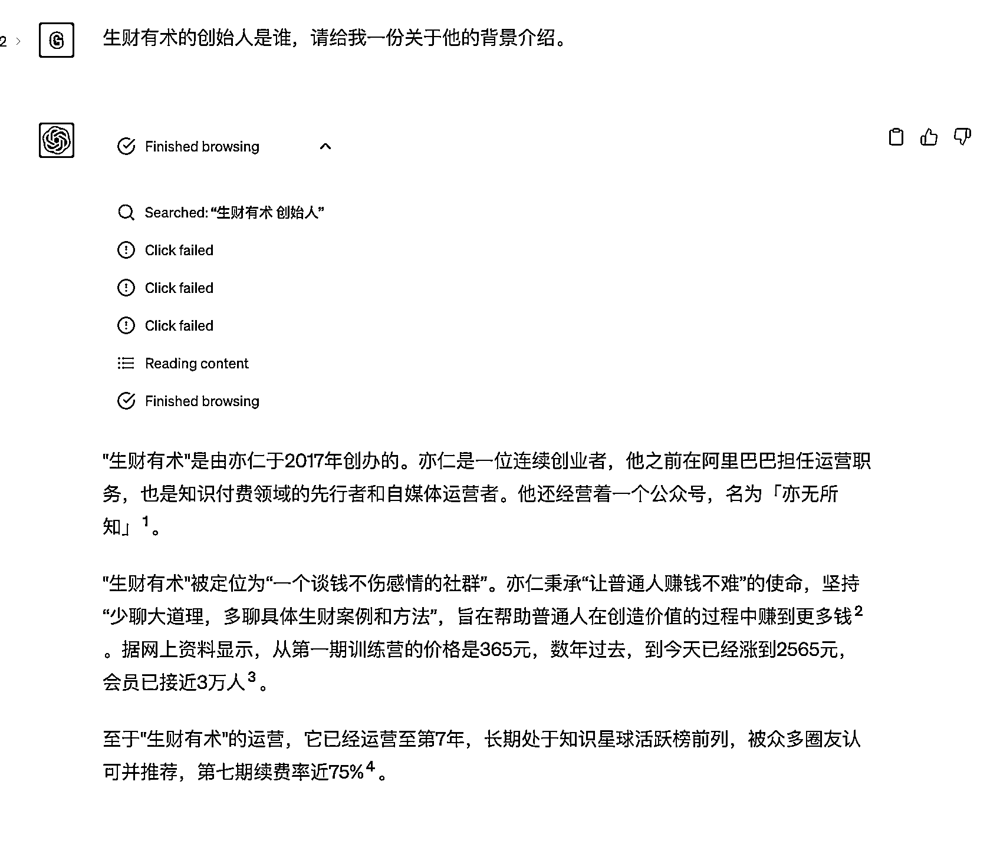

# 2.1 ChatGPT Plus 究竟强在哪？

ChatGPT Plus 是 OpenAI 推出的付费进阶服务。和免费版（也就是普通版）相比，Plus 版在模型参数规模与运算能力上都有明显提升，因而能够输出更丰富、更复杂的回答内容。同时，它在对话处理方面也更胜一筹，可以应对更长的上下文，支持更复杂的多轮交流。

值得一提的是，从 5 月 16 日开始，ChatGPT Plus 已经接入了联网功能。你可以直接向它询问最新发生的事情，它会自行检索并整理信息，最后给出一个相对可靠的答案。

不过也要留意，Plus 版对对话次数做了限制，目前规定是每 3 小时最多使用 25 次。另外，当前版本的 ChatGPT 并没有真正意义上的上下文记忆能力，因此它并不适合用来训练或处理篇幅很长的内容。

如果你觉得每个月大约 20 美元的花费不算什么负担——差不多相当于一顿饭的钱——那完全可以考虑升级到 Plus 版。

