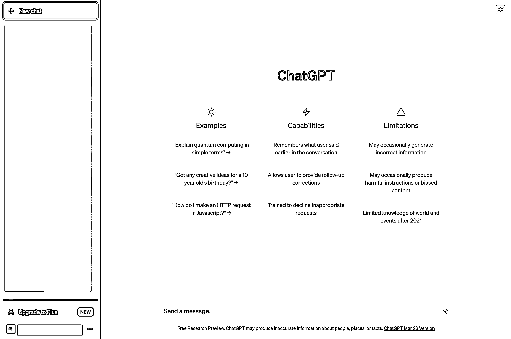
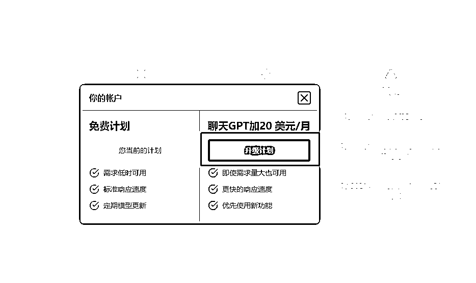
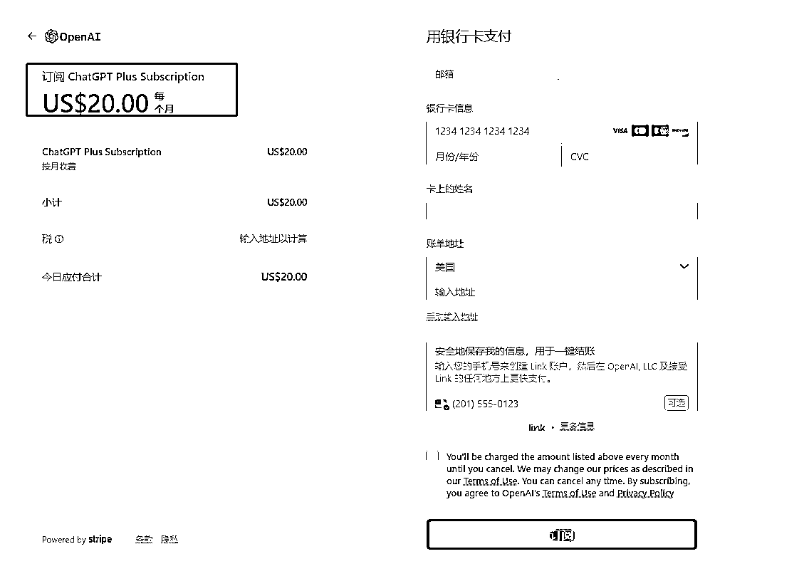
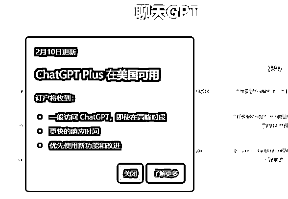

# 2.3 拿下 ChatGPT Plus 的两种方式

想用上 ChatGPT Plus，目前常见做法有两条：给现有账号升级，或者重新注册一个美区账号。下面分别说清楚。

**给已有账号升级**
登录账号后，页面通常会弹出升级 Plus 的提示。点“升级到 Plus”，就能进入会员方案选择页。

进入会员选择界面后：

目前开通 Plus，免税州月费为 20 美元，非免税州也差不多在 20 美元/月，约合 135.68 元人民币。付款需要境外信用卡。

如果人在国内、手头没有国外信用卡，也可以尝试用 DePay 虚拟卡来付费，大致流程如下：
1. 注册 DePay，并开通虚拟卡：depay.depay.one
2. 通过朋友或 Binance、OKX 等中心化交易所买入 USDT。
3. 把 USDT 提到 DePay 账户。
4. 在 DePay 里将 USDT 兑成 USD，充入虚拟卡。
5. 去 ChatGPT Plus 付款，账单地址尽量选美国免税州（比如中转地址）。

**重新注册美区账号**
另一种做法是重新注册账号：把账号位置选为美区，手机号和原生 IP 也都使用美区的。这个办法不保证百分百成功，但有一定概率能拿到 Plus 资格。

P.S. 美国未来有可能向所有用户开放 ChatGPT Plus。

