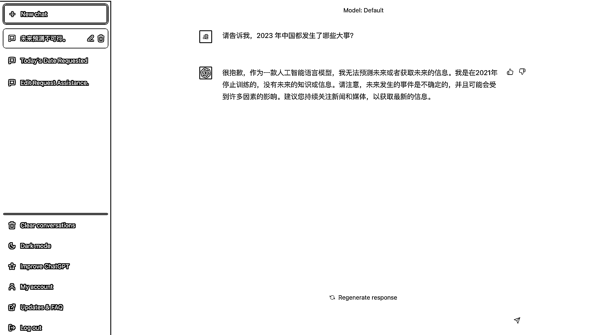

# 3.1 ChatGPT 能做什么，又做不到什么

先看 ChatGPT 具备哪些能力。它能结合对话的上下文来理解意思并作答；面对用户提出的问题，它会尝试给出回应；它还能吸收新知识，并把学到的东西用在后续问答和交流中；支持多种语言，中文、英语、西班牙语、法语、日语等都能处理；遇到较复杂的问题，它也会努力拆解，用更容易懂的方式说明；同时，它的应用场景并不单一，智能家居、智能客服等场景都能借助它来解决问题。上述特性说明来自 ChatGPT。

不过，免费版有一个时间边界：它的数据来源只到 2021 年，此后发生的事情，免费版目前完全不了解。

（免费版 ChatGPT 界面）

此外，免费版目前不具备查找能力。它不能连接互联网、搜索引擎、数据库，也不能调用自身模型之外的任何信息源；事实核验、提供参考资料、执行计算或翻译这些事，它都做不了。它给出的内容只能基于内部知识与逻辑推演生成。因此，若要确认事实，一方面要喂给它更准确的资料进行训练，另一方面还需要人工核对、确认结果。

付费版 ChatGPT Plus 从 5 月 16 日起逐步支持联网，能够借助互联网等模型外部信息来源进行学习，从而生成更新、更准确的回答。但网络信息量庞大，稳妥起见，仍建议给出更明确的检索方向，并对结果做人工复核。

