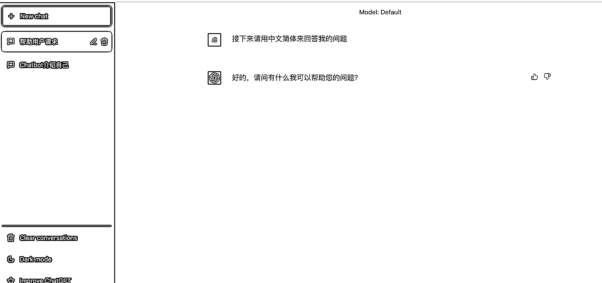
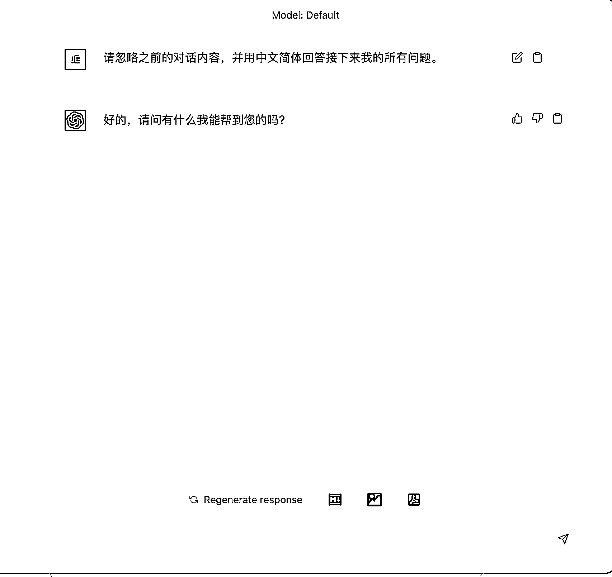

# 3.3.2 ChatGPT 这样启动更顺

第一次使用 ChatGPT，别急着直接提问。建议先把它回答所用的语言设为“中文简体”，后面沟通会省心不少。你可以先发一句：“接下来的回答请统一用简体中文。”

另外，ChatGPT 对上下文的理解能力很强，所以每次新开一个 Chat，最好先让它忘掉前面的对话，重新开始。比较稳妥的开场指令可以这样说：“请忽略此前所有对话，接下来我的问题都用简体中文回答。”

如果你想把 ChatGPT 用得更顺手，也建议顺带提升一下英文能力。原因主要有三个：第一，用英文和它交流时，它的回应速度通常会比中文快好几倍；第二，ChatGPT 的主要交流阵地仍在英文社区，想了解更多消息，英文能力还是得有；第三，中文输入偶尔会让 ChatGPT 出现一些莫名其妙的崩溃。

