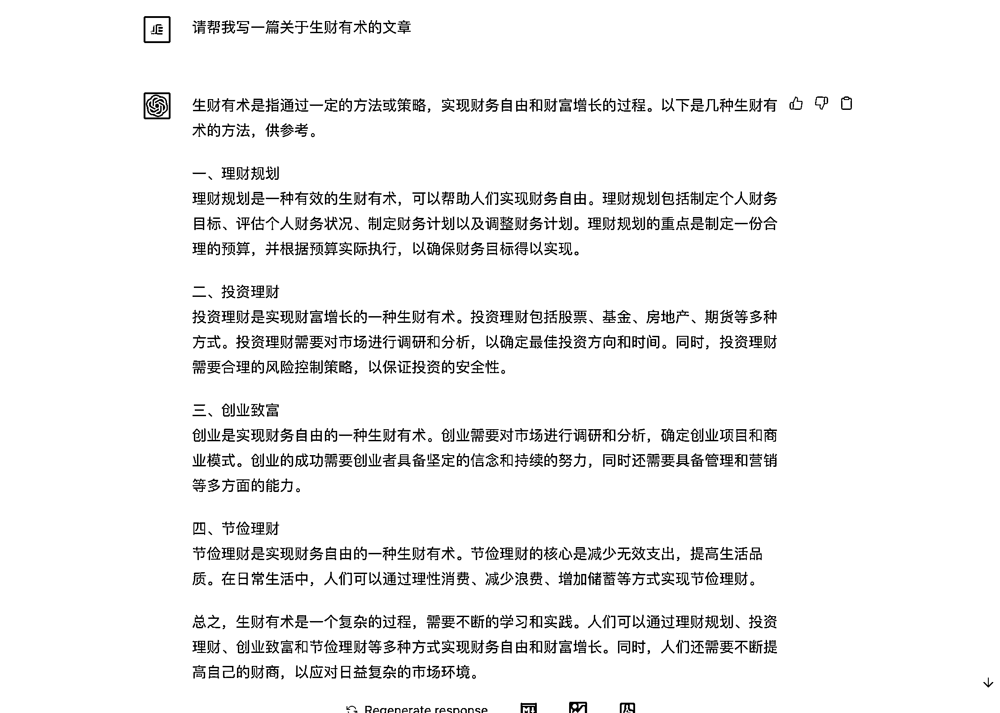
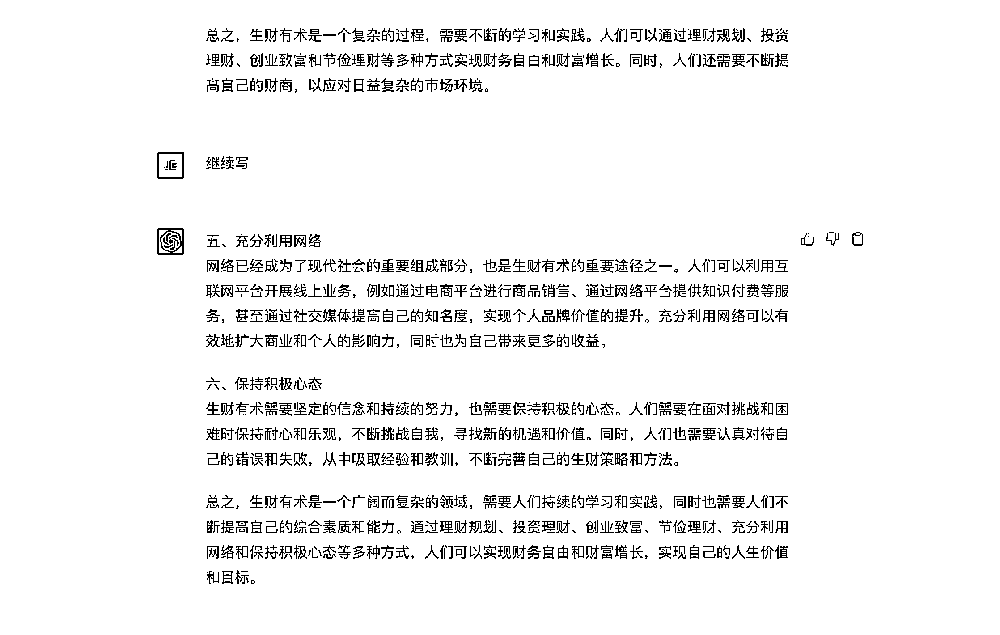
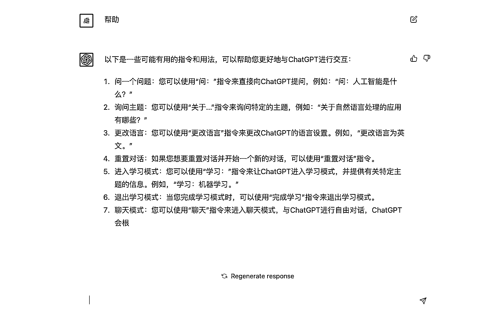

# 3.3.6 指令用对，ChatGPT 更贴合预期

如果 ChatGPT 给出的回答没达到你的设想，不必将就。你可以用指令去修正它、扩展它，让结果逐步靠近你真正想要的答案。

最常用的一个词是“继续”。它有两层用法：一是让 ChatGPT 沿着已有内容往下展开；二是让被中断的回答接着说完。不过后一种情况眼下有个小 bug，可能出现上下文衔接不上的问题。

想避开这个坑，就别只丢“继续”两个字，而要把“继续”和具体动作绑在一起。比如：继续写、继续翻译、继续提炼。

另外几个高频指令也值得记住：
• Clarify：把内容澄清、讲明，让它更容易理解；
• Exemplify：用例子来说明；
• Expand：在原内容上扩写，补充更多信息；
• Rewrite：重新改写内容；
• Shorten：压缩、精简内容。

这些指令在 3 种模式下都能用。用熟之后，ChatGPT 产出内容的满意度会明显提升。

除了通用指令，这里还整理了文案创作和 AI 绘画相关指令。想进一步了解，可以查看「7.1.1.3 ChatGPT 中和文本创作相关的指令」以及「7.2.3 ChatGPT 中和 AI 绘画创作相关的指令」。

当然，ChatGPT 的指令远不止这些。想解锁更多，可以先掌握一部分，再输入：帮助，获取更多 ChatGPT 指令。

