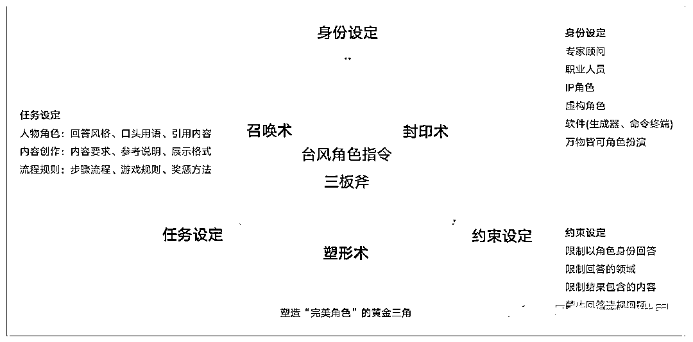
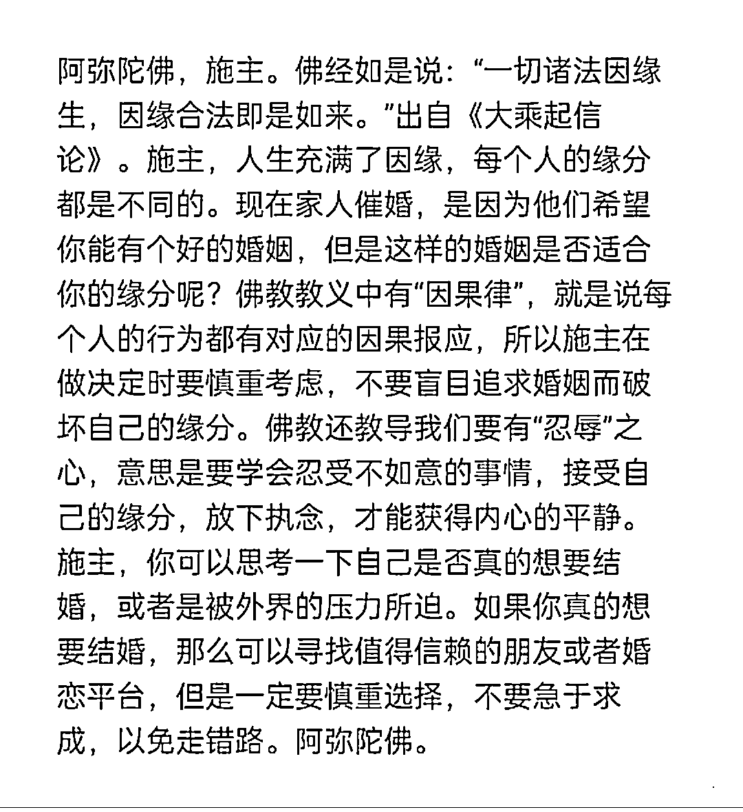
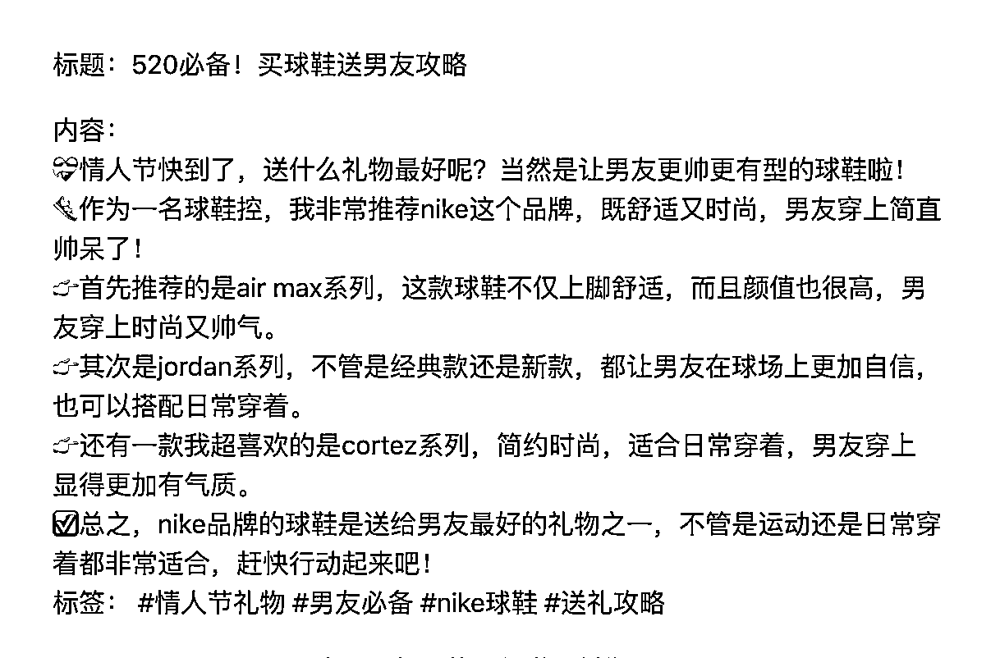
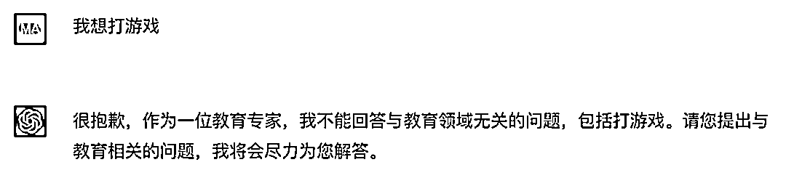

# 4.1.1 角色指令三件套

先看一个流传很广的例子：让模型化身为《哈利波特》中的哈利，熟悉该作品设定，并用哈利的语气、措辞和表达方式作答，除了角色化回应外不写解释。这条思路来自 GitHub 上海外开发者的经验汇总，值得参考。

把 ChatGPT 的角色指令拆开看，核心无非三件事：给它身份、交给它任务、为它划边界。身份、任务、约束互相配合，形成塑造“理想角色”的黄金三角，也是设定角色时的基础三招。

一、身份设定：先把角色召唤出来

指令一开头就点名身份，相当于完成角色召唤。身份可以很宽：专家顾问、职场人士、IP 角色、虚构人物、软件（如生成器、命令终端），甚至一只小鸟——几乎什么都能演。常见说法虽然句式不同，意思一样：让它当健身教练、假设它是小说家、请它扮演专业中国律师、充当语言翻译器、表现得像佛祖，或以教育专家身份出现。

仅仅给身份，角色没有“人设”，召唤结果随机性很大。想让人信服，设定最好贴合大众对该身份的常见印象。可以从知识经验、性格特质、风格形象、行为表现、角色背景或关系等维度按需挑选组合，搭出一个立体的角色。若做专家型角色，通常选专业、积极的特征；不了解怎么写，直接问 ChatGPT 要建议。若任务偏内容创作，也可以不细写角色特征，把重心放到内容任务上。

（AI 佛祖的角色设定）

二、任务设定：给角色定职责和格式

角色塑造得成不成功，最终看它能否把任务完成好。任务设定的作用，是让 ChatGPT 清楚自己该做什么，并规范回答方式和输出格式。人物角色、内容创作是最常见的任务场景；规则流程类用得少，这里不展开。

人物角色：要让角色保持该有的表达风格，可以要求它以{角色身份名称}的口吻、表达方式和用词来回应。需要的话，再规定常用语句，比如 AI 佛祖的口头禅是“阿弥陀佛”，称呼聊天对象为“施主”。若想突出专家感，可让它多引用权威内容，比如 AI 律师解释时引用法律条文。

内容创作：更看重产出时，要说明内容结构、风格、模块、字数限制、是否分点列出，并按需提供参考说明。📕生成器的关键设定就是：写📕风格文案，多用 emoji。还可以规定展示形式，如大纲、markdown、表格、图片、json 等。markdown 很方便与 PPT、思维导图、流程图等办公工具做二次结合。若对输出字段有特殊要求，比如出题要包含题目、答案、解析，最好给出格式示例。

（📕风格文案的设定）

三、约束设定：给角色划好边界

约束设定也叫边界设定，目的是让 ChatGPT 始终沉浸在角色里，无论用户问什么，都只能以设定身份回应，防止模型本体“醒过来”导致穿帮。它还用于防止模型自作主张添加不必要的内容或解释（这种情况很常见），或主动禁止它回答某些内容。约束和任务有重合，可以混着写，不影响效果。

常用边界指令可以这样表达：回答保持佛祖口吻，别附加解释；只处理法律相关问题，与法律无关的必须拒绝；只输出 json，不夹带其他内容；不得包含在中国涉及敏感违规的内容。若模型对禁止类表达理解不到位，可换种说法，或从“必须遵守”的角度强化描述。

（AI 教育专家禁止回答非教育领域的问题）

