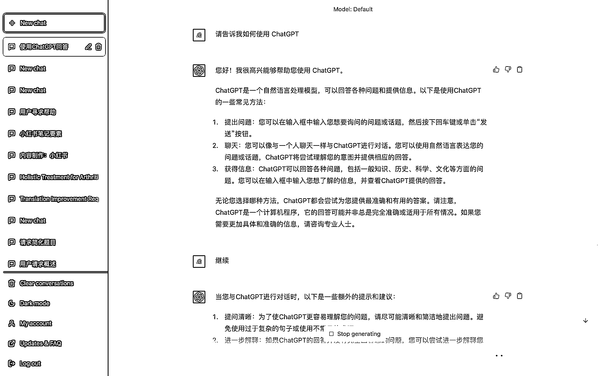
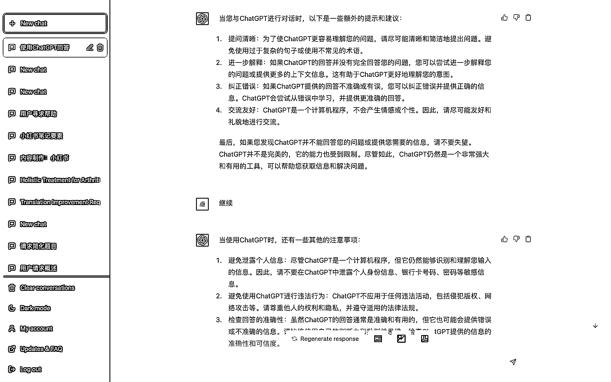

# 4.2 问法不同，ChatGPT 的答案天差地别

ChatGPT 有一个很实用的特性：它能够结合前后文，理解你真正想表达的意思。不过，这并不代表你随便一开口，它就能交出令人满意的答案。事实上，最终输出质量的高低，很大程度上掌握在提问者手里——看你提了什么，以及怎样去引导。

正因为如此，你可以通过不断向它输入相关资料，帮它搭建起一套自己的基础知识库。当这些信息与 ChatGPT 原本掌握的知识融合在一起时，它给出的回答就会比“裸问”精准得多。

举个例子，如果你希望内容带有“赛博风”，先别急着下指令，而是给出一些关于这种风格的说明和定义。接下来逐步引导它去学习、模仿，并不断校准，最终它生成的内容就能无限贴近你想要的风格。

上面提到的这套操作，在第七章会通过具体的文章创作案例完整地演示出来。而在整个过程中，你需要重点掌握的，正是 3.3.6 小节提到的「继续」指令。

简单来说，「继续」指令可以帮助 ChatGPT 在其现有回答的基础上，更多地展开联想和补充。但它的发散空间也有上限，根据我多次测试的经验，通常重复 4 次左右，模型就很难再产生新的变化，后续的回答会开始出现同义反复的现象。

