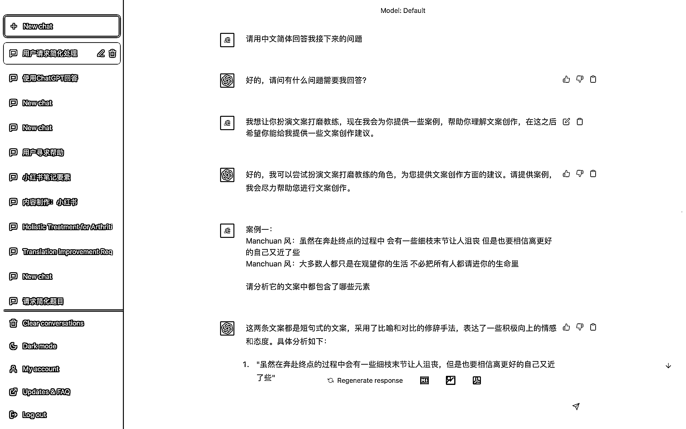
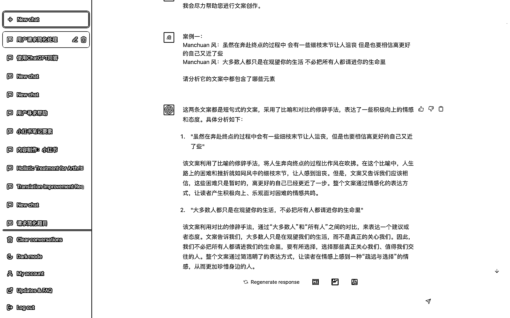
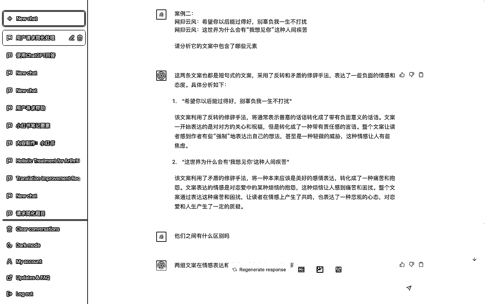
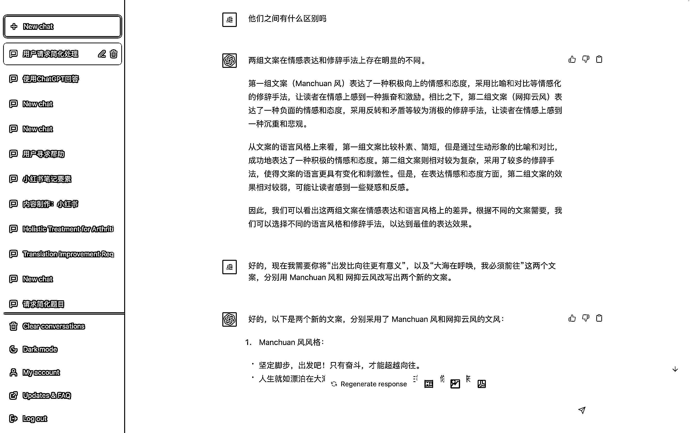
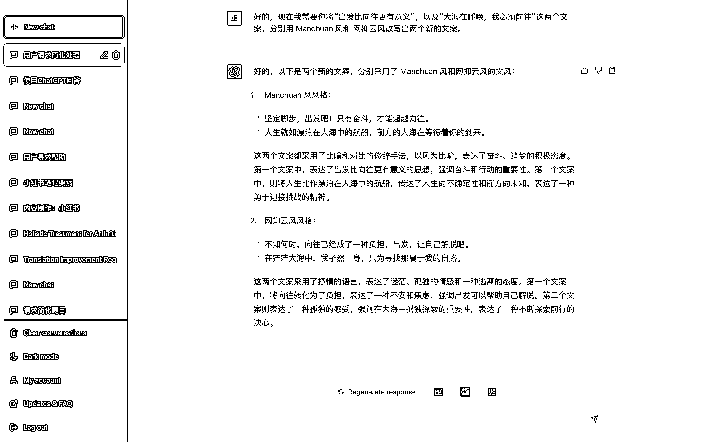

# 4.3.1 先聊够，再提问（推荐）

想让 ChatGPT 更准确地接住你的问题，一个很实用的办法是：在正式发问前，先放入足够多的对话内容，让它逐步吃透相关文本中的定义。

这些前置交流相当于给模型提供语境线索。它会在大量对话里梳理上下文，再结合这些信息去理解你真正想问什么，从而给出更贴合、更准确的回答。

还有一点别忽略：既然 ChatGPT 能借助上下文来读懂你的问题，那就不太适合在同一个 Chat 里塞进多个主题。更稳妥的做法是让每个 Chat 只围绕一个主题展开。

