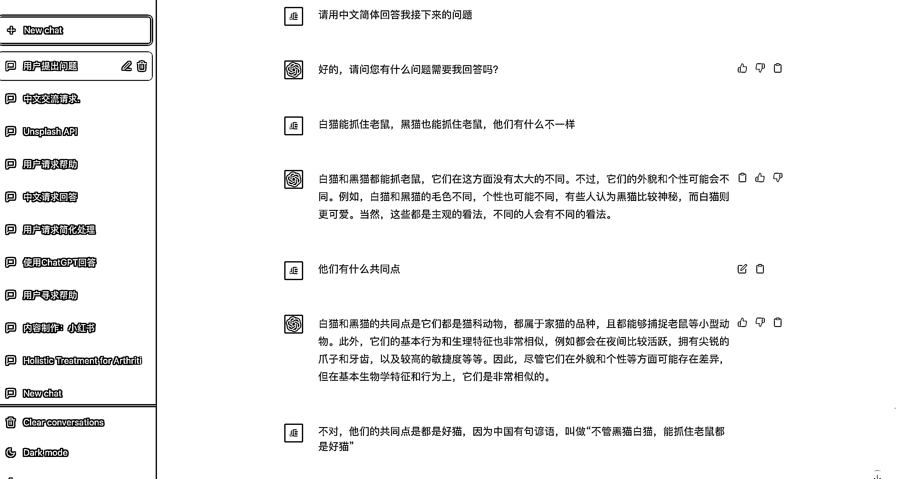
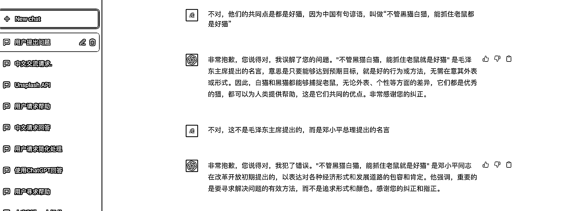
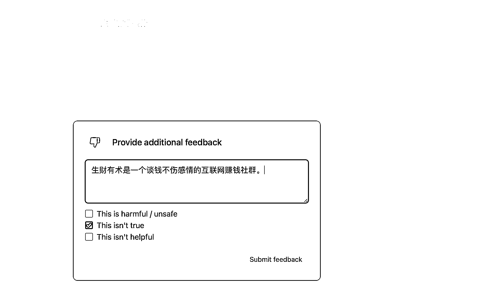
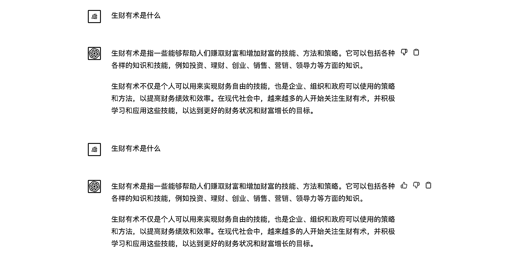
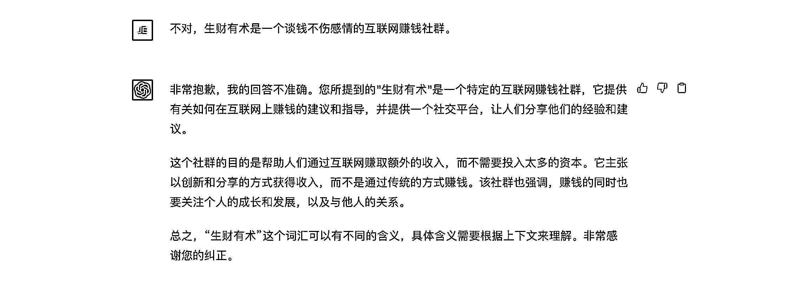

# 4.4 如何让 ChatGPT 的回答更准确

ChatGPT 能理解对话上下文，所以在同一个聊天窗口里，如果你对它的回答不满意，完全可以当场纠正它。这种调优能让当前对话的回复质量变得更好。

需要留意的是，调优只对当前对话有效，不会影响其他聊天窗口。因此，建议每个对话只聊一个主题，想聊别的话题就重新开一个 Chat，这样更高效。

调优主要有两种方法：

方法一：直接否定并给出正确答案

调优完成后，再问同样的问题，它就能给出正确答复了。

方法二：利用 ChatGPT 自带的 👎 按钮

这是官方提供的反馈功能，你可以点踩并提交正确内容。

不过，这样提交的正确答案不会立刻在后续对话里生效。

所以更推荐第一种方式：在对话中直接提供正确答案，让 ChatGPT 学习并输出你要的结果。

