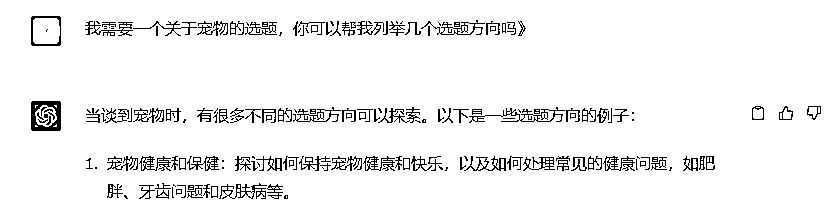
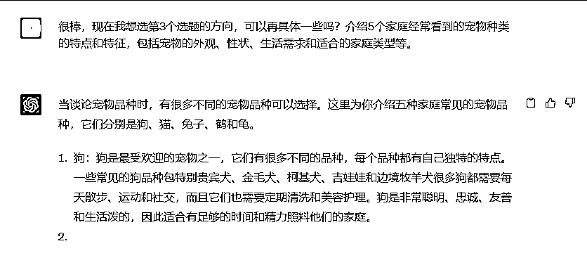

# 6.2 一句提示，换来一串选题

想让 ChatGPT 帮忙找文章题目，不必把指令写得很复杂。给出一个轻量方向，它就能开始发散。具体可以这样操作。

先丢给 ChatGPT 一句简短提示，或抛出一个小问题，例如“健康饮食话题”或“写作技巧的提示方式”。接着，结合文章体裁与目标读者，挑选合适的模型和参数。然后按下生成键，它便会围绕这句提示产出若干选题。你可以从中挑一个或几个，也能把结果当作跳板继续发散。

拿到初步选题后，不妨用关键词和主题词继续往外扩，让选题更有深度，也更有广度。常见做法有三：其一，借助关键词类工具或搜索框，把与选题相关的词和短语搜罗出来；比如写健康饮食，就搜“健康饮食”“饮食习惯”等词，顺藤摸瓜找到更多相关表达。其二，用主题词表或分类体系做延展；比如写科技趋势，可围绕“科技”“趋势”等主题词向外扩展。其三，调用 ChatGPT 的文本生成功能，把关键词和主题词交给它，让它自动扩写更多文章内容，从而把选题挖得更透。

这些内容出自 ChatGPT。

再举个简单例子。先定一个创作大方向，比如“宠物”“美食”“汽车”，让 ChatGPT 抛来几组选题方向。数量由你定，也可以放手让它自由发挥。

若这些方向不合心意，就补充更多你期望的选题特征，再让它继续给新选题。若其中出现不错的方向，就进入下一步，让它围绕该方向给出更细的内容。

