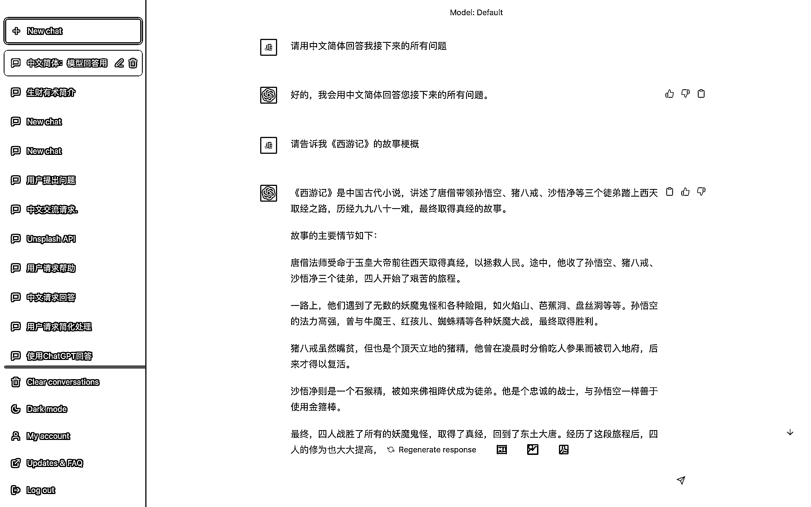
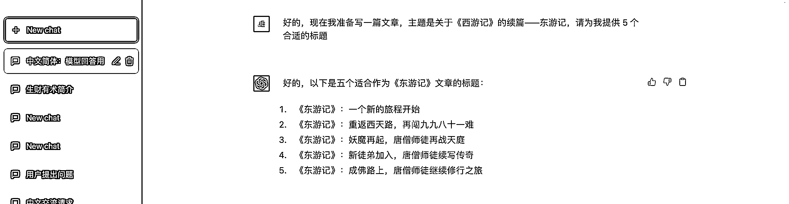
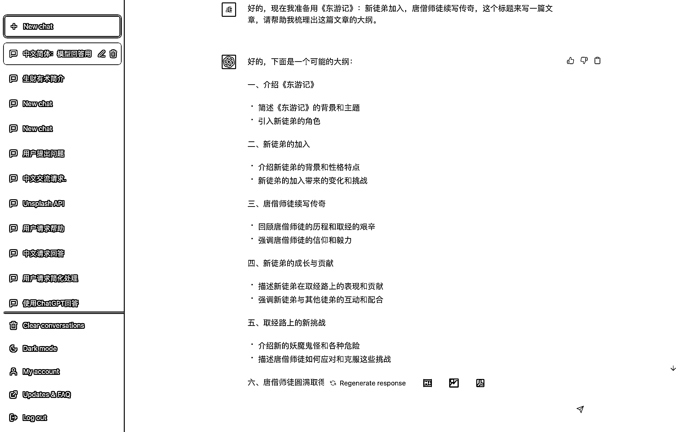
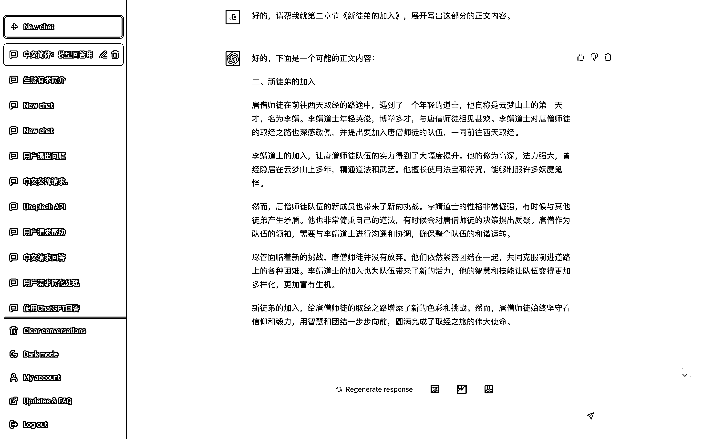

# 7.1.1.1 从零开始：让ChatGPT无中生有写长文

ChatGPT本身并不擅长一口气写出长篇内容，但我们可以利用它对上下文的理解能力，通过有步骤地引导，让它一步步把内容“挤”出来。下面就以《西游记》续篇《东游记》为例，看看怎样用几句提示词，让ChatGPT从无到有完成一篇完整文章。

第一步：先做前置对话，让ChatGPT准确领会你的需求

第二步：给出主题，让ChatGPT想出一个合适的文章标题

第三步：让ChatGPT根据标题列出文章大纲

第四步：让ChatGPT按照大纲逐小节展开写作

后面的操作其实就是重复第三步，不断让ChatGPT对照大纲把各部分内容写出来就可以了。

简单归纳一下，常规的创作流程就是：

•前置对话

•生成标题

•生成大纲

•生成正文

其中前置对话最不能忽视，它基本决定了ChatGPT后续给出的内容是否合你心意。

另外还要提醒一句：如果想让ChatGPT对已有内容做润色，最好把要修改的段落复制到一个新的对话窗口里，让它在那边专门润色，不要在原对话里直接改。因为原对话如果积累了太多文本，很容易让ChatGPT理解偏你的意思。