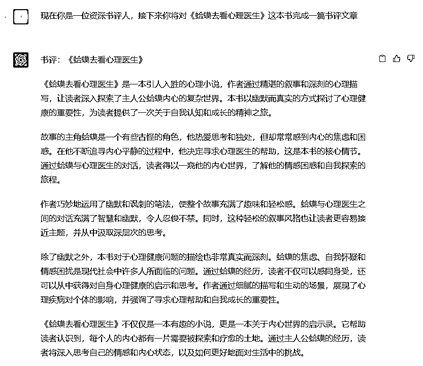
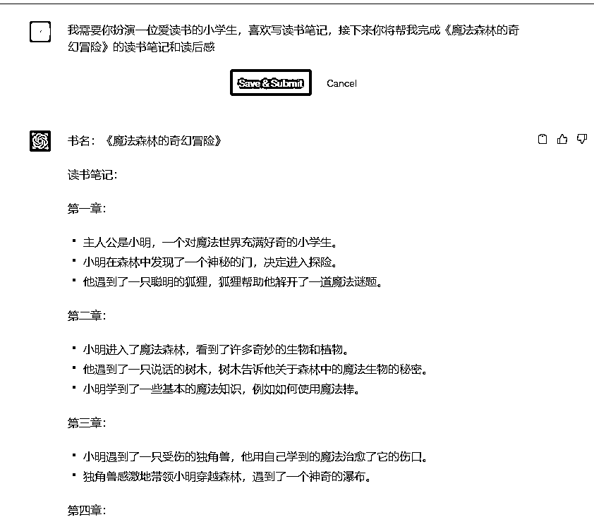
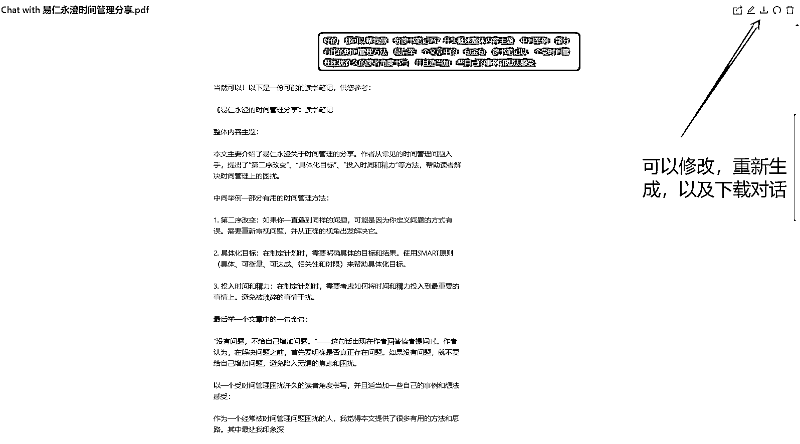
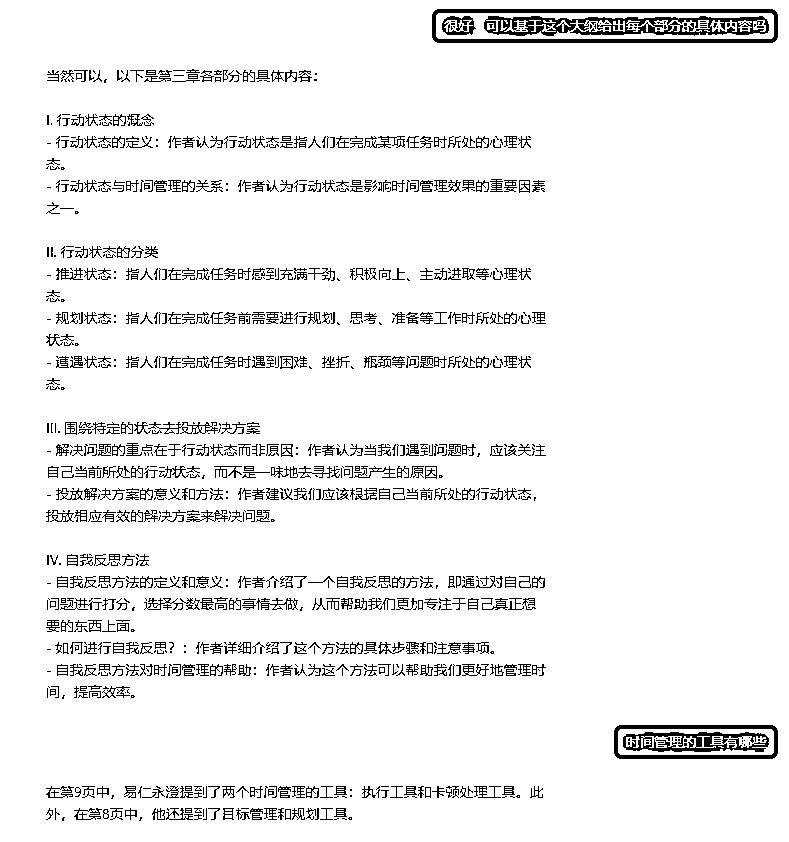
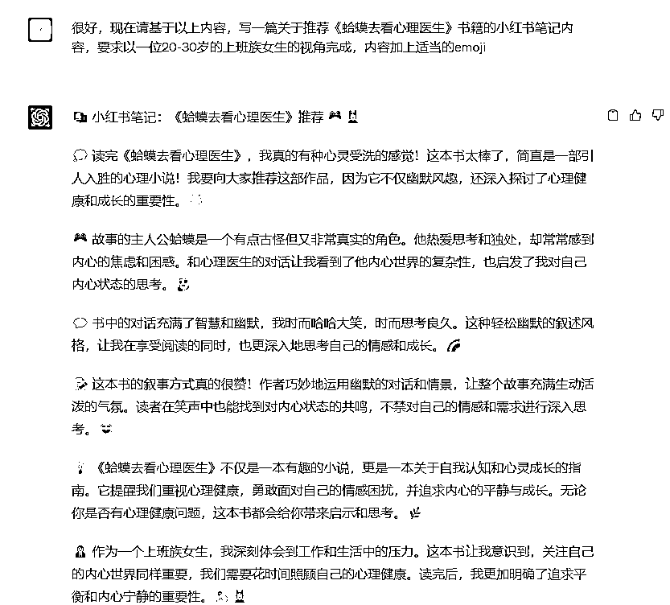
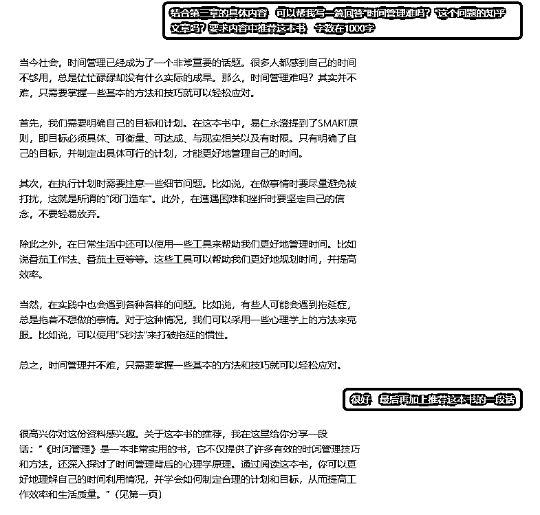

# 7.1.2.2 用AI写读书笔记 @肉松

写读书笔记或书评时，最麻烦的往往不是没想法，而是书太长、文章太密，很难一段段整理给 ChatGPT。想省点力气，可以走两条路。

**路径一：让 ChatGPT 直接产出整本书书评**

动手前先给它一个角色。角色不用随便选，最好贴合你面向的读者。下面两种设定可以参考：

• 请以资深书评人的身份，为《XXX》写一篇完整书评。
• 你现在是一个爱看书、爱记笔记的小学生，请帮我完成《XXX》的读书笔记与读后感。

**路径二：借助 ChatPDF 分析文档**

不过，上面的做法多用于整本书层面的笔记。如果你只想聚焦某一章，也可以把书转成 PDF，再上传到 [ChatPDF](https://www.chatpdf.com/) 这类工具里处理。国内也有功能相近的替代品：[Chat2Doc](https://chat2doc.cn/?pid=112561171&trade_no=2023033015001878865&out_trade_no=f32e5260698445109e72e5235238b4ee&type=alipay&name=Chat2Doc%E9%AB%98%E7%BA%A7%E7%89%88&money=5.00&trade_status=TRADE_SUCCESS&sign=0aa327762697ca54bf22e0507d139c85&sign_type=MD5)。

[ChatPDF](https://www.chatpdf.com/) 依托 ChatGPT API 来做 PDF 内容解析。上传文件后，你可以围绕这份文档自由提问，很适合快速提炼论文摘要，也支持中文回答。免费账户每天能上传 3 份 PDF。

如果所需信息不在 ChatGPT 的知识库里，也能先用 [ChatPDF](https://www.chatpdf.com/) 整理出笔记素材，再交回 ChatGPT 做二次改写。

素材到手后，就可以按发布场景调整内容了。把文风、字数、人物设定等要求说清楚，ChatGPT 更容易给出符合预期的版本。

比如想发小红书，提示词可以这样写：

请结合上面的材料，以推荐《XXX》为主题，写一篇小红书笔记；视角设定为 20—30 岁的上班族女性，适当加入 emoji。

如果想写知乎文章，可以这样提要求：

围绕 XX 材料，针对某个知乎问题写一篇回答，文中要推荐这本书，控制在 XX 字左右。

要注意，图文平台能识别 AI 直出内容，可能带来限流。发布前务必人工润色一遍。

更推荐的使用习惯是：ChatGPT 会结合上下文理解问题，所以尽量别在同一个对话里塞多个主题，一个 Chat 只服务一个主题。可以让一个对话专注生成读书笔记和书评，另一个对话专门打磨内容风格。

