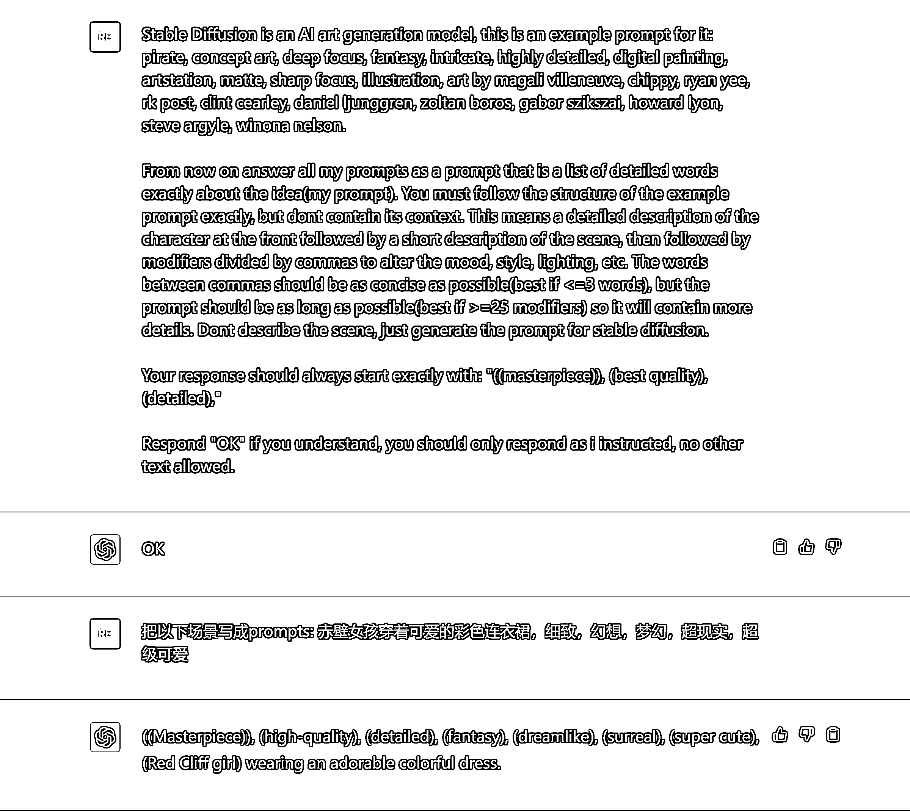

## 7.2.2.1 让 ChatGPT 代写画图描述

把下面这段中文设定复制进 ChatGPT，它就会按固定套路，把你脑中的画面转成 Stable Diffusion 能识别的英文词语串。第二段里的赤壁少女只是示例，换成任何题材都可以。

【Prompt: 1】

Stable Diffusion 是 AI 艺术生成模型。我希望你从此刻起，把我给你的每个想法都整理成一份 Stable Diffusion 可用的详细词语清单。请严格沿用我示例中的结构，但不要照搬示例内容：开头先细致刻画角色，接着用短句交代场景，随后用逗号分隔的修饰语调整氛围、风格、光线等。逗号之间的词尽量精简，最好不超过 3 个词；整段则尽量拉长，修饰项最好不少于 25 个，这样细节才够多。不要展开描述场景，只输出 Stable Diffusion 所需的那串词。每次回答都必须以“((masterpiece)), (best quality), (detailed),”开头。如果你明白了，请只回复“OK”，不要输出任何其他内容。

【Prompt：2】请把下面这个画面整理成 Stable Diffusion 用的英文词语串：赤壁背景下的少女，穿一条色彩明快、带俏皮感的裙装；细节繁复，兼具奇想、梦境与非现实氛围，整体偏萌系。



ChatGPT 给出的正面词语串大致如下：

```
（（Masterpiece））， （high-quality）， （detailed）， （fantasy）， （dreamlike）， （surreal）， （super cute）， （Red Cliff girl） wearing an adorable colorful dress。<lora:japaneseDollLikeness_v10:0.3>, <lora:koreanDollLikeness_v15:0.3>, <lora:taiwanDollLikeness_v10:0.2>, <lora:cuterichstyleLora300_cuterichstyleLora300:1>
```

只给正面词还不够。Stable Diffusion 还要靠负面词语串来挡掉不想要的画面。下面这份清单覆盖面较广，复制后可直接使用：

```
（worst quality:2）， （low quality:2）， （normal quality:2）， lowres， normal quality， （（monochrome））， （（grayscale））， skin spots， acnes， skin blemishes， age spot， backlight，（ugly:1.331）， （duplicate:1.331）， （morbid:1.21）， （mutilated:1.21）， （tranny:1.331）， deformed eyes， deformed lips， mutated hands， （poorly drawn hands:1.331）， blurry， （bad anatomy:1.21）， （bad proportions:1.331）， three arms， extra limbs， extra legs， extra arms， extra hands， （more than 2 nipples:1.331）， （missing arms:1.331）， （extra legs:1.331）， （fused fingers:1.61051）， （too many fingers:1.61051）， （unclear eyes:1.331）， bad hands， missing fingers， extra digit， （futa:1.1）， bad body， pubic hair， glans， easynegative， three feet， four feet， nsfw， naked， nude， unequal eyes， （close up:2）， untracked eyes， crossed eyes， （（（toothy）））， bra， （（（large breast）））
```