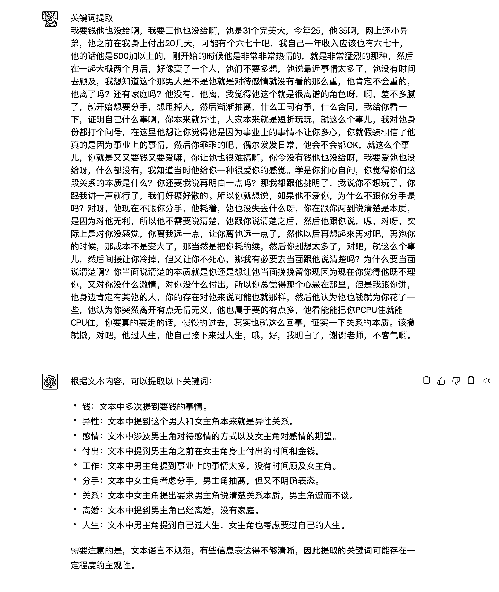
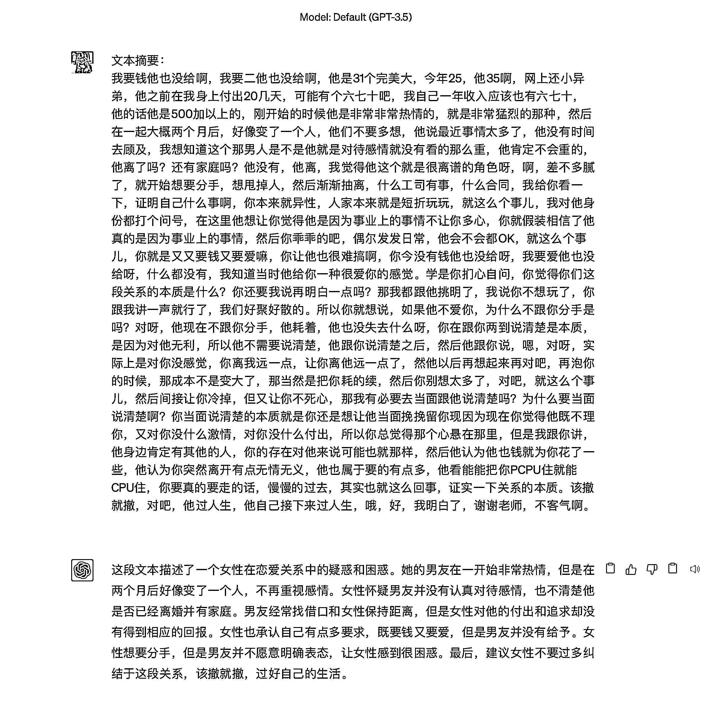
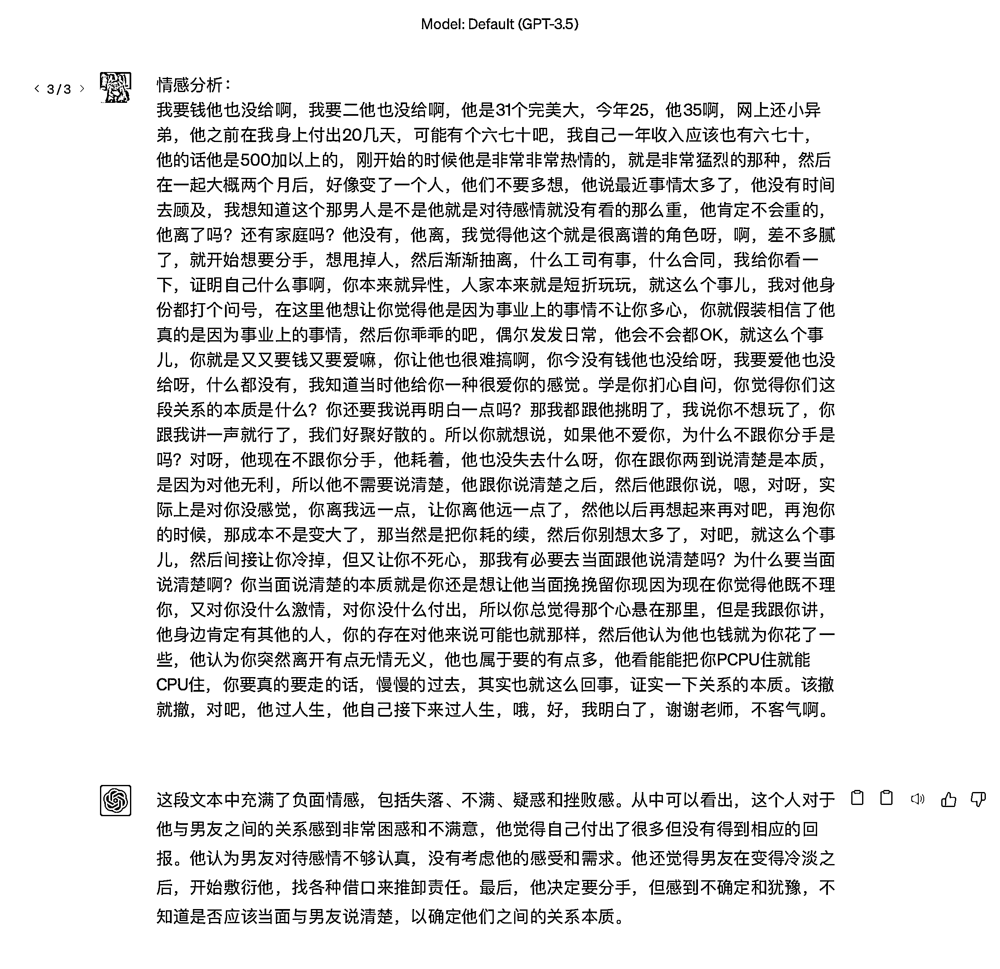

# 7.3.1 做视频，ChatGPT 能帮你这四件事 @陈思成

拍短视频时，ChatGPT 不只是聊天工具，它还能在内容生产环节搭把手。具体来说，有四类能力值得用起来。

其一，写内容。它产出的文字前后衔接顺畅、语法规范，既能帮你起草抖音脚本，也能写文章、编对话，适合拿来填充视频文案。

其二，找关键词。把已有内容交给它，它可以从中筛出核心词，方便你判断抖音上哪些话题正热、哪些趋势值得跟。

其三，压缩长文。面对篇幅较大的材料，它能把内容提炼成简明摘要，让你不必通读全文也能迅速抓住重点。

其四，判断情绪。它能够识别文字里的情感走向，从而帮你摸清观众对某一话题的偏好。

