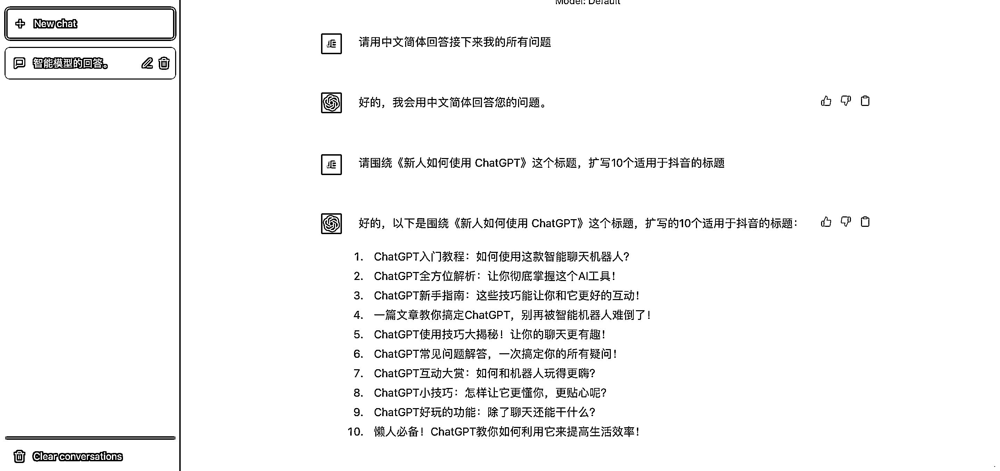
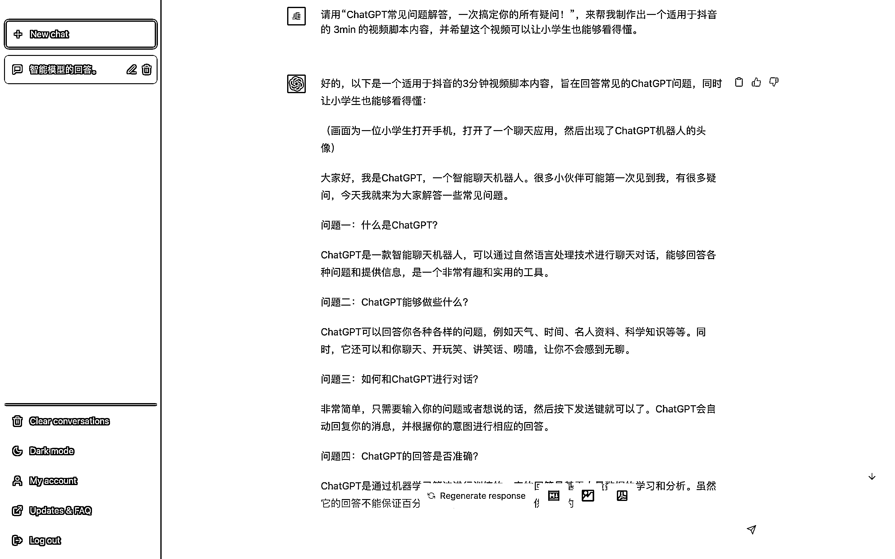
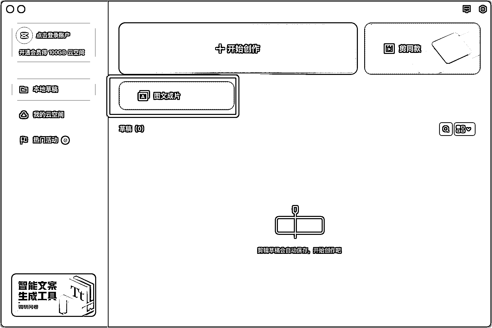
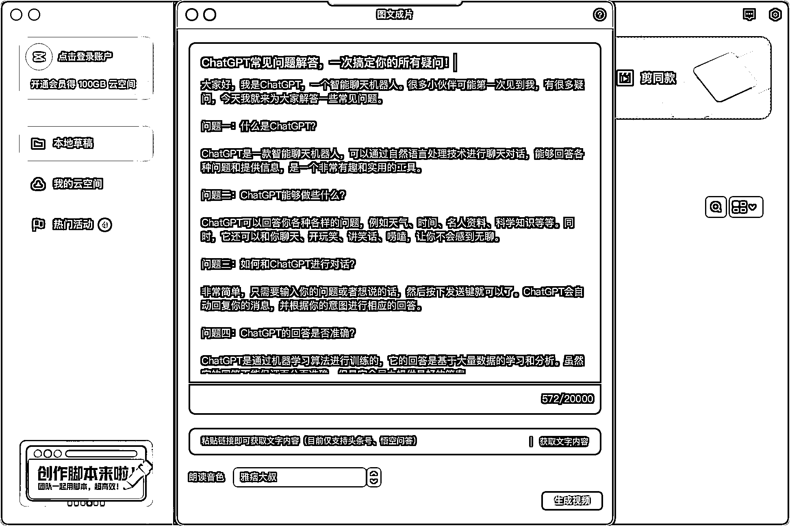
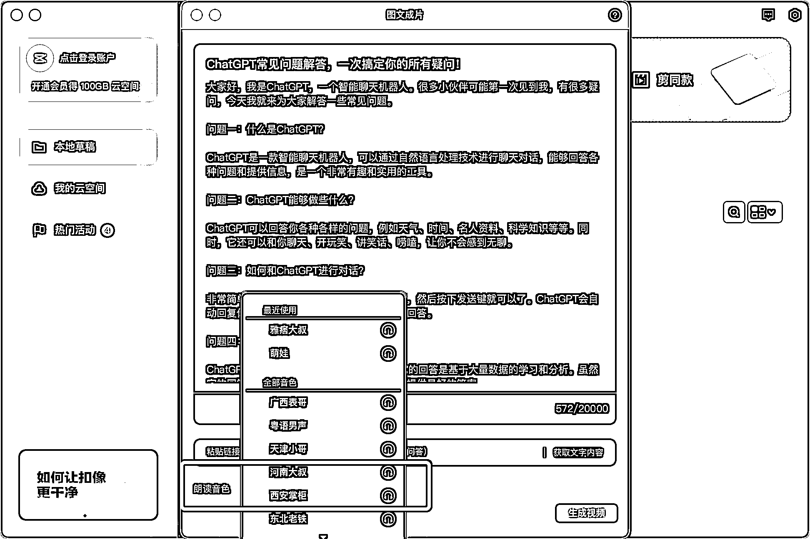
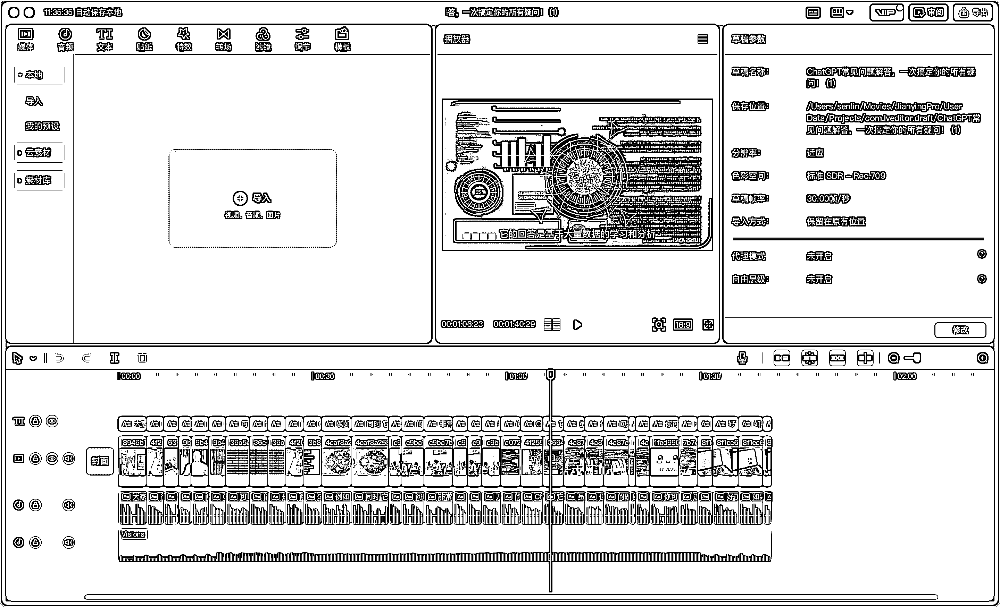

# 7.3.3.2 图片加解说，低成本出片

想压低视频制作成本，其实还有一条很实用的路子。你刷抖音时可能见过这种内容：画面由一连串图片铺开，再配上讲解声音完成成片，这就是常说的 PPT 视频。它的核心做法并不复杂——用大量图片叠加解说来完成视频创作。

具体可以拆成三步：

- 让 ChatGPT 写出视频标题
- 让 ChatGPT 生成视频脚本
- 放进剪映，用图文成片一键完成

下面把操作过程展开说。

步骤一：先让 ChatGPT 帮忙想标题

假设你准备做一期《新人如何使用 ChatGPT》的视频，可以先让 ChatGPT 围绕主题扩写一批标题，再从中挑选合意的选项。

步骤二：把选中的标题交给 ChatGPT 写脚本

标题定下来后，就可以让 ChatGPT 围绕它生成视频脚本内容。

它给出的脚本里通常会包含画面介绍和画面内容。如果你准备照着脚本自己拍摄制作，这部分可以直接参考；但如果你打算交给剪映自动生成，就要把画面提示词删掉，只留下画面内容对应的文本。比如“（画面为一位小学生打开手机，打开了一个聊天应用，然后出现了 ChatGPT 机器人的头像）”这类描述，就需要从文案中移除。

步骤三：确认脚本后导入剪映，一键图文成片

脚本内容检查无误后，就可以进入剪映的图文成片功能。

接着选一个合适的配音音色，视频就能生成出来。

剪映会自动匹配图片，配图有时和文本内容不完全贴合，不过一般影响不大。如果你希望效果更精细，可以把中间不合适的图片替换掉。

