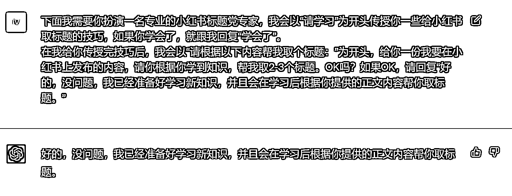

# 8.1 先定专家身份

想让 ChatGPT 答得更贴合需求，第一步就是让它进入角色：先为它指定一个与任务相匹配的内容专家身份。这里沿用的，是 4.1 中给 ChatGPT 设定身份的做法。

比如你要拟一个📕笔记标题，可以先给它身份，同时把后续配合流程约定清楚。提示词可以这样写：

“接下来请你担任一名擅长📕标题的专家。我会用‘请学习’开头，把一些起标题的技巧教给你；你掌握后，回复我‘学会了’。等我讲完技巧，会再用‘请根据以下内容帮我取个标题：’开头，把一篇准备发布在📕的正文交给你。请结合刚学到的知识，产出 2—3 个标题。可以吗？如果没问题，请回复‘好的，没问题，我已经准备好学习新知识，并且会在学习后根据你提供的正文内容帮你取标题。’”

括号里的文字只是解释说明，正式训练时删掉；划线处都是可替换内容，你可以按实际需求调整，也可以让它写正文、提供选题等。

实例：

