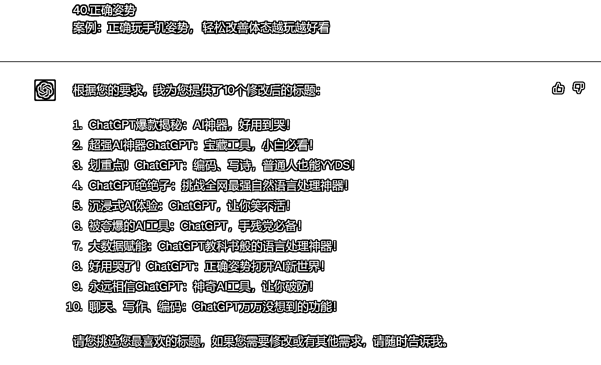

# 8.5 第五步：借平台热词精修标题

不同平台的内容风格和受众偏好各不相同，能跑出流量的高频词也各有门道。所以到这一步，要拿平台上的出圈热词，给已经拟好的标题再做一次打磨。

向 AI 下指令时，可以这样表达：

“大方向没问题，但还需要补两条：一是把标题压到二十字内，越精炼越好；二是从下面这些爆款词里挑一到两个，自然地放进标题里。”

1. 好用到哭  
   示例：六个黑科技应用让人舍不得删
2. 大数据  
   示例：把这条推给正在美白路上的人
3. 教科书般  
   示例：退坑流程讲出教科书级水准，敢不敢来试
4. 小白必看  
   示例：化妆流程一次讲清，跟着练就行
5. 宝藏  
   示例：挖到 36 个宝藏创作者，想进阶的人别错过，逆袭路线拉满
6. 绝绝子  
   示例：这组 INS 风高光质感，不妨动手试一次

案例：

PS. 另外，@AI训练师小凡 的分享文档里还汇总了三十余个同类高热词，详见《胎教级标题党培训手册——4步让GPT成为📕标题大师》。

参考材料：前一本为《胎教级标题党培训手册——4步让GPT成为📕标题大师》，后一本为《用赚钱大航海手册调教 ChatGPT 从 0-1 生成短视频文案》。

